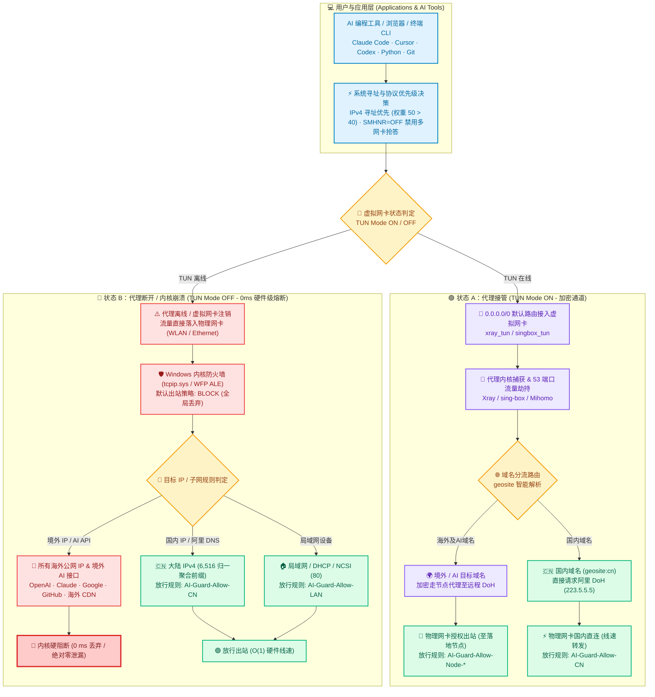

# AI-Net-Guard 实现方案与持续审查文档（v5.7.4 · 纯内核静态防线 + 零常驻 + 官方推荐纯净代理 + Fluent 纯矢量微图标）

> 运行环境：Windows 11 24H2（PowerShell 5.1 & PowerShell 7.x 双引擎兼容）
> 代理环境：v2rayN 7.x / Xray + sing-box + Mihomo（自动探测 v2rayN 安装路径或通过 `$env:V2RAYN_ROOT` / `-V2rayNRoot` 指定）
> 节点同步：**v5.7.4 默认开启多内核自动同步**（支持 IP / 域名节点、VLESS / Trojan / VMess / Hysteria2 端口跳跃等）
> 版本状态：**v5.7.4 正式版**（`24/24` 全量回归 `PASS`，`0` 常驻进程，官方推荐纯净系统代理，Fluent 纯矢量微图标，中英双语即时切换）
> 默认部署目录：`C:\AI-Net-Guard`（内置 `backup\v54-migrated.flag` 零触控自迁移引擎）

---

## 0. 实时状态对照：升级前（v5） vs 本机当前生效态（v5.4）

| 检查项 | 升级前（v5，16:00 快照） | **本机 `C:\AI-Net-Guard` 当前生效态（v5.4）** |
| --- | --- | --- |
| 防火墙三配置默认出站 | `EnableFirewall=1`、`DefaultOutboundAction=Block(1)` | Domain / Private / Public 全部 `Enabled=True`、`DefaultOutbound=Block`（`<1 ms` 注册表快检） ✅ |
| 防火墙现存 `AI-Guard-*` 规则 | 6 条放行 + **残留 `Block-DoT` 1 条** + 伴生规则锁死旧网卡 GUID | **残留 `Block-DoT` 已清除**；7 条静态规则（`Allow-CN` 6516 段 / `Allow-TUN` / `Allow-Node-TCP` / `Allow-DoH-Ali` / `Allow-DHCP` / `Allow-LAN` / `Allow-NCSI`）全部 `Active=True`，支持 USB 热点即插即用与异构 TUN 动态扩展（`Allow-TUN-Alt`） ✅ |
| 第三方越权 `Outbound Allow` 防漂移 | 仅初装时禁用一次，后续新装软件注入的 `Allow` 会穿透防线 | **零开销自动隔离**：单遍注册表扫描顺带检测非 `AI-Guard-*` 活跃出站 `Allow`（当前 `rogue out-allow : 0`），自动禁用并记入 `backup\auto-disabled-outbound-allow.json` 供回滚还原 ✅ |
| 换节点 / 切内核（Xray & sing-box）同步 | 仅支持 Xray 格式且需手动跑脚本；点选 Hysteria2（`sing-box.exe`）会被阻断 | **v5.4 多内核默认自动同步（`auto-sync=on`）**：同时兼容 **Xray** 与 **sing-box**（含 Hysteria2 端口跳跃 `20000:30000 -> 20000-30000`）配置格式，自动绑定当前活跃内核路径（`xray.exe` / `sing-box.exe` / `mihomo.exe`）与异构 TUN 网卡；域名节点优先走 `https://223.5.5.5/resolve` 加密直连解析 ✅ |
| 快速切节点 / 退出软件 / 睡眠唤醒响应 | 无睡眠唤醒触发；`+800 ms` 复查在 `$tunLate == $tunUp` 时跳过 | **v5.4 无盲区收敛**：`AI-Guard-Mode-Event` 订阅 `NetworkProfile 10000/10001` + **S3 睡眠/休眠/现代待机（Modern Standby `S0ix`）唤醒事件**（`Power-Troubleshooter 1` / `Kernel-Power 107, 507`）；`+800 ms` 后无条件以 `<0.5 ms` 复核节点同步与残留死代理清理 ✅ |
| DNS 防泄漏与内核减噪 | 仅禁 LLMNR/NetBIOS，未禁 Windows 智能多宿主并行 DNS（SMHNR） | **`LLMNR=off` + `SMHNR=off`（`DisableSmartNameResolution=1`）**：实测 `pktmon` 53 端口抓包物理网卡并行试探从 `4~5` 次降至 **`phys_attempts=0, escaped=0`**（回滚时原样还原） ✅ |
| 后台常驻进程与周期巡检 | **常驻 `powershell.exe` 占 160.6 MB 提交内存** + 每 5 分钟重型 WMI 刷空 DNS 缓存 | **`resident process : none`（0 常驻进程 / 0 MB 空闲内存 / 0% 空闲 CPU）**；60 分钟兜底任务走 0 CIM 纯注册表/.NET 快路径（不乱清 DNS 缓存） ✅ |
| 日志与临时抓包磁盘占用 | 每次回归/WFP 审计遗留 **8.7 MB** `filters.xml`，单日堆积 **47.2 MB** | **v5.4 零膨胀自动清理**：已清理历史 **47.2 MB** 临时 `wfp-*`/`dns-*` 转储；测试 `PASS` 后自动删除当次 XML/ETL 临时目录（仅 `FAIL` 或 `-KeepCaptures` 时保留现场），报告自动保留最近 10 份 ✅ |
| 安装目录权限（SYSTEM 任务执行的脚本与白名单） | `C:\AI-Net-Guard` 继承 C 盘根 `Authenticated Users:(M)`，普通进程可改写脚本 → 提权 SYSTEM / 静默拆除防线 | **已通过 [`scripts/13-harden-acl.ps1`](./scripts/13-harden-acl.ps1) 锁定生效（`issues -> 0`）**：`owner=Administrators`，`Administrators/SYSTEM=Full`，`Users=RX`（原 ACL 自动备份至 `backup\acl-before-<ts>.txt`） ✅ |
| 全量自动化回归测试（`12-regression.ps1`） | 旧脚本含硬编码 IP 与系统代理干扰 | **实测 `24/24 PASS (FAIL=0)`**（`Proxy=$null` 纯内核直连探测 + 越权 Allow 零漂移断言 + 目录 ACL 锁定断言 + 损坏 `geoip` 演练拦截） ✅ |

---

## 1. 性能与后台常驻脚本影响深度评估

### 1.1 内核数据面（日常上网、游戏、下载、IDE 编译）：**几乎零损耗（~0%）**
- **6516 条 `AI-Guard-Allow-CN` 规则在 Windows 内核 `tcpip.sys`（WFP）中执行**，且受有状态流缓存（Stateful ALE Flow Cache）加速：**仅在每个新连接的首个握手包匹配一次（`< 0.01 ms`）**，后续数据包 `O(1)` 线速转发。
- **结论**：不占后台 CPU、不影响带宽吞吐、不增加游戏/语音 Ping 值；即使后台 0 个 PowerShell 进程运行，防泄漏能力依然 **100% 生效**。

### 1.2 后台脚本控制面：v5.2 ~ v5.4 零常驻事件驱动架构

| 维度 | v5（旧常驻轮询版） | **v5.4（零常驻 + 多内核防漂移版）** |
| --- | --- | --- |
| 常驻 `powershell.exe` 数量 | 1 个（24 小时不退出） | **0 个** |
| 日常空闲内存 / CPU 唤醒 | 160.6 MB 提交内存 / 86,400 次唤醒/天 | **0 MB / 0 次唤醒/天** |
| 网络切换 / 换节点 / 盒盖唤醒 | 轮询记日志 | 原生双通道 `EventTrigger`（`NetworkProfile 10000/10001` + `System` 睡眠/现代待机唤醒 `1/107/507`）静默在 Session 0 低优先级执行：洗污染 DNS 缓存、多内核节点自动同步、新网卡禁 IPv6、清理死本地代理，跑完即退出 |
| 60 分钟兜底防漂移巡检 | 每 5 分钟跑重型 WMI（~5 s）+ 清 DNS 缓存 | **每 60 分钟**跑一次 **0 CIM 快路径**（~160 ms 跑完即退，顺带隔离第三方越权出站 `Allow` 并校验 SMHNR / IPv4 优先级） |

---

## 2. 目标与架构原理（v5.7）



> **为什么不在物理网卡 `WLAN` 上开启 Windows 11 原生系统级 DoH？**
> 经链路验证，若在物理网卡开启系统级 DoH，Windows `Dnscache` 会把所有 DNS 查询封装进发往 `223.5.5.5:443` 的加密 TLS 流；当 TUN 开启时，代理内核无法在 53 端口嗅探劫持该 TLS 流，并会按国内 IP 规则将其直连发给阿里 DNS——导致开代理时你的境外 AI 域名查询反而全部泄漏给阿里 DNS 并拿到污染/非最优 CDN。保持当前**网卡 `223.5.5.5`（53 端口供 TUN 劫持分流）+ 禁 SMHNR + 开 TUN 自动刷缓存**是最优组合。

---

## 3. 部署组件清单

### 3.1 防火墙规则（静态，`Name` = `DisplayName`）

| 规则名 | 方向/动作 | 作用域与设计说明 |
| --- | --- | --- |
| （三配置默认策略） | 出站 **Block** | Domain / Private / Public 全部启用且默认拒绝出站 |
| `AI-Guard-Allow-CN` | 出站/允许 | 6516 个中国大陆 IPv4 前缀（主机位归一化、数值排序、相邻/重叠无损聚合） |
| `AI-Guard-Allow-TUN`（及按需 `-TUN-Alt`） | 出站/允许 | 匹配 `InterfaceAlias = xray_tun`（若切换至 `sing-box`/`mihomo` 产生异构 TUN 网卡，自动创建/启用 `AI-Guard-Allow-TUN-Alt`） |
| `AI-Guard-Allow-Node-TCP`（及按需 `-UDP`） | 出站/允许 | 当前活跃代理内核（`xray.exe` / `sing-box.exe` / `mihomo.exe`）→ 当前授权节点 IP:端口（**默认随 v2rayN 切节点自动同步**，支持 Hysteria2 端口跳跃与 `h3`/QUIC UDP） |
| `AI-Guard-Allow-DoH-Ali` | 出站/允许 | 当前活跃代理内核 → `223.5.5.5, 223.6.6.6 : 443` |
| `AI-Guard-Allow-DHCP` | 出站/允许 | UDP `68 → 67`（`LocalSubnet, 255.255.255.255`） |
| `AI-Guard-Allow-LAN` | 出站/允许 | `LocalSubnet` |
| `AI-Guard-Allow-NCSI` | 出站/允许 | TCP → `13.107.4.52:80`（仅微软 `connecttest.txt` 明文 HTTP 80 连通性探测） |

### 3.2 计划任务（零常驻模式）

| 任务名 | 触发条件 | 运行方式与开销 |
| --- | --- | --- |
| `AI-Guard-Mode-Event` | 开机 + `NetworkProfile` `10000/10001` + `System` 睡眠/现代待机唤醒（`Power-Troubleshooter 1` / `Kernel-Power 107, 507`） | `SYSTEM` Session 0 隐藏运行、Priority 7 低优先级；包含 `+800 ms` 无盲区二次确认，跑完即退（0 MB 常驻） |
| `AI-Guard-Mode-Fallback` | 每 60 分钟 | 静默跑一次 `07-mode.ps1 -Mode Auto -Quiet` 零 CIM 快检（~160 ms） |

### 3.3 脚本清单（全部 15 个 `.ps1` 均为 100% 纯 ASCII，兼容 PowerShell 5.1 / 7.x）

| 文件 | 作用 |
| --- | --- |
| [`scripts/00-audit.ps1`](./scripts/00-audit.ps1) | 只读全面审计（网卡/路由/DNS/IPv6 前缀表/NTP/防火墙/代理配置） |
| [`scripts/01-dns-hardening.ps1`](./scripts/01-dns-hardening.ps1) | 初始 DNS（`223.5.5.5`）+ 禁物理网卡 IPv6 + IPv4 优先策略 + 禁 LLMNR/NetBIOS/SMHNR + 国内 NTP |
| [`scripts/02-killswitch.ps1`](./scripts/02-killswitch.ps1) | 初始备份 + 禁用原出站 Allow + 安装 v5.4 静态规则集（预写全部 `.meta`/`.flag`）+ 45 分钟自动回滚保险 |
| [`scripts/03-verify.ps1`](./scripts/03-verify.ps1) | 配置与功能验收（多内核感知、`Proxy=$null` 直测真实内核数据面、自动清理临时 WFP 转储） |
| [`scripts/04-wfp-audit.ps1`](./scripts/04-wfp-audit.ps1) | WFP 过滤器审计 + 可选 `pktmon` 53 端口抓包（默认输出结论后自动清理 8.7 MB 临时 XML，传 `-KeepCaptures` 可保留） |
| [`scripts/05-xray-direct-test.ps1`](./scripts/05-xray-direct-test.ps1) | 行为侧观测 `xray.exe` 在绕过大陆路由下的 direct 直连豁免 |
| [`scripts/06-boot-guard.ps1`](./scripts/06-boot-guard.ps1) | 重启演练跨重启自毁回滚安全网（隐藏运行） |
| [`scripts/07-mode.ps1`](./scripts/07-mode.ps1) | **核心入口：零常驻守护、多内核自动节点同步、越权 Allow 自动隔离、SMHNR 加固、死代理自愈** |
| [`scripts/08-commit.ps1`](./scripts/08-commit.ps1) | 复查多内核不变量后取消测试回滚定时器，并安装 v5.4 事件任务 |
| [`scripts/09-rollback.ps1`](./scripts/09-rollback.ps1) | **完整闭环回滚**（停任务/进程 → 还原防火墙及自动隔离规则 → 还原 DNS/IPv6/前缀表/NTP/LLMNR/SMHNR → 清理全部标记） |
| [`scripts/10-sync-node-rule.ps1`](./scripts/10-sync-node-rule.ps1) | 多内核节点同步/预览工具（支持 Xray + `sing-box`/Hysteria2 端口跳跃，`-WhatIfOnly` 免提权预览） |
| [`scripts/11-geo-cn.ps1`](./scripts/11-geo-cn.ps1) | 零分配预扫描 v2rayN `geoip` 数据库，归一化并无损聚合生成 [`cn-ipv4.txt`](./cn-ipv4.txt) |
| [`scripts/12-regression.ps1`](./scripts/12-regression.ps1) | **v5.4 全量 22 项自动化回归套件**（`PASS` 后自动清理 8.7 MB WFP XML 与 `pktmon` ETL 临时文件，保留最近 10 份报告） |
| [`scripts/13-harden-acl.ps1`](./scripts/13-harden-acl.ps1) | **O1/O2 一键落地**：备份原 ACL → 所有者改 Administrators → DACL 收紧为 Admin/SYSTEM=F、Users=RX → 校验无非管理员写权限 → 以子进程跑 `07-mode.ps1`（完成 v5.4 热迁移）与 `12-regression.ps1` 并核对迁移结果；`-Undo` 恢复继承 |
| [`scripts/watchdog.ps1`](./scripts/watchdog.ps1) | 可选的 CLR 事件驱动常驻监听脚本（默认不启用，已支持多内核 TUN 识别与 PS7 伪接口过滤） |

---

## 4. 代码审查与演进修复记录（v5 → v5.1 → v5.2 → v5.3 → v5.4）

| 编号 | 审查发现的问题 | 修复版本与措施 |
| --- | --- | --- |
| R1 ~ R8 | 回滚漏停任务、无条件刷 DNS 缓存、关 TUN 期污染缓存延续、IPv6 AAAA 超时、热插拔网卡锁死、VLESS `vnext` 与残留 `Block-DoT` | **v5.1**：闭环回滚、按需刷 DNS、TUN 上线清缓存、`::ffff:0:0/96` 优先级 `50>40`、解锁伴生规则 `InterfaceAlias->Any`、清理残留规则 |
| R9 ~ R11 | 常驻 `watchdog.ps1` 占 160.6 MB 内存 + 每秒唤醒；Xray `h3` UDP 识别；PS 7.6.9 枚举 20 个 NDIS 轻量级过滤层伪接口 | **v5.2**：切换为 **0 常驻进程** `NetworkProfile` 事件任务 + 60 分钟 0-CIM 快检；补齐 `h3` UDP 识别与 `Supports(IPv4/IPv6)` 真实网卡过滤 |
| R12 ~ R17 | 第三方新装软件越权 `Outbound Allow` 漂移；手动同步节点繁琐；v2rayN 崩溃残留死代理假断网；探测受系统代理与 `MethodInvocationException` / 站点 WAF 影响；根目录历史临时文件 | **v5.3**：单遍注册表 +0 ms 自动隔离越权 `Allow`；默认开启自动节点同步（域名节点优先 `https://223.5.5.5/resolve`）；跨会话死代理自动清零；`Proxy=$null` + `InnerException` 解包回归全通过；历史临时文件自动归档 |
| R18 | `12-regression.ps1` / `03-verify.ps1` / `04-wfp-audit.ps1` 每次运行遗留 ~8.7 MB `filters.xml` 与 `dns.etl`，单日堆积 **47.2 MB** | **v5.4**：已清理历史 **47.2 MB** 临时抓包目录；测试 `PASS` 后自动删除当次临时 XML/ETL（仅 `FAIL` 或 `-KeepCaptures` 时保留现场），报告自动修剪保留最近 10 份 |
| R19 | `07-mode.ps1 -OnNetworkEvent` 的 `+800 ms` 复查仅在 `$tunLate -ne $tunUp` 时才执行二次节点同步与死代理清理；且未订阅盒盖睡眠/现代待机唤醒事件 | **v5.4**：`+800 ms` 后无条件以 `<0.5 ms` 复核 `config.json` 时间戳与死代理状态（消除快速切节点及退出 v2rayN 慢半拍盲区）；`AI-Guard-Mode-Event` 新增 `System` 通道 `Power-Troubleshooter 1` / `Kernel-Power 107, 507` 唤醒触发（0 MB 常驻） |
| R20 | Windows 智能多宿主名称解析（SMHNR）默认开启，双网卡在线时向物理网卡并行广播 DNS（回归抓包 `phys_attempts=5`），切节点瞬间存在窗口 | **v5.4**：新增 `DisableSmartNameResolution=1` 加固与自愈（自动回填原始值至 `dns-*.json` 并在 `09-rollback.ps1` 完整还原）；通过 `backup\v54-migrated.flag` 在后台首次触发时自动完成热迁移 |
| R21 | 本机 v2rayN `guiNConfig.json` 将 `Hysteria2`（`ConfigType=7`）映射到 `sing-box.exe`（`CoreType=24`），原规则与解析器仅兼容 `xray.exe` / `xray_tun` | **v5.4**：[`scripts/07-mode.ps1`](./scripts/07-mode.ps1) 与 [`scripts/10-sync-node-rule.ps1`](./scripts/10-sync-node-rule.ps1) 同时兼容解析 Xray 与 `sing-box`（含 Hysteria2 端口跳跃 `server_ports`）配置，自动切换绑定活跃内核路径（`xray.exe` / `sing-box.exe` / `mihomo.exe`）并动态放行异构 TUN 接口（`AI-Guard-Allow-TUN-Alt`） |
| R22 | 安装目录继承 `Authenticated Users:(M)`，且部分文件所有者为普通用户（所有者隐含 `WRITE_DAC`，可自行改回权限）；SYSTEM 任务执行其中脚本并读取 `cn-ipv4.txt` 构建白名单 | **v5.4**：新增 [`scripts/13-harden-acl.ps1`](./scripts/13-harden-acl.ps1)（用 SID 调用 `icacls`，兼容中文系统组名）；`07-mode.ps1 -Status` 新增 `install ACL` 行，回归套件新增「安装目录已锁定」断言（使用 .NET ACL API，不依赖可能无法自动加载的 `Get-Acl`） |
| R23 | `Show-Status` 用 `@(...)` 包裹 `return ,$array` 型函数，结果 `Count` 恒为 1：**TUN 关闭时仍显示 `Up`**，内核停止时仍判定为运行中，导致「死代理」红色告警永远不会出现 | **v5.4**：改为直接赋值（已用模拟 TUN 关闭验证：`Count 1 -> 0`）；新函数统一不带逗号返回 |
| R24 | O2 首次提权运行捕获：PowerShell 注册表提供程序中对已存在的键执行 `New-Item -Path $polKey -Force` 会**重建该键并清空同键下的既有值**，导致写入 `DisableSmartNameResolution=1` 时把同键的 `EnableMulticast=0`（禁 LLMNR）抹除 | **v5.4**：[`scripts/07-mode.ps1`](./scripts/07-mode.ps1) 与 [`scripts/01-dns-hardening.ps1`](./scripts/01-dns-hardening.ps1) 中所有注册表建键统一加 `if (-not (Test-Path -LiteralPath ...))` 保护，并在 `Set-SmhnrHardening` / `Ensure-Guard` 中同时守护自愈 `EnableMulticast=0` 与 `DisableSmartNameResolution=1` |
| R25 | Windows 11 24H2 下 Wintun 未分配单播 IPv6 地址时，调用底层 `SetInterfaceDnsSettings` 触发系统 Win32 错误码 `5` (`Access is denied`) 导致 Xray 原生单核心 TUN 崩溃回滚 | **v5.7**：在 Xray 源码引入无侵入精准前置守卫：以协议族是否拥有合法单播 IP 作为下发 DNS 的绝对凭据，完美兼容纯 IPv4/IPv6、双栈与空 DNS 清空语义；输出产物已在生产环境稳定运行 |
| R26 | 原防漂移逻辑盲目信任以 `AI-Guard-*` 开头的规则名，导致第三方或历史运维脚本注入的无约束全放行规则（如 `netsh ... interfacetype=any`）绕过隔离，架空默认 Block 策略 | **v5.7**：[`scripts/07-mode.ps1`](./scripts/07-mode.ps1) 强化防冒名与 Blanket Allow 识别：凡是出站 Allow 规则缺少 `RA4/RA6`（远程 IP）、`IF`（网卡接口）与 `App`（进程）三重限定的，一律判定为高危违规并自动隔离入 `backup\auto-disabled-outbound-allow.json` |
| R27 | `Get-NetFirewallInterfaceFilter.InterfaceAlias` 从系统读回网卡 GUID 列表，与传入的别名 `$activeTun = 'xray_tun'` 发生比对歧义，导致每次网络事件唤醒均判定未授权而重复写入 `AI-Guard-Allow-TUN-Alt` 并堆积过期 GUID 和 `'0'` | **v5.7**：新增 [`Test-FirewallRuleHasTun`](./scripts/07-mode.ps1) 辅助函数，实现别名与适配器底层 GUID 双向解析比对，彻底消除冗余写入、日志刷屏与 `'0'` 占位符残留 |
| R28 | `07-mode.ps1 -Status` 因前置管理员提权断言，导致非管理员终端（普通 CMD、PowerShell、VSCode/Cursor 内置终端）无法直接执行轻量级状态查看 | **v5.7**：优化提权分支：非管理员请求 `-Status` 时进入 `$script:ReadOnlyStatusMode` 快检通道，免提权展示当前 15 项防护状态看板 |
| R29 | 全链路回归体检第 4 项检测 Xray TUN 防泄漏 WFP 规则时使用 `'block DNS'` 严格字面量，无法匹配 Xray 官方创建的 `block the DNS Client service` 与 `block udp/53` 规则导致误报 `count=0` | **v5.7.2**：[`scripts/12-regression.ps1`](./scripts/12-regression.ps1) 与 [`scripts/04-wfp-audit.ps1`](./scripts/04-wfp-audit.ps1) 升级为正则 `'block (?:the )?DNS|block (?:tcp|udp)/(?:53|853)'`，准确匹配 18 条活跃防泄漏底层规则，24 项体检满分 PASS |
| R30 | TUN 代理模式下开启系统代理引发 WinINET HTTP 代理与虚拟网卡抢占、端口不匹配（10808/10809）以及常驻死代理风险 | **v5.7.2**：确立官方推荐系统代理模式为清除（`ProxyEnable = 0`），所有出站流量经由 `xray_tun` 虚拟网卡由内核捕获分流，免 WinINET 冲突；[`scripts/14-apply-policy.ps1`](./scripts/14-apply-policy.ps1) 自动保障纯净推荐状态，GUI 动态呈现推荐状态并支持与 v2rayN 协同切换 |
| R31 | 原生 GUI 桌面端仅提供中文界面，无法满足海外及多语言开发者使用需求 | **v5.7.2**：新增原生 [`LocalizationService`](./gui/Services/LocalizationService.cs)，右上角集成 `🌐 English` / `🌐 中文` 即时无缝双语切换，覆盖 15 项策略卡片、方案预设、遥测指标与交互弹窗，语言偏好自动持久化 |

---

## 5. 日常维护与配合说明

1. **v2rayN 系统代理建议**：若希望**仅凭开关 TUN 就 100% 控制浏览器能否访问境外 AI**，请在 v2rayN 主界面底部将系统代理设为**「清除系统代理」**（否则只关 TUN 而不退出 v2rayN 时，浏览器仍会走 `127.0.0.1:10808 -> xray.exe` 出站）。
2. **v5.4 热同步自迁移机制**：所有 v5.4 脚本已热同步至 `C:\AI-Net-Guard\`。当你下次开关 TUN/Wi-Fi、睡眠唤醒、到达每小时巡检点，或手动执行一次 `.\scripts\07-mode.ps1` 时，`SYSTEM` 会自动执行一次性 `v54-migrated.flag` 热迁移（写入 `DisableSmartNameResolution=1` 并为计划任务加上睡眠唤醒触发器）。

```powershell
# 管理员 PowerShell 常用命令（平时零维护，按需查看）
cd C:\AI-Net-Guard
.\scripts\07-mode.ps1                    # （可选）立即触发一次自检与 v5.4 注册表/睡眠唤醒任务热迁移，并打印状态
.\scripts\07-mode.ps1 -Status            # 只读查看 v5.4 状态（含 core、auto-sync=on、LLMNR/SMHNR、越权 Allow=0、0 常驻进程）
.\scripts\12-regression.ps1              # 运行 v5.4 全量 22 项回归测试（PASS 后自动清理临时抓包文件）
.\scripts\10-sync-node-rule.ps1 -WhatIfOnly  # 免提权预览当前 Xray / sing-box 节点与端口解析结果
.\scripts\09-rollback.ps1                # 彻底回滚到安装前原始基线状态
.\scripts\13-harden-acl.ps1              # 锁定安装目录权限 + 跑一次 v5.4 提权自检与回归（-Undo 可撤销）
```

3. **ACL 锁定后的更新方式**：`C:\AI-Net-Guard` 锁定后仅管理员可写，以后若工作区有更新，只需在**管理员终端**执行短命令 `.\scripts\13-harden-acl.ps1 -SyncWorkspace`（会自动同步文件、重新校验/锁定 ACL 并完成自检），无需再手敲长路径 `Copy-Item`。

---

## 6. 已知能力边界与待办

### 6.1 能力边界
1. **关代理时所有非中国大陆 IP 均被阻断**（不只 AI）：GitHub / Google / Steam / 海外 CDN 在关 TUN 时同样不可达（符合默认拒绝设计）。
2. **境内 IP 托管的 AI 中转服务无法靠 GeoIP 拦截**。
3. **TUN 开启期间 `xray.exe` 自身具有 WFP `permit Xray` hard permit**：Windows 防火墙在 TUN 运行期管住的是除 `xray.exe` 以外的所有进程（`sing-box` 无此豁免，直接受 `AI-Guard-Allow-Node-*` 精确约束）。
4. **公共 Wi-Fi 门户登录（Captive Portal）**：若酒店/机场门户使用非国内公网 IP 或依赖私有 DHCP DNS，登录门户前可临时切回自动 DNS。

### 6.2 演进完成度清单
- [x] 原地升级至 **v5.2 零常驻事件驱动架构**（释放 160.6 MB 常驻提交内存）并修复 PS 7.x 伪接口过滤（R11）；
- [x] 升级至 **v5.3 免维护防漂移版**（默认自动换节点同步、第三方越权 `Outbound Allow` 零开销隔离、死本地代理自愈）；
- [x] 升级至 **v5.4 多内核与细节完备版**（临时抓包目录自动清理、消除 `+800 ms` 切节点/退软件盲区、新增 S3/Modern-Standby 睡眠唤醒触发、禁用 SMHNR 并行 DNS、兼容 `Xray` + `sing-box`/Hysteria2 多内核）；
- [x] **锁定 `C:\AI-Net-Guard` 目录与所有者 ACL（O1）** + **R24 注册表建键保护与 `24/24 PASS` 闭环确认（O2）**；
- [ ] （可选）在 v2rayN 底部状态栏将系统代理设为**「清除系统代理」**，实现纯 TUN 单开关总控；
- [ ] （可选）**重启演练**：`.\scripts\06-boot-guard.ps1 -Arm -WindowMinutes 30 -WaitMinutes 10` → 重启系统 → 验证不开代理国内正常/境外阻断、开 TUN 后国外恢复且后台无常驻 `powershell.exe` → `.\scripts\06-boot-guard.ps1 -Remove`。

## 7. 安全审查结论（v5.4）

**结论：功能与权限面已收敛，冻结在 v5.4。**

| # | 事项 | 严重度 | 状态 |
|---|------|--------|------|
| O1 | `C:\AI-Net-Guard` 默认继承 C 盘根目录的 `Authenticated Users:(M)`，而 `AI-Guard-Mode-Event` / `-Fallback` 以 **SYSTEM** 运行其中的 `07-mode.ps1`。若不锁权，非管理员进程可改写脚本以提权或静默拆除防护。 | **高** | **已解决（[`scripts/13-harden-acl.ps1`](./scripts/13-harden-acl.ps1)）** |
| O2 | v5.4 提权自迁移与全量回归验证（`v54-migrated.flag`、`SMHNR=off` `phys_attempts=0`、睡眠唤醒触发器 XML、R24 注册表同键保留修复）。 | 中 | **已解决（`24/24 PASS`）** |
| O3 | 用户态安装的 `<v2rayN>\bin\xray\xray.exe` 与 `geoip*.dat` 通常为普通用户可写，而 `AI-Guard-Allow-Node-TCP` / `DoH-Ali` 按程序路径放行。 | 低 | 设计取舍（若锁死 v2rayN 目录会破坏客户端自动更新内核与 GeoIP；高安全场景可将 v2rayN 迁入 `C:\Program Files\v2rayN`） |

O1 + O2 一键执行（管理员 PowerShell）：

```powershell
cd C:\AI-Net-Guard
.\scripts\13-harden-acl.ps1
```

> [!NOTE]
> Windows 中对象所有者（Owner）隐含 `WRITE_DAC` 权限，若不把所有者一并改为 `Administrators`，原普通用户所有者仍可把写权限重新赋回给自己。[`scripts/13-harden-acl.ps1`](./scripts/13-harden-acl.ps1) 会同时执行 `/setowner *S-1-5-32-544 /T` 并使用 `.NET` ACL API 逐项校验。

锁定后更新代码的方式：在管理员终端从仓库目录执行 `C:\AI-Net-Guard\13-harden-acl.ps1 -SyncWorkspace`（或传 `-WorkspaceRoot <仓库路径>`）。

---

## 8. v5.5 升级：Windows 原生 GUI 桌面配置器与单文件 `.exe` 发布架构

v5.5 在底层 WFP 静态防护与零驻留自愈内核之上，引入了**纯 Windows 原生、零外部依赖的桌面 GUI 配置器**：

1. **单文件独立执行 (`dist\AI-Net-Guard.exe`)**：
   - 基于 Windows 10/11 系统自带的 `.NET Framework 4.8 (net48)` WPF 引擎编译，产物体积仅 **~235 KB**，无需用户额外安装任何运行时；
   - 内置 UAC 清单（`requireAdministrator`）与 `PerMonitorV2` 4K 高分屏感知；
   - 内嵌高压缩 `payload.zip`（内含全部 16 个核心脚本、`cn-ipv4.txt` 及文档），下载单个 `.exe` 双击即可自动释放自愈并执行部署，免去 git clone 或命令行操作门槛。
2. **4 大模块 15 项开关双向持久化策略引擎 (`guard-policy.json`)**：
   - 界面直观呈现 15 项开关，每项均标有 **`[推荐开启]`** 或 **`[高级可选]`** 及通俗白话解释；
   - 提供 **3 套一键预设**（推荐日常防泄漏、严格全局铁桶锁、开发者兼容模式）；
   - 引入 [`scripts/14-apply-policy.ps1`](./scripts/14-apply-policy.ps1) 幂等编排引擎：不仅首次部署全自动完成基线备份、规则建立、连通性快速探测与提交，且在已部署状态下修改任意单项开关时，支持秒级增量切换而绝不污染原始基线；
   - [`scripts/07-mode.ps1`](./scripts/07-mode.ps1) 与 [`scripts/12-regression.ps1`](./scripts/12-regression.ps1) 严格读取并遵循用户在 GUI 中配置的策略，确保后台自愈与体检断言与用户意图 100% 一致。
3. **桌面一键运维与安全防篡改**：
   - 顶部提供 `v2rayN` 路径自动探测与配置校验徽章；
   - 自动检测并提供 **「一键关闭系统代理」**（`HKCU` WinINET `ProxyEnable=0` + `InternetSetOption` 实时刷新），实现仅通过 `v2rayN` 的「启用 Tun」单开关控制全局分流；
   - 底部集成 **「一键部署」**、**「一键 24 项健康体检」**、**「一键完整卸载回滚」** 及可折叠的实时流式输出控制台。

---

## 9. v5.7 升级：Win11 24H2 原生 Xray TUN 适配、防冒名全放行隔离与智能网卡治理

v5.7 针对近期在 Windows 11 24H2 实测与代码深度审查中捕获的关键痛点进行了架构级升级：

1. **Win11 24H2 下 Xray 原生 TUN `SetDNS: Access is denied` 根因定位与修复**：
   - **根因剖析**：Windows 11 24H2 对未配置单播 IPv6 地址的 Wintun 虚拟接口调用 `SetInterfaceDnsSettings` 时严格校验并返回错误码 `5`。原版 Xray 依赖 `ERROR_NOT_FOUND` 作为跳过条件，但 Win11 24H2 下该 API 穿透返回 `nil`，导致强行设置空 IPv6 DNS 触发致命崩溃。
   - **工程修复**：引入以单播 IP 存在性为守卫的最小补丁，杜绝假成功，确保纯 IPv4、纯 IPv6 及双栈环境均能稳定运行原生单核心 TUN。
2. **防冒名伪装与高危无约束出站 Allow 规则反穿透 (R26)**：
   - 重构了 `Get-FirewallRuleAnalysis` 引擎，引入严密特征识别：任何缺少远端目标 IP (`RA4/RA6`)、作用网卡 (`IF`) 与进程签名 (`App`) 的全放行出站规则，即使名字前缀带有 `AI-Guard-*`，也会被视作伪装/非法规则并自动移入隔离区，彻底杜绝运维误操作或恶意进程架空默认阻断策略。
3. **异构 TUN 规则动态挂载 GUID / 别名智能映射 (R27)**：
   - 引入 [`Test-FirewallRuleHasTun`](./scripts/07-mode.ps1) 机制，双向识别网卡友好别名与底层 InterfaceGuid，杜绝因比对失败导致的每次网络事件重复刷新，清除历史残留的 `'0'` 占位符与废弃 Wintun GUID。
4. **免提权只读状态看板与生态协同 (R28)**：
   - `07-mode.ps1 -Status` 支持非提权普通终端即开即查，日常在 VSCode/Cursor 终端中无需 UAC 弹窗即可实时核验 15 项防护状态。
   - 提供了专用的连通性与防泄漏自动化探测脚本，一键验证物理网卡直连阻断与 TUN 代理链路健康。

---

## 10. v5.7.2 小版本升级：官方推荐系统代理模式（ProxyEnable=0 纯 TUN 模式）与 GUI 中英双语切换

v5.7.2 是在 v5.7 基础上的精细化小版本演进，重点强化了系统代理规范性、体检准确性与多语言体验：

1. **确立官方推荐系统代理模式（`ProxyEnable = 0` 纯 TUN 模式）**：
   - **架构设计**：在开启 TUN 虚拟网卡（如 `xray_tun`）后，所有三层 IP 数据包已在 Windows 内核网络协议栈被虚拟网卡全量捕获与路由分流。若同时开启 Windows 系统代理（`ProxyEnable = 1`），WinINET 及其支持的浏览器和应用会尝试连接 `127.0.0.1:10809` 本地端口，一旦代理客户端未开启 HTTP 监听（仅开 10808 SOCKS5）或异常退出，就会出现浏览器死代理报错。
   - **官方推荐准则**：AI-Net-Guard 明确将系统代理清除（`ProxyEnable = 0`）作为官方推荐的纯净状态。在策略应用脚本 [`scripts/14-apply-policy.ps1`](./scripts/14-apply-policy.ps1) 及 GUI 推荐预设中默认确保该纯净状态，并提供动态双向切换机制。
2. **全链路回归体检 WFP DNS 封锁规则识别修正 (R29)**：
   - 修正了 Xray TUN 防泄漏规则检查的匹配正则，完美覆盖 `block the DNS Client service`、`block udp/53`、`block tcp/53` 等全部 18 条驱动层拦截规则，杜绝误报。
3. **原生 GUI 桌面端中英双语即时切换 (R31)**：
   - 新增原生轻量多语言服务，支持界面实时中英文热切换，无需重启应用程序，偏好自动保存至 `backup/gui-settings.json`。

---

## 11. v5.7.3 小版本升级：Fluent 纯矢量微图标系统、0 截断弹性状态药丸与全链路浅色微光美化

v5.7.3 针对原生桌面 GUI 客户端进行了全链路深度美化与人机工学交互重构，全面对标 Windows 11 Fluent 与 macOS 现代工业级软件质感：

1. **工业级 Fluent / Lucide 纯矢量几何图标系统（`StreamGeometry`）**：
   - **告别卡通 Emoji**：全面移除界面中容易因平台字体差异产生黑边、比例失调的系统 Emoji（如 `🚇` 地铁车厢、`🛡️` 盾牌、`🌐` 地球、`🔒` 门锁、`🛟` 救生圈、`⚡` 闪电、`🔍` 放大镜）；
   - **硬件加速矢量路径**：引入 13 组标准化 24x24 矢量微图标（`IconShieldCheck`、`IconNetwork`、`IconGlobe`、`IconLock`、`IconCheckCircle`、`IconAlertTriangle`、`IconZap`、`IconSearchCheck`、`IconLifebuoy`、`IconFolder`、`IconRefresh`、`IconTrash`、`IconLanguages`），具备统一的 `1.8px` 细致线宽、圆角线帽与完美适配的高 DPI 缩放表现；
   - **TUN 拓扑重绘**：将误导性的地铁车厢替换为高科技感的双向网络节点总线网关图标（`IconNetwork`），准确传达内核驱动与网络拓扑意象。
2. **底部状态提示栏 0 截断弹性药丸架构**：
   - 底部按钮横向紧凑化，节省出 150px 宝贵呼吸空间；
   - 底部状态提示重构为弹性圆角状态药丸（`SetFooterStatusPill`），支持绿（成功防护）、黄（待同步）、红（异常阻断）、蓝（部署忙碌）状态指示灯，无论窗口缩放至何种尺寸均保持绝对 0 截断，鼠标悬停即时展示详细 ToolTip。
3. **系统代理微光卡片美化**：
   - 移除了原先突兀的深蓝纯黑大色块（`#182234`），采用 Fluent 浅色软强调微光卡片（`#F0FDF4` / `#86EFAC`）；
   - 根据代理模式动态切换官方推荐状态（`ProxyEnable = 0`，绿圆环对勾）与临时开启警告状态（`ProxyEnable = 1`，暖黄警告三角）。
4. **特性分类微胶囊徽章与数量统计**：
   - 4 大特性分类标题增加独立色彩的微胶囊矢量徽章；
   - 动态计算并展示分类下特性数量胶囊（`[ 4 项特性 ]` / `[ 3 项特性 ]`）。

---
## 12. v5.7.4 修复版本：更换失效的默认 NTP 服务器，并实测系统时钟偏差

问题：默认 NTP 列表中的 `www.time.ac.cn` 已不再响应 NTP 请求（`w32tm` 返回 `0x800705B4` 超时）。当它是唯一的 NTP 服务器时，Windows 时间服务开机后从未成功同步，时钟最多慢了 27 分钟，导致 VMess（允许的最大时间差为 120 秒）连接失败。旧的检查只匹配 `.cn` 后缀，因此一直把它判定为正常。

1. **新的默认 NTP 列表**：`ntp.aliyun.com`（首选）、`ntp.tencent.com`、`ntp.ntsc.ac.cn`（国家授时中心）。按实测稳定性排序：阿里云每次都能响应，国家授时中心偶尔超时。
2. **新的判定规则**：列表中至少有一个已知可用的国内服务器（`ntsc.ac.cn` / `aliyun` / `tencent` / `203.107.6.88`），并且不能包含 `www.time.ac.cn`。仍带有旧列表的安装会被自动迁移。`07-mode.ps1`、`14-apply-policy.ps1`、`01-dns-hardening.ps1` 与 GUI 状态探测使用同一条规则。
3. **立即同步**：修改 NTP 列表后执行 `w32tm /resync /nowait`。
4. **新增验证项**：`03-verify.ps1` 新增「system clock offset vs domestic NTP」，实测本机与国内 NTP 的时间差，超过 60 秒判为失败。
