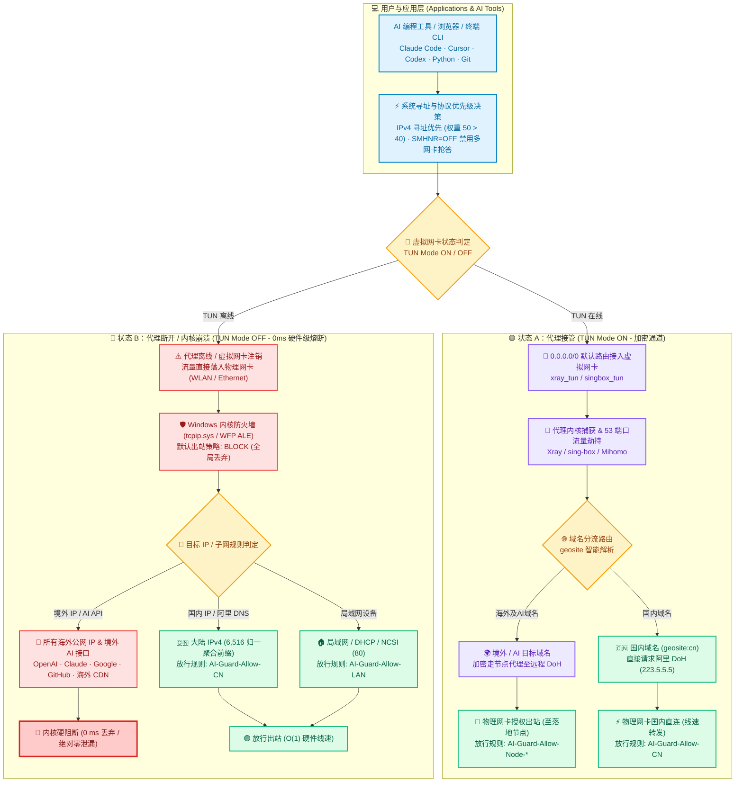

# AI-Net-Guard 实现方案与持续审查文档（v5.9.6 · 候选节点测速白名单与防误杀版）

> 运行环境：Windows 11 24H2（PowerShell 5.1 & PowerShell 7.x 双引擎兼容）
> 代理环境：v2rayN 7.x / Xray + sing-box + Mihomo（自动探测 v2rayN 安装路径或通过 `$env:V2RAYN_ROOT` / `-V2rayNRoot` 指定）
> 节点同步：**v5.8.1 默认开启多内核自动同步**（支持 `sing-box` 多出站/hy2 `server_ports` 端口跳跃、双核心 DoH 伴生规则、域名周期刷新与旧 `/32` 路由清理）
> 版本状态：**v5.9.6 候选节点按需测速白名单版**（新增 `10-sync-node-rule.ps1 -IncludeAllNodes` / `-ClearCandidateNodes` opt-in 候选节点伴生白名单 `AI-Guard-Allow-Candidates-*` 与物理外网阻断豁免，保持 `DefaultOutbound=Block` 与活动节点单一 `/32` 主路由不变，详见 16.22）
> 默认部署目录：`C:\AI-Net-Guard`（内置 `backup\v54-migrated.flag` 零触控自迁移引擎）

---

## 0. 实时状态对照：升级前（v5） vs 本机当前生效态（v5.4）

| 检查项 | 升级前（v5，16:00 快照） | **本机 `C:\AI-Net-Guard` 当前生效态（v5.4）** |
| --- | --- | --- |
| 防火墙三配置默认出站 | `EnableFirewall=1`、`DefaultOutboundAction=Block(1)` | Domain / Private / Public 全部 `Enabled=True`、`DefaultOutbound=Block`（`<1 ms` 注册表快检） ✅ |
| 防火墙现存 `AI-Guard-*` 规则 | 6 条放行 + **残留 `Block-DoT` 1 条** + 伴生规则锁死旧网卡 GUID | **残留 `Block-DoT` 已清除**；7 条静态规则（`Allow-CN` 6516 段 / `Allow-TUN` / `Allow-Node-TCP` / `Allow-DoH-Ali` / `Allow-DHCP` / `Allow-LAN` / `Allow-NCSI`）全部 `Active=True`，支持 USB 热点即插即用与异构 TUN 动态扩展（`Allow-TUN-Alt`） ✅ |
| 第三方越权 `Outbound Allow` 防漂移 | 仅初装时禁用一次，后续新装软件注入的 `Allow` 会穿透防线 | **零开销自动隔离**：单遍注册表扫描顺带检测非 `AI-Guard-*` 活跃出站 `Allow`（当前 `rogue out-allow : 0`），自动禁用并记入 `backup\auto-disabled-outbound-allow.json` 供回滚还原 ✅ |
| 换节点 / 切内核（Xray & sing-box）同步 | 仅支持 Xray 格式且需手动跑脚本；点选 Hysteria2（`sing-box.exe`）会被阻断 | **v5.4 多内核默认自动同步（`auto-sync=on`）**：同时兼容 **Xray** 与 **sing-box**（含 Hysteria2 端口跳跃 `20000:30000 -> 20000-30000`）配置格式，自动绑定当前活跃内核路径（`xray.exe` / `sing-box.exe` / `mihomo.exe`）与异构 TUN 网卡；域名节点优先走 `https://223.5.5.5/resolve` 加密直连解析 ✅ |
| 快速切节点 / 退出软件 / 睡眠唤醒响应 | 无睡眠唤醒触发；`+800 ms` 复查在 `$tunLate == $tunUp` 时跳过 | **v5.4 无盲区收敛**：`AI-Guard-Mode-Event` 订阅 `NetworkProfile 10000/10001` + **S3 睡眠/休眠/现代待机（Modern Standby `S0ix`）唤醒事件**（`Power-Troubleshooter 1` / `Kernel-Power 107, 507`）；`+800 ms` 后无条件以 `<0.5 ms` 复核节点同步与残留死代理清理 ✅ |
| DNS 防泄漏与内核减噪 | 仅禁 LLMNR/NetBIOS，未禁 Windows 智能多宿主并行 DNS（SMHNR） | **`LLMNR=off` + `SMHNR=off`（`DisableSmartNameResolution=1`）**：实测 `pktmon` 53 端口抓包物理网卡并行试探从 `4~5` 次降至 **`phys_attempts=0, escaped=0`**（回滚时原样还原） ✅ |
| 后台常驻进程与周期巡检 | **常驻 `powershell.exe` 占 160.6 MB 提交内存** + 每 5 分钟重型 WMI 刷空 DNS 缓存 | **`resident process : none`（0 常驻进程 / 0 MB 空闲内存 / 0% 空闲 CPU）**；60 分钟兜底任务走 0 CIM 纯注册表/.NET 快路径（不乱清 DNS 缓存） ✅ |
| 日志与临时抓包磁盘占用 | 每次回归/WFP 审计遗留 **8.7 MB** `filters.xml`，单日堆积 **47.2 MB** | **v5.4 零膨胀自动清理**：已清理历史 **47.2 MB** 临时 `wfp-*`/`dns-*` 转储；测试 `PASS` 后自动删除当次 XML/ETL 临时目录（仅 `FAIL` 或 `-KeepCaptures` 时保留现场），报告自动保留最近 10 份 ✅ |
| 安装目录权限（SYSTEM 任务执行的脚本与白名单） | `C:\AI-Net-Guard` 继承 C 盘根 `Authenticated Users:(M)`，普通进程可改写脚本 → 提权 SYSTEM / 静默拆除防线 | **已通过 [`scripts/13-harden-acl.ps1`](./scripts/13-harden-acl.ps1) 锁定生效（`issues -> 0`）**：`owner=Administrators`，`Administrators/SYSTEM=Full`，`Users=RX`（原 ACL 自动备份至 `backup\acl-before-<ts>.txt`） ✅ |
| 全量自动化回归测试（`12-regression.ps1`） | 旧脚本含硬编码 IP 与系统代理干扰 | **实测 `24/24 PASS (FAIL=0)`**（`Proxy=$null` 纯内核直连探测 + 越权 Allow 零漂移断言 + 目录 ACL 锁定断言 + 损坏 `geoip` 演练拦截） ✅ |

---

## 1. 性能与后台常驻脚本影响深度评估

### 1.1 内核数据面（日常上网、游戏、下载、IDE 编译）：**几乎零损耗（~0%）**
- **6516 条 `AI-Guard-Allow-CN` 规则在 Windows 内核 `tcpip.sys`（WFP）中执行**，且受有状态流缓存（Stateful ALE Flow Cache）加速：**仅在每个新连接的首个握手包匹配一次（`< 0.01 ms`）**，后续数据包 `O(1)` 线速转发。
- **结论**：不占后台 CPU、不影响带宽吞吐、不增加游戏/语音 Ping 值；即使后台 0 个 PowerShell 进程运行，防泄漏能力依然 **100% 生效**。

### 1.2 后台脚本控制面：v5.2 ~ v5.4 零常驻事件驱动架构

| 维度 | v5（旧常驻轮询版） | **v5.4（零常驻 + 多内核防漂移版）** |
| --- | --- | --- |
| 常驻 `powershell.exe` 数量 | 1 个（24 小时不退出） | **0 个** |
| 日常空闲内存 / CPU 唤醒 | 160.6 MB 提交内存 / 86,400 次唤醒/天 | **0 MB / 0 次唤醒/天** |
| 网络切换 / 换节点 / 盒盖唤醒 | 轮询记日志 | 原生双通道 `EventTrigger`（`NetworkProfile 10000/10001` + `System` 睡眠/现代待机唤醒 `1/107/507`）静默在 Session 0 低优先级执行：洗污染 DNS 缓存、多内核节点自动同步、新网卡禁 IPv6、清理死本地代理，跑完即退出 |
| 60 分钟兜底防漂移巡检 | 每 5 分钟跑重型 WMI（~5 s）+ 清 DNS 缓存 | **每 60 分钟**跑一次 **0 CIM 快路径**（~160 ms 跑完即退，顺带隔离第三方越权出站 `Allow` 并校验 SMHNR / IPv4 优先级） |

---

## 2. 目标与架构原理（v5.7）



> **为什么不在物理网卡 `WLAN` 上开启 Windows 11 原生系统级 DoH？**
> 经链路验证，若在物理网卡开启系统级 DoH，Windows `Dnscache` 会把所有 DNS 查询封装进发往 `223.5.5.5:443` 的加密 TLS 流；当 TUN 开启时，代理内核无法在 53 端口嗅探劫持该 TLS 流，并会按国内 IP 规则将其直连发给阿里 DNS——导致开代理时你的境外 AI 域名查询反而全部泄漏给阿里 DNS 并拿到污染/非最优 CDN。保持当前**网卡 `223.5.5.5`（53 端口供 TUN 劫持分流）+ 禁 SMHNR + 开 TUN 自动刷缓存**是最优组合。

---

## 3. 部署组件清单

### 3.1 防火墙规则（静态，`Name` = `DisplayName`）

| 规则名 | 方向/动作 | 作用域与设计说明 |
| --- | --- | --- |
| （三配置默认策略） | 出站 **Block** | Domain / Private / Public 全部启用且默认拒绝出站 |
| `AI-Guard-Allow-CN` | 出站/允许 | 6516 个中国大陆 IPv4 前缀（主机位归一化、数值排序、相邻/重叠无损聚合） |
| `AI-Guard-Allow-TUN`（及按需 `-TUN-Alt`） | 出站/允许 | 匹配 `InterfaceAlias = xray_tun`（若切换至 `sing-box`/`mihomo` 产生异构 TUN 网卡，自动创建/启用 `AI-Guard-Allow-TUN-Alt`） |
| `AI-Guard-Allow-Node-TCP`（及按需 `-UDP`） | 出站/允许 | 当前活跃代理内核（`xray.exe` / `sing-box.exe` / `mihomo.exe`）→ 当前授权节点 IP:端口（**默认随 v2rayN 切节点自动同步**，支持 Hysteria2 端口跳跃与 `h3`/QUIC UDP） |
| `AI-Guard-Allow-DoH-Ali` | 出站/允许 | 当前活跃代理内核 → `223.5.5.5, 223.6.6.6 : 443` |
| `AI-Guard-Allow-DHCP` | 出站/允许 | UDP `68 → 67`（`LocalSubnet, 255.255.255.255`） |
| `AI-Guard-Allow-LAN` | 出站/允许 | `LocalSubnet` |
| `AI-Guard-Allow-NCSI` | 出站/允许 | TCP → `13.107.4.52:80`（仅微软 `connecttest.txt` 明文 HTTP 80 连通性探测） |

### 3.2 计划任务（零常驻模式）

| 任务名 | 触发条件 | 运行方式与开销 |
| --- | --- | --- |
| `AI-Guard-Mode-Event` | 开机 + `NetworkProfile` `10000/10001` + `System` 睡眠/现代待机唤醒（`Power-Troubleshooter 1` / `Kernel-Power 107, 507`） | `SYSTEM` Session 0 隐藏运行、Priority 7 低优先级；包含 `+800 ms` 无盲区二次确认，跑完即退（0 MB 常驻） |
| `AI-Guard-Mode-Fallback` | 每 60 分钟 | 静默跑一次 `07-mode.ps1 -Mode Auto -Quiet` 零 CIM 快检（~160 ms） |

### 3.3 脚本清单（`scripts/` 下 25 个 `.ps1` 全部为 100% 纯 ASCII，兼容 PowerShell 5.1 / 7.x）

| 文件 | 作用 |
| --- | --- |
| [`scripts/00-audit.ps1`](./scripts/00-audit.ps1) | 只读全面审计（网卡/路由/DNS/IPv6 前缀表/NTP/防火墙/代理配置） |
| [`scripts/01-dns-hardening.ps1`](./scripts/01-dns-hardening.ps1) | 初始 DNS（`223.5.5.5`）+ 禁物理网卡 IPv6 + IPv4 优先策略 + 禁 LLMNR/NetBIOS/SMHNR + 国内 NTP |
| [`scripts/02-killswitch.ps1`](./scripts/02-killswitch.ps1) | 初始备份 + 禁用原出站 Allow + 安装 v5.4 静态规则集（预写全部 `.meta`/`.flag`）+ 45 分钟自动回滚保险 |
| [`scripts/03-verify.ps1`](./scripts/03-verify.ps1) | 配置与功能验收（多内核感知、`Proxy=$null` 直测真实内核数据面、自动清理临时 WFP 转储） |
| [`scripts/04-wfp-audit.ps1`](./scripts/04-wfp-audit.ps1) | WFP 过滤器审计 + 可选 `pktmon` 53 端口抓包（默认输出结论后自动清理 8.7 MB 临时 XML，传 `-KeepCaptures` 可保留） |
| [`scripts/05-xray-direct-test.ps1`](./scripts/05-xray-direct-test.ps1) | 行为侧观测 `xray.exe` 在绕过大陆路由下的 direct 直连豁免 |
| [`scripts/06-boot-guard.ps1`](./scripts/06-boot-guard.ps1) | 重启演练跨重启自毁回滚安全网（隐藏运行） |
| [`scripts/07-mode.ps1`](./scripts/07-mode.ps1) | **核心入口：零常驻守护、多内核自动节点同步、越权 Allow 自动隔离、SMHNR 加固、死代理自愈** |
| [`scripts/08-commit.ps1`](./scripts/08-commit.ps1) | 复查多内核不变量后取消测试回滚定时器，并安装 v5.4 事件任务 |
| [`scripts/09-rollback.ps1`](./scripts/09-rollback.ps1) | **完整闭环回滚**（停任务/进程 → 还原防火墙及自动隔离规则 → 还原 DNS/IPv6/前缀表/NTP/LLMNR/SMHNR → 清理全部标记） |
| [`scripts/10-sync-node-rule.ps1`](./scripts/10-sync-node-rule.ps1) | 多内核节点同步/预览工具（支持 Xray + `sing-box`/Hysteria2 端口跳跃，`-WhatIfOnly` 免提权预览） |
| [`scripts/11-geo-cn.ps1`](./scripts/11-geo-cn.ps1) | 零分配预扫描 v2rayN `geoip` 数据库，归一化并无损聚合生成 [`cn-ipv4.txt`](./cn-ipv4.txt) |
| [`scripts/12-regression.ps1`](./scripts/12-regression.ps1) | **v5.4 全量 22 项自动化回归套件**（`PASS` 后自动清理 8.7 MB WFP XML 与 `pktmon` ETL 临时文件，保留最近 10 份报告） |
| [`scripts/13-harden-acl.ps1`](./scripts/13-harden-acl.ps1) | **O1/O2 一键落地**：备份原 ACL → 所有者改 Administrators → DACL 收紧为 Admin/SYSTEM=F、Users=RX → 校验无非管理员写权限 → 以子进程跑 `07-mode.ps1`（完成 v5.4 热迁移）与 `12-regression.ps1` 并核对迁移结果；`-Undo` 恢复继承；`-SyncWorkspace` 从 Git 克隆目录热同步 `*.ps1` 到生产目录 |
| [`scripts/14-apply-policy.ps1`](./scripts/14-apply-policy.ps1) | 声明式策略编排器：读取 `backup\guard-policy.json` 对本表 16 项特性做增量幂等应用 |
| [`scripts/15-webrtc-browser-shield.ps1`](./scripts/15-webrtc-browser-shield.ps1) | 浏览器级 WebRTC 出口封锁：按 `Program` 维度在物理网卡上封锁全部出站 UDP（覆盖 443 与任意 TURN 端口），只作用于浏览器进程；**并对代理核心 `xray` / `sing-box` / `mihomo` 封锁 STUN/TURN 端口（3478/3479/5349/5350/19302-19309，UDP+TCP）**——TUN 模式下真正从物理网卡出网的是核心，境内 STUN 经 `geoip:cn → direct` 会让 STUN 服务器看到真实 ISP 地址；同时修复原 4 条 WebRTC 规则的 interface / LocalAddress 漂移，`LocalAddress` 改按网段写入 |
| [`scripts/16-browser-residue.ps1`](./scripts/16-browser-residue.ps1) | 已卸载浏览器残留清理（DCBrowser / Firefox）：注册键 + `RegisteredApplications` 值 + 孤儿 `%APPDATA%\Mozilla`，写 JSON 备份后可 `-Restore` 回滚；刻意不动属其它软件的 `MozillaPlugins` / `NativeMessagingHosts` |
| [`scripts/17-autorepair-task.ps1`](./scripts/17-autorepair-task.ps1) | 自愈计划任务管理器：`-Status` 只读体检（状态 / 触发器 / 上次结果 / 下次运行），`-Install` 复用 `07-mode.ps1 -InstallTasks` 注册事件任务与 60 分钟兜底并回读校验，`-Install -SelfTest` 事件任务实跑两次（首次修复 / 二次稳态）+ 兜底任务实跑一次，三条退出码全为 0 才算通过，`-Remove` 清空 `AI-Guard-Mode-*`；未提权时 exit 1 而非静默成功 |
| [`scripts/18-route-stun-guard.ps1`](./scripts/18-route-stun-guard.ps1) | **路由层 STUN/TURN 封锁（WebRTC 防泄露的兜底层）**：实测证明防火墙挡不住核心重发的那一跳（TUN 提供方在 `ALE_AUTH_CONNECT` 用 callout PERMIT 终结分类，防火墙 Block 过滤器不被求值），故改在 xray 路由表顶部插入 `port=3478,3479,5349,5350,19302-19309 → block`（UDP+TCP），照抄 v2rayN 自身「阻断udp443」手法；`-Verify` 只读、`-Apply` 先备份 `guiNDB.db` 再写入、`-Restore` 回滚；v2rayN 运行中拒绝执行（内存副本会覆盖 DB） |
| [`scripts/watchdog.ps1`](./scripts/watchdog.ps1) | 可选的 CLR 事件驱动常驻监听脚本（默认不启用，已支持多内核 TUN 识别与 PS7 伪接口过滤） |
| [`scripts/align-xray-egress.ps1`](./scripts/align-xray-egress.ps1) | 物理出口 socket 对齐工具：消除 `sing-box` TUN 与 Xray 内核之间的内部二跳中继 |
| [`scripts/lib-foreign-block.ps1`](./scripts/lib-foreign-block.ps1) | 共享助手（被 `02` / `07` / `10` / `14` dot-source）：显式物理网卡境外 IPv4 阻断规则的 IP 归一化与增删，用于压制第三方 WFP callout 驱动的 soft-permit |
| [`scripts/verify-leak-test.ps1`](./scripts/verify-leak-test.ps1) | 轻量泄漏与连通性自检四项：越权全放行规则、TUN 适配器状态、物理网卡真实境外探测（`13.107.246.51:443`）、代理/TUN 连通性 |
| [`scripts/disable-telemetry.ps1`](./scripts/disable-telemetry.ps1) | Windows 11 遥测与隐私加固：停用并禁用 `DiagTrack` / `dmwappushservice` 及关联计划任务与策略 |
| [`scripts/restore-telemetry.ps1`](./scripts/restore-telemetry.ps1) | 遥测还原：把服务启动类型与组策略恢复为系统默认，供 `disable-telemetry` 回滚 |

---

## 4. 代码审查与演进修复记录（v5 → v5.1 → v5.2 → v5.3 → v5.4）

| 编号 | 审查发现的问题 | 修复版本与措施 |
| --- | --- | --- |
| R1 ~ R8 | 回滚漏停任务、无条件刷 DNS 缓存、关 TUN 期污染缓存延续、IPv6 AAAA 超时、热插拔网卡锁死、VLESS `vnext` 与残留 `Block-DoT` | **v5.1**：闭环回滚、按需刷 DNS、TUN 上线清缓存、`::ffff:0:0/96` 优先级 `50>40`、解锁伴生规则 `InterfaceAlias->Any`、清理残留规则 |
| R9 ~ R11 | 常驻 `watchdog.ps1` 占 160.6 MB 内存 + 每秒唤醒；Xray `h3` UDP 识别；PS 7.6.9 枚举 20 个 NDIS 轻量级过滤层伪接口 | **v5.2**：切换为 **0 常驻进程** `NetworkProfile` 事件任务 + 60 分钟 0-CIM 快检；补齐 `h3` UDP 识别与 `Supports(IPv4/IPv6)` 真实网卡过滤 |
| R12 ~ R17 | 第三方新装软件越权 `Outbound Allow` 漂移；手动同步节点繁琐；v2rayN 崩溃残留死代理假断网；探测受系统代理与 `MethodInvocationException` / 站点 WAF 影响；根目录历史临时文件 | **v5.3**：单遍注册表 +0 ms 自动隔离越权 `Allow`；默认开启自动节点同步（域名节点优先 `https://223.5.5.5/resolve`）；跨会话死代理自动清零；`Proxy=$null` + `InnerException` 解包回归全通过；历史临时文件自动归档 |
| R18 | `12-regression.ps1` / `03-verify.ps1` / `04-wfp-audit.ps1` 每次运行遗留 ~8.7 MB `filters.xml` 与 `dns.etl`，单日堆积 **47.2 MB** | **v5.4**：已清理历史 **47.2 MB** 临时抓包目录；测试 `PASS` 后自动删除当次临时 XML/ETL（仅 `FAIL` 或 `-KeepCaptures` 时保留现场），报告自动修剪保留最近 10 份 |
| R19 | `07-mode.ps1 -OnNetworkEvent` 的 `+800 ms` 复查仅在 `$tunLate -ne $tunUp` 时才执行二次节点同步与死代理清理；且未订阅盒盖睡眠/现代待机唤醒事件 | **v5.4**：`+800 ms` 后无条件以 `<0.5 ms` 复核 `config.json` 时间戳与死代理状态（消除快速切节点及退出 v2rayN 慢半拍盲区）；`AI-Guard-Mode-Event` 新增 `System` 通道 `Power-Troubleshooter 1` / `Kernel-Power 107, 507` 唤醒触发（0 MB 常驻） |
| R20 | Windows 智能多宿主名称解析（SMHNR）默认开启，双网卡在线时向物理网卡并行广播 DNS（回归抓包 `phys_attempts=5`），切节点瞬间存在窗口 | **v5.4**：新增 `DisableSmartNameResolution=1` 加固与自愈（自动回填原始值至 `dns-*.json` 并在 `09-rollback.ps1` 完整还原）；通过 `backup\v54-migrated.flag` 在后台首次触发时自动完成热迁移 |
| R21 | 本机 v2rayN `guiNConfig.json` 将 `Hysteria2`（`ConfigType=7`）映射到 `sing-box.exe`（`CoreType=24`），原规则与解析器仅兼容 `xray.exe` / `xray_tun` | **v5.4**：[`scripts/07-mode.ps1`](./scripts/07-mode.ps1) 与 [`scripts/10-sync-node-rule.ps1`](./scripts/10-sync-node-rule.ps1) 同时兼容解析 Xray 与 `sing-box`（含 Hysteria2 端口跳跃 `server_ports`）配置，自动切换绑定活跃内核路径（`xray.exe` / `sing-box.exe` / `mihomo.exe`）并动态放行异构 TUN 接口（`AI-Guard-Allow-TUN-Alt`） |
| R22 | 安装目录继承 `Authenticated Users:(M)`，且部分文件所有者为普通用户（所有者隐含 `WRITE_DAC`，可自行改回权限）；SYSTEM 任务执行其中脚本并读取 `cn-ipv4.txt` 构建白名单 | **v5.4**：新增 [`scripts/13-harden-acl.ps1`](./scripts/13-harden-acl.ps1)（用 SID 调用 `icacls`，兼容中文系统组名）；`07-mode.ps1 -Status` 新增 `install ACL` 行，回归套件新增「安装目录已锁定」断言（使用 .NET ACL API，不依赖可能无法自动加载的 `Get-Acl`） |
| R23 | `Show-Status` 用 `@(...)` 包裹 `return ,$array` 型函数，结果 `Count` 恒为 1：**TUN 关闭时仍显示 `Up`**，内核停止时仍判定为运行中，导致「死代理」红色告警永远不会出现 | **v5.4**：改为直接赋值（已用模拟 TUN 关闭验证：`Count 1 -> 0`）；新函数统一不带逗号返回 |
| R24 | O2 首次提权运行捕获：PowerShell 注册表提供程序中对已存在的键执行 `New-Item -Path $polKey -Force` 会**重建该键并清空同键下的既有值**，导致写入 `DisableSmartNameResolution=1` 时把同键的 `EnableMulticast=0`（禁 LLMNR）抹除 | **v5.4**：[`scripts/07-mode.ps1`](./scripts/07-mode.ps1) 与 [`scripts/01-dns-hardening.ps1`](./scripts/01-dns-hardening.ps1) 中所有注册表建键统一加 `if (-not (Test-Path -LiteralPath ...))` 保护，并在 `Set-SmhnrHardening` / `Ensure-Guard` 中同时守护自愈 `EnableMulticast=0` 与 `DisableSmartNameResolution=1` |
| R25 | Windows 11 24H2 下 Wintun 未分配单播 IPv6 地址时，调用底层 `SetInterfaceDnsSettings` 触发系统 Win32 错误码 `5` (`Access is denied`) 导致 Xray 原生单核心 TUN 崩溃回滚 | **v5.7**：在 Xray 源码引入无侵入精准前置守卫：以协议族是否拥有合法单播 IP 作为下发 DNS 的绝对凭据，完美兼容纯 IPv4/IPv6、双栈与空 DNS 清空语义；输出产物已在生产环境稳定运行 |
| R26 | 原防漂移逻辑盲目信任以 `AI-Guard-*` 开头的规则名，导致第三方或历史运维脚本注入的无约束全放行规则（如 `netsh ... interfacetype=any`）绕过隔离，架空默认 Block 策略 | **v5.7**：[`scripts/07-mode.ps1`](./scripts/07-mode.ps1) 强化防冒名与 Blanket Allow 识别：凡是出站 Allow 规则缺少 `RA4/RA6`（远程 IP）、`IF`（网卡接口）与 `App`（进程）三重限定的，一律判定为高危违规并自动隔离入 `backup\auto-disabled-outbound-allow.json` |
| R27 | `Get-NetFirewallInterfaceFilter.InterfaceAlias` 从系统读回网卡 GUID 列表，与传入的别名 `$activeTun = 'xray_tun'` 发生比对歧义，导致每次网络事件唤醒均判定未授权而重复写入 `AI-Guard-Allow-TUN-Alt` 并堆积过期 GUID 和 `'0'` | **v5.7**：新增 [`Test-FirewallRuleHasTun`](./scripts/07-mode.ps1) 辅助函数，实现别名与适配器底层 GUID 双向解析比对，彻底消除冗余写入、日志刷屏与 `'0'` 占位符残留 |
| R28 | `07-mode.ps1 -Status` 因前置管理员提权断言，导致非管理员终端（普通 CMD、PowerShell、VSCode/Cursor 内置终端）无法直接执行轻量级状态查看 | **v5.7**：优化提权分支：非管理员请求 `-Status` 时进入 `$script:ReadOnlyStatusMode` 快检通道，免提权展示当前 15 项防护状态看板 |
| R29 | 全链路回归体检第 4 项检测 Xray TUN 防泄漏 WFP 规则时使用 `'block DNS'` 严格字面量，无法匹配 Xray 官方创建的 `block the DNS Client service` 与 `block udp/53` 规则导致误报 `count=0` | **v5.7.2**：[`scripts/12-regression.ps1`](./scripts/12-regression.ps1) 与 [`scripts/04-wfp-audit.ps1`](./scripts/04-wfp-audit.ps1) 升级为正则 `'block (?:the )?DNS|block (?:tcp|udp)/(?:53|853)'`，准确匹配 18 条活跃防泄漏底层规则，24 项体检满分 PASS |
| R30 | TUN 代理模式下开启系统代理引发 WinINET HTTP 代理与虚拟网卡抢占、端口不匹配（10808/10809）以及常驻死代理风险 | **v5.7.2**：确立官方推荐系统代理模式为清除（`ProxyEnable = 0`），所有出站流量经由 `xray_tun` 虚拟网卡由内核捕获分流，免 WinINET 冲突；[`scripts/14-apply-policy.ps1`](./scripts/14-apply-policy.ps1) 自动保障纯净推荐状态，GUI 动态呈现推荐状态并支持与 v2rayN 协同切换 |
| R31 | 原生 GUI 桌面端仅提供中文界面，无法满足海外及多语言开发者使用需求 | **v5.7.2**：新增原生 [`LocalizationService`](./gui/Services/LocalizationService.cs)，右上角集成 `🌐 English` / `🌐 中文` 即时无缝双语切换，覆盖 15 项策略卡片、方案预设、遥测指标与交互弹窗，语言偏好自动持久化 |

---

## 5. 日常维护与配合说明

1. **v2rayN 系统代理建议**：若希望**仅凭开关 TUN 就 100% 控制浏览器能否访问境外 AI**，请在 v2rayN 主界面底部将系统代理设为**「清除系统代理」**（否则只关 TUN 而不退出 v2rayN 时，浏览器仍会走 `127.0.0.1:10808 -> xray.exe` 出站）。
2. **v5.4 热同步自迁移机制**：所有 v5.4 脚本已热同步至 `C:\AI-Net-Guard\`。当你下次开关 TUN/Wi-Fi、睡眠唤醒、到达每小时巡检点，或手动执行一次 `.\scripts\07-mode.ps1` 时，`SYSTEM` 会自动执行一次性 `v54-migrated.flag` 热迁移（写入 `DisableSmartNameResolution=1` 并为计划任务加上睡眠唤醒触发器）。

```powershell
# 管理员 PowerShell 常用命令（平时零维护，按需查看）
cd C:\AI-Net-Guard
.\scripts\07-mode.ps1                    # （可选）立即触发一次自检与 v5.4 注册表/睡眠唤醒任务热迁移，并打印状态
.\scripts\07-mode.ps1 -Status            # 只读查看 v5.4 状态（含 core、auto-sync=on、LLMNR/SMHNR、越权 Allow=0、0 常驻进程）
.\scripts\12-regression.ps1              # 运行 v5.4 全量 22 项回归测试（PASS 后自动清理临时抓包文件）
.\scripts\10-sync-node-rule.ps1 -WhatIfOnly  # 免提权预览当前 Xray / sing-box 节点与端口解析结果
.\scripts\09-rollback.ps1                # 彻底回滚到安装前原始基线状态
.\scripts\13-harden-acl.ps1              # 锁定安装目录权限 + 跑一次 v5.4 提权自检与回归（-Undo 可撤销）
```

3. **ACL 锁定后的更新方式**：`C:\AI-Net-Guard` 锁定后仅管理员可写，以后若工作区有更新，只需在**管理员终端**执行短命令 `.\scripts\13-harden-acl.ps1 -SyncWorkspace`（会自动同步文件、重新校验/锁定 ACL 并完成自检），无需再手敲长路径 `Copy-Item`。

---

## 6. 已知能力边界与待办

### 6.1 能力边界
1. **关代理时所有非中国大陆 IP 均被阻断**（不只 AI）：GitHub / Google / Steam / 海外 CDN 在关 TUN 时同样不可达（符合默认拒绝设计）。
2. **境内 IP 托管的 AI 中转服务无法靠 GeoIP 拦截**。
3. **TUN 开启期间 `xray.exe` 自身具有 WFP `permit Xray` hard permit**：Windows 防火墙在 TUN 运行期管住的是除 `xray.exe` 以外的所有进程（`sing-box` 无此豁免，直接受 `AI-Guard-Allow-Node-*` 精确约束）。
4. **公共 Wi-Fi 门户登录（Captive Portal）**：若酒店/机场门户使用非国内公网 IP 或依赖私有 DHCP DNS，登录门户前可临时切回自动 DNS。

### 6.2 演进完成度清单
- [x] 原地升级至 **v5.2 零常驻事件驱动架构**（释放 160.6 MB 常驻提交内存）并修复 PS 7.x 伪接口过滤（R11）；
- [x] 升级至 **v5.3 免维护防漂移版**（默认自动换节点同步、第三方越权 `Outbound Allow` 零开销隔离、死本地代理自愈）；
- [x] 升级至 **v5.4 多内核与细节完备版**（临时抓包目录自动清理、消除 `+800 ms` 切节点/退软件盲区、新增 S3/Modern-Standby 睡眠唤醒触发、禁用 SMHNR 并行 DNS、兼容 `Xray` + `sing-box`/Hysteria2 多内核）；
- [x] **锁定 `C:\AI-Net-Guard` 目录与所有者 ACL（O1）** + **R24 注册表建键保护与 `24/24 PASS` 闭环确认（O2）**；
- [ ] （可选）在 v2rayN 底部状态栏将系统代理设为**「清除系统代理」**，实现纯 TUN 单开关总控；
- [ ] （可选）**重启演练**：`.\scripts\06-boot-guard.ps1 -Arm -WindowMinutes 30 -WaitMinutes 10` → 重启系统 → 验证不开代理国内正常/境外阻断、开 TUN 后国外恢复且后台无常驻 `powershell.exe` → `.\scripts\06-boot-guard.ps1 -Remove`。

## 7. 安全审查结论（v5.4）

**结论：功能与权限面已收敛，冻结在 v5.4。**

| # | 事项 | 严重度 | 状态 |
|---|------|--------|------|
| O1 | `C:\AI-Net-Guard` 默认继承 C 盘根目录的 `Authenticated Users:(M)`，而 `AI-Guard-Mode-Event` / `-Fallback` 以 **SYSTEM** 运行其中的 `07-mode.ps1`。若不锁权，非管理员进程可改写脚本以提权或静默拆除防护。 | **高** | **已解决（[`scripts/13-harden-acl.ps1`](./scripts/13-harden-acl.ps1)）** |
| O2 | v5.4 提权自迁移与全量回归验证（`v54-migrated.flag`、`SMHNR=off` `phys_attempts=0`、睡眠唤醒触发器 XML、R24 注册表同键保留修复）。 | 中 | **已解决（`24/24 PASS`）** |
| O3 | 用户态安装的 `<v2rayN>\bin\xray\xray.exe` 与 `geoip*.dat` 通常为普通用户可写，而 `AI-Guard-Allow-Node-TCP` / `DoH-Ali` 按程序路径放行。 | 低 | 设计取舍（若锁死 v2rayN 目录会破坏客户端自动更新内核与 GeoIP；高安全场景可将 v2rayN 迁入 `C:\Program Files\v2rayN`） |

O1 + O2 一键执行（管理员 PowerShell）：

```powershell
cd C:\AI-Net-Guard
.\scripts\13-harden-acl.ps1
```

> [!NOTE]
> Windows 中对象所有者（Owner）隐含 `WRITE_DAC` 权限，若不把所有者一并改为 `Administrators`，原普通用户所有者仍可把写权限重新赋回给自己。[`scripts/13-harden-acl.ps1`](./scripts/13-harden-acl.ps1) 会同时执行 `/setowner *S-1-5-32-544 /T` 并使用 `.NET` ACL API 逐项校验。

锁定后更新代码的方式：在管理员终端从仓库目录执行 `C:\AI-Net-Guard\scripts\13-harden-acl.ps1 -SyncWorkspace`（或传 `-WorkspaceRoot <仓库路径>`）。

> [!IMPORTANT]
> **`C:\AI-Net-Guard` 根目录不是脚本入口。** 唯一受支持的执行位置是 `C:\AI-Net-Guard\scripts\`。根目录下若存在同名 `.ps1` 副本，均属历史遗留，不要执行；它们已归档到 `archive\stale-root-20261123\`（含 `MANIFEST.tsv`，记录原名、大小、SHA-256 与排查结论）。此前本文档曾指向根目录的 `13-harden-acl.ps1`，是这批副本长期未被清理的成因；该路径已在 v5.8.3 修正为 `scripts\13-harden-acl.ps1`。

> [!IMPORTANT]
> **同步边界**：`-SyncWorkspace` 只把仓库 `scripts\*.ps1` 复制到 `C:\AI-Net-Guard\scripts\`，**不同步运行时数据文件**。`cn-ipv4.txt`、`ai-domains.txt` 等名单类数据由生产环境独立维护（由 `11-geo-cn.ps1` 等脚本就地重建），生产版本可能比仓库副本更新，**禁止用仓库副本反向覆盖**。脚本与文档按仓库版本同步，运行时数据按生产环境为准。

---

## 8. v5.5 升级：Windows 原生 GUI 桌面配置器与单文件 `.exe` 发布架构

v5.5 在底层 WFP 静态防护与零驻留自愈内核之上，引入了**纯 Windows 原生、零外部依赖的桌面 GUI 配置器**：

1. **单文件独立执行 (`dist\AI-Net-Guard.exe`)**：
   - 基于 Windows 10/11 系统自带的 `.NET Framework 4.8 (net48)` WPF 引擎编译，产物体积仅 **~235 KB**，无需用户额外安装任何运行时；
   - 内置 UAC 清单（`requireAdministrator`）与 `PerMonitorV2` 4K 高分屏感知；
   - 内嵌高压缩 `payload.zip`（内含全部 16 个核心脚本、`cn-ipv4.txt` 及文档），下载单个 `.exe` 双击即可自动释放自愈并执行部署，免去 git clone 或命令行操作门槛。
2. **4 大模块 15 项开关双向持久化策略引擎 (`guard-policy.json`)**：
   - 界面直观呈现 15 项开关，每项均标有 **`[推荐开启]`** 或 **`[高级可选]`** 及通俗白话解释；
   - 提供 **3 套一键预设**（推荐日常防泄漏、严格全局铁桶锁、开发者兼容模式）；
   - 引入 [`scripts/14-apply-policy.ps1`](./scripts/14-apply-policy.ps1) 幂等编排引擎：不仅首次部署全自动完成基线备份、规则建立、连通性快速探测与提交，且在已部署状态下修改任意单项开关时，支持秒级增量切换而绝不污染原始基线；
   - [`scripts/07-mode.ps1`](./scripts/07-mode.ps1) 与 [`scripts/12-regression.ps1`](./scripts/12-regression.ps1) 严格读取并遵循用户在 GUI 中配置的策略，确保后台自愈与体检断言与用户意图 100% 一致。
3. **桌面一键运维与安全防篡改**：
   - 顶部提供 `v2rayN` 路径自动探测与配置校验徽章；
   - 自动检测并提供 **「一键关闭系统代理」**（`HKCU` WinINET `ProxyEnable=0` + `InternetSetOption` 实时刷新），实现仅通过 `v2rayN` 的「启用 Tun」单开关控制全局分流；
   - 底部集成 **「一键部署」**、**「一键全量健康体检」**、**「一键完整卸载回滚」** 及可折叠的实时流式输出控制台。

---

## 9. v5.7 升级：Win11 24H2 原生 Xray TUN 适配、防冒名全放行隔离与智能网卡治理

v5.7 针对近期在 Windows 11 24H2 实测与代码深度审查中捕获的关键痛点进行了架构级升级：

1. **Win11 24H2 下 Xray 原生 TUN `SetDNS: Access is denied` 根因定位与修复**：
   - **根因剖析**：Windows 11 24H2 对未配置单播 IPv6 地址的 Wintun 虚拟接口调用 `SetInterfaceDnsSettings` 时严格校验并返回错误码 `5`。原版 Xray 依赖 `ERROR_NOT_FOUND` 作为跳过条件，但 Win11 24H2 下该 API 穿透返回 `nil`，导致强行设置空 IPv6 DNS 触发致命崩溃。
   - **工程修复**：引入以单播 IP 存在性为守卫的最小补丁，杜绝假成功，确保纯 IPv4、纯 IPv6 及双栈环境均能稳定运行原生单核心 TUN。
2. **防冒名伪装与高危无约束出站 Allow 规则反穿透 (R26)**：
   - 重构了 `Get-FirewallRuleAnalysis` 引擎，引入严密特征识别：任何缺少远端目标 IP (`RA4/RA6`)、作用网卡 (`IF`) 与进程签名 (`App`) 的全放行出站规则，即使名字前缀带有 `AI-Guard-*`，也会被视作伪装/非法规则并自动移入隔离区，彻底杜绝运维误操作或恶意进程架空默认阻断策略。
3. **异构 TUN 规则动态挂载 GUID / 别名智能映射 (R27)**：
   - 引入 [`Test-FirewallRuleHasTun`](./scripts/07-mode.ps1) 机制，双向识别网卡友好别名与底层 InterfaceGuid，杜绝因比对失败导致的每次网络事件重复刷新，清除历史残留的 `'0'` 占位符与废弃 Wintun GUID。
4. **免提权只读状态看板与生态协同 (R28)**：
   - `07-mode.ps1 -Status` 支持非提权普通终端即开即查，日常在 VSCode/Cursor 终端中无需 UAC 弹窗即可实时核验 15 项防护状态。
   - 提供了专用的连通性与防泄漏自动化探测脚本，一键验证物理网卡直连阻断与 TUN 代理链路健康。

---

## 10. v5.7.2 小版本升级：官方推荐系统代理模式（ProxyEnable=0 纯 TUN 模式）与 GUI 中英双语切换

v5.7.2 是在 v5.7 基础上的精细化小版本演进，重点强化了系统代理规范性、体检准确性与多语言体验：

1. **确立官方推荐系统代理模式（`ProxyEnable = 0` 纯 TUN 模式）**：
   - **架构设计**：在开启 TUN 虚拟网卡（如 `xray_tun`）后，所有三层 IP 数据包已在 Windows 内核网络协议栈被虚拟网卡全量捕获与路由分流。若同时开启 Windows 系统代理（`ProxyEnable = 1`），WinINET 及其支持的浏览器和应用会尝试连接 `127.0.0.1:10809` 本地端口，一旦代理客户端未开启 HTTP 监听（仅开 10808 SOCKS5）或异常退出，就会出现浏览器死代理报错。
   - **官方推荐准则**：AI-Net-Guard 明确将系统代理清除（`ProxyEnable = 0`）作为官方推荐的纯净状态。在策略应用脚本 [`scripts/14-apply-policy.ps1`](./scripts/14-apply-policy.ps1) 及 GUI 推荐预设中默认确保该纯净状态，并提供动态双向切换机制。
2. **全链路回归体检 WFP DNS 封锁规则识别修正 (R29)**：
   - 修正了 Xray TUN 防泄漏规则检查的匹配正则，完美覆盖 `block the DNS Client service`、`block udp/53`、`block tcp/53` 等全部 18 条驱动层拦截规则，杜绝误报。
3. **原生 GUI 桌面端中英双语即时切换 (R31)**：
   - 新增原生轻量多语言服务，支持界面实时中英文热切换，无需重启应用程序，偏好自动保存至 `backup/gui-settings.json`。

---

## 11. v5.7.3 小版本升级：Fluent 纯矢量微图标系统、0 截断弹性状态药丸与全链路浅色微光美化

v5.7.3 针对原生桌面 GUI 客户端进行了全链路深度美化与人机工学交互重构，全面对标 Windows 11 Fluent 与 macOS 现代工业级软件质感：

1. **工业级 Fluent / Lucide 纯矢量几何图标系统（`StreamGeometry`）**：
   - **告别卡通 Emoji**：全面移除界面中容易因平台字体差异产生黑边、比例失调的系统 Emoji（如 `🚇` 地铁车厢、`🛡️` 盾牌、`🌐` 地球、`🔒` 门锁、`🛟` 救生圈、`⚡` 闪电、`🔍` 放大镜）；
   - **硬件加速矢量路径**：引入 13 组标准化 24x24 矢量微图标（`IconShieldCheck`、`IconNetwork`、`IconGlobe`、`IconLock`、`IconCheckCircle`、`IconAlertTriangle`、`IconZap`、`IconSearchCheck`、`IconLifebuoy`、`IconFolder`、`IconRefresh`、`IconTrash`、`IconLanguages`），具备统一的 `1.8px` 细致线宽、圆角线帽与完美适配的高 DPI 缩放表现；
   - **TUN 拓扑重绘**：将误导性的地铁车厢替换为高科技感的双向网络节点总线网关图标（`IconNetwork`），准确传达内核驱动与网络拓扑意象。
2. **底部状态提示栏 0 截断弹性药丸架构**：
   - 底部按钮横向紧凑化，节省出 150px 宝贵呼吸空间；
   - 底部状态提示重构为弹性圆角状态药丸（`SetFooterStatusPill`），支持绿（成功防护）、黄（待同步）、红（异常阻断）、蓝（部署忙碌）状态指示灯，无论窗口缩放至何种尺寸均保持绝对 0 截断，鼠标悬停即时展示详细 ToolTip。
3. **系统代理微光卡片美化**：
   - 移除了原先突兀的深蓝纯黑大色块（`#182234`），采用 Fluent 浅色软强调微光卡片（`#F0FDF4` / `#86EFAC`）；
   - 根据代理模式动态切换官方推荐状态（`ProxyEnable = 0`，绿圆环对勾）与临时开启警告状态（`ProxyEnable = 1`，暖黄警告三角）。
4. **特性分类微胶囊徽章与数量统计**：
   - 4 大特性分类标题增加独立色彩的微胶囊矢量徽章；
   - 动态计算并展示分类下特性数量胶囊（`[ 4 项特性 ]` / `[ 3 项特性 ]`）。

---
## 12. v5.7.4 修复版本：更换失效的默认 NTP 服务器，并实测系统时钟偏差

问题：默认 NTP 列表中的 `www.time.ac.cn` 已不再响应 NTP 请求（`w32tm` 返回 `0x800705B4` 超时）。当它是唯一的 NTP 服务器时，Windows 时间服务开机后从未成功同步，时钟最多慢了 27 分钟，导致 VMess（允许的最大时间差为 120 秒）连接失败。旧的检查只匹配 `.cn` 后缀，因此一直把它判定为正常。

1. **新的默认 NTP 列表**：`ntp.aliyun.com`（首选）、`ntp.tencent.com`、`ntp.ntsc.ac.cn`（国家授时中心）。按实测稳定性排序：阿里云每次都能响应，国家授时中心偶尔超时。
2. **新的判定规则**：列表中至少有一个已知可用的国内服务器（`ntsc.ac.cn` / `aliyun` / `tencent` / `203.107.6.88`），并且不能包含 `www.time.ac.cn`。仍带有旧列表的安装会被自动迁移。`07-mode.ps1`、`14-apply-policy.ps1`、`01-dns-hardening.ps1` 与 GUI 状态探测使用同一条规则。
3. **立即同步**：修改 NTP 列表后执行 `w32tm /resync /nowait`。
4. **新增验证项**：`03-verify.ps1` 新增「system clock offset vs domestic NTP」，实测本机与国内 NTP 的时间差，超过 60 秒判为失败。

---
## 13. v5.7.5 修复版本：WebRTC STUN/TURN 物理网卡旁路泄漏双层防护 (`BlockWebRtcLeak`)

1. **根因实测**：
   - 在 Windows TUN 模式下，无论使用 `sing-box`（如 Hysteria2 节点）还是 `Xray`（如 VLESS 节点），物理网卡默认路由仍与虚拟 TUN 网卡并存。
   - 当浏览器 WebRTC ICE 显式将 UDP Socket 绑定至物理网卡本地 IP（如 `192.168.1.x`）向公网 STUN 服务器（如 `74.125.250.129:19302`）发包时，即使 `Xray` 开启了 `autoSystemWfpBlockLeak=["dns","misconfigtun"]`，该机制仅覆盖 53 端口及 `0.0.0.0` 未绑定流，仍无法拦截绑定物理网卡 IP 的 STUN 出站包，导致 STUN 响应直接暴露真实运营商公网 IP。
2. **双层防御实现**：
   - **内核/防火墙层 (`AI-Guard-Block-WebRTC-UDP/TCP` & `AI-Guard-Block-WebRTC-LocalIP-UDP/TCP` & `AI-Guard-Allow-TUN` 源 IP 隔离)**：
     - 除物理网卡别名与物理源 IP 的 STUN/TURN 显式阻断规则（`3478, 3479, 5349, 5350, 19302-19309`）外，还将 `AI-Guard-Allow-TUN` 与 `AI-Guard-Allow-TUN-Alt` 的 `LocalAddress` 收窄为实际 TUN 地址与私网 TUN 网段（排除任何物理网卡子网），从根源彻底阻断“绑定物理 IP 借道 `0.0.0.0/0` TUN 规则绕过 `DefaultOutboundAction=Block`”的任意端口直连旁路泄漏（含 `13.107.246.51:443` 探针与 TURN-over-TLS/443）。
   - **另附发现并修复验证假阴性**：`03-verify.ps1` 与 `12-regression.ps1` 原先的物理网卡绑定直连探针存在 `try { throw 'leak detected' } catch { return 'blocked' }` 的异常自吞 bug，本次一并修复为在 `finally` 之后再判定抛出。
   - **浏览器策略层**：写入 Chrome / Edge 组策略 `WebRtcIPHandlingPolicy = disable_non_proxied_udp`（及 Edge `WebRtcLocalhostIpHandling = disable_non_proxied_udp`），并在安装前捕获原始注册表值到 DNS 备份 JSON（v5.5 格式），`09-rollback.ps1` 或关闭开关时完整恢复。
3. **全链路集成与验证**：
   - 新增策略开关 `BlockWebRtcLeak`（第 16 项策略，默认开启），同步集成于 `01-dns-hardening.ps1`、`02-killswitch.ps1`、`07-mode.ps1`（0-CIM 快路径审计与新接入物理网卡自动纳管）、`09-rollback.ps1`、`14-apply-policy.ps1` 及 WPF GUI（`GuardPolicy.cs`、`MainWindow.xaml.cs`）。
   - `03-verify.ps1`、`12-regression.ps1`、`verify-leak-test.ps1` 均新增规则/策略检查及物理网卡绑定真实 STUN UDP（`74.125.250.129:19302`）阻断实测探针。

---
## 14. v5.7.6 升级版本：显式物理境外阻断 (`AI-Guard-Block-Foreign-Physical`) 与 Hysteria2/VLESS 多核深化优化

1. **第三方 WFP 软放行与物理网卡旁路彻底封堵**：
   - 在同时安装第三方安全/流控 WFP 驱动（如 `hrwfpdrv` 火绒、`idmwfp` IDM、`nfwfp` NetFilter）的环境下，其 `Flow Established Callout` 等软放行优先级高于 Windows 防火墙底层的 `DefaultOutboundAction = Block`，导致仅依赖默认拒绝时，显式绑定物理 IP（如 `192.168.1.x`）的非 CN 请求仍可能出站。
   - **核心修复**：
     - 新增共享模块 [`scripts/lib-foreign-block.ps1`](./scripts/lib-foreign-block.ps1)，基于 `[0, 2^32-1]` IPv4 区间扫面算法精准计算 `cn-ipv4.txt` + 私网/LAN + NCSI(`13.107.4.52`) + 阿里 DoH(`223.5.5.5/223.6.6.6`) + 落地节点 IP 之外的全部补集网段，在物理网卡接口写入显式 `Action=Block` 规则 **`AI-Guard-Block-Foreign-Physical`**，跨子层一票否决任何第三方 WFP 软放行与 `Xray TUN` 软放行。
     - 同步收窄 `AI-Guard-Allow-TUN` / `AI-Guard-Allow-TUN-Alt` 的 `LocalAddress` 为 TUN 地址及非重叠私网 TUN 网段，并维护 `AI-Guard-Block-PhysicalIP-On-TUN` 显式阻断。
2. **Hysteria2 (`hy2`) + `sing-box` + 双核心稳定性优化**：
   - **多出站 & 端口跳跃 (`server_ports`) 完备支持**：`02-killswitch.ps1`、`07-mode.ps1`、`10-sync-node-rule.ps1` 全面支持扫描 `sing-box` 多代理出站及 `configTest*.json` 中的 `server_ports`（自动将 `:` 转为防火墙范围 `-`），并在 `07-mode.ps1` 快路径比对 `AI-Guard-Allow-Node-UDP` 的具体 IP 与端口，同时自动清理不再使用 UDP 时的陈旧 `AI-Guard-Allow-Core-*-UDP` 规则。
   - **双核心阿里 DoH 伴生放行 (`AI-Guard-Allow-Core-*-DoH`)**：为所有已安装代理核心（`xray.exe`、`sing-box.exe`、`v2rayN.exe`）各自维护 `223.5.5.5/223.6.6.6:443` 放行规则，切换协议或双核协同不互抢。
   - **域名节点 15 分钟周期重解析 & 旧 `/32` 路由清理**：CDN/DDNS 域名落地节点自动定期刷新 IP，切换节点时清理旧 `/32` 物理主机路由。
   - **`03-verify.ps1` 与 `04-wfp-audit.ps1` 完善**：节点校验同时观测 `sing-box` UDP 套接字与物理 `/32` 路由对齐；WFP 审计器支持输出非 `AI-Guard` 的 `ALE_AUTH_CONNECT_V4` `FWP_ACTION_PERMIT` / `FWP_ACTION_CALLOUT_TERMINATING` 过滤器。

---
## 15. v5.7.7 升级版本：浏览器内置 DoH 防泄漏锁定与 Windows mDNS 禁用

1. **禁止 Chrome / Edge 内置 DoH 旁路国内 DNS (`DnsOverHttpsMode = "off"`)**：
   - 当物理网卡 DNS 锁定为 `223.5.5.5` 时，浏览器若默认开启“安全 DNS 自动模式”可能直接升级为阿里云 `dns.alidns.com` DoH，绕过 `xray_tun` 的国外 DoH 分流模块（`dns-module`）并将境外域名泄漏给国内 DNS。
   - 归属于 `LockPhysicalDns`（及 `StrictNrptDoh`）：在 [`scripts/01-dns-hardening.ps1`](./scripts/01-dns-hardening.ps1)、[`scripts/14-apply-policy.ps1`](./scripts/14-apply-policy.ps1) 与 [`scripts/07-mode.ps1`](./scripts/07-mode.ps1)（`Set-BrowserDohPolicy`）中统一写入 Chrome / Edge 组策略 `DnsOverHttpsMode = "off"`，使浏览器域名请求统一进入 `xray_tun` / 系统解析路径分流；并在 `dns-*.json`（`ChromeDohMode`、`EdgeDohMode`）完整备份以便关闭或 [`scripts/09-rollback.ps1`](./scripts/09-rollback.ps1) 时原样恢复。
2. **显式禁用 Windows 系统级 mDNS (`EnableMDNS = 0`)**：
   - 归属于 `DisableLlmnrNetbios`：除 `DNSClient\EnableMulticast=0`（LLMNR）与 NetBIOS 外，同步在 `HKLM:\SYSTEM\CurrentControlSet\Services\Dnscache\Parameters` 写入 `EnableMDNS = 0`，并在 `dns-*.json`（`MdnsEnabled`）保存原始基线，关闭开关或完整回滚时无损还原。
   - [`scripts/03-verify.ps1`](./scripts/03-verify.ps1)、[`scripts/12-regression.ps1`](./scripts/12-regression.ps1) 与 [`scripts/verify-leak-test.ps1`](./scripts/verify-leak-test.ps1) 同步增加 `DnsOverHttpsMode=off` 与 `EnableMDNS=0` 校验。

---
## 16. v5.8.0 升级版本：路由层 STUN 封锁与自愈快路径重构

### 16.1 WebRTC 泄露的真实链路（推翻 v5.7.x 的结论）

v5.7.x 把"防火墙 Block 规则已启用"当成 WebRTC 已封堵的证据，实测不成立。用**不经浏览器**的裸 UDP STUN 客户端（`System.Net.Sockets.UdpClient` 直接发 Binding Request）测量：

| 目标 | 结果 | 判定 |
| --- | --- | --- |
| `stun.miwifi.com:3478`（111.206.174.x） | `mapped=203.0.113.10` | **泄露真实宽带 IP** |
| `stun.chat.bilibili.com:3478`（106.12.x） | `mapped=203.0.113.10` | **泄露** |
| `stun.l.google.com:19302` | `mapped=198.51.100.10` | 走代理，正常 |

当时 8 条 `AI-Guard-Block-WebRTC-*` 全部 `Active=TRUE`，`xray.exe` 程序路径、12 个 STUN 端口、网卡 GUID 全部正确。真实链路是：

```
任意进程 -> xray_tun（默认路由 metric 0）-> xray.exe 路由命中 geoip:cn -> direct
        -> xray.exe 从物理网卡重发，源 IP 192.168.1.x -> NAT -> 203.0.113.10
```

根因不是"规则不够具体"。Windows 防火墙的仲裁是**显式 Block 一律压过 Allow**，与具体度无关。真正原因是 TUN 提供方在 `ALE_AUTH_CONNECT` 层对核心自身的出站安装 callout 并 **PERMIT + 终结分类**，防火墙的 Block 过滤器根本没有被求值。旁证：同一个探针若显式绑定物理地址（`verify-leak-test.ps1` 第 3 段即如此）规则一定生效，失效的只是"核心自己发包"这一跳。**任何防火墙规则都堵不住这一跳**。

### 16.2 `18-route-stun-guard.ps1`：在核心路由表里丢弃 STUN/TURN

唯一能在重发前看到包的层次是核心自己的路由表。v2rayN 本身就用这个手法阻断 QUIC（生成的 `config.json` 里带 `{"port":"135,137-139,5353","network":"udp","outboundTag":"block"}`），因此沿用同一形状，在当前生效路由集**顶部**插入两条：

```json
{"Port":"3478,3479,5349,5350,19302,19303,19304,19305,19306,19307,19308,19309","Network":"udp","OutboundTag":"block","Remarks":"STUN-GUARD: ..."}
{"Port":"... 同上 ...","Network":"tcp","OutboundTag":"block","Remarks":"STUN-GUARD: ..."}
```

- **国内直连规则一行不动**，`geoip:cn` / `geosite:cn` 位置与语义不变，代理流量零增加，配额不受影响。
- **确定性**：包在核心内被丢弃，不产生任何出站，不依赖 WFP 仲裁与第三方驱动行为。
- **安全性**：`-Verify`（默认）只读；`-Apply` 先把 `guiNDB.db` 备份到 `backup\v2rayn-routing\<时间戳>\` 再写；`-Restore` 一键回滚且恢复前先快照当前库；**v2rayN 运行中拒绝执行**（其内存副本会在退出时覆盖数据库）；以 `STUN-GUARD:` 前缀做幂等剥离，重复执行不会叠加规则；写入后回读校验，读不到即视为失败（exit 3）。
- **代价**：网页版 WebRTC 通话彻底拿不到 `srflx` 候选，可能只能走 TURN 中转或直接建连失败。这是"宁可不通也不泄露"的显式取舍，可随时 `-Restore` 撤销。

### 16.3 `verify-leak-test.ps1` 第 9 段：从"数规则"改为"测行为"

新增活体 STUN 探针（`stun.miwifi.com` / `stun.chat.bilibili.com` / `stun.qq.com` + `stun.l.google.com` / `stun.cloudflare.com` 对照）。判定标准改为行为，且**与 B1 语义严格一致：任何应答都算失败，境内境外同等对待**——B1 只匹配目的端口、不看目标地址，境外能应答就说明这条端口没有被丢弃，不存在"境外应答属正常"这一说。探针错误按 `SocketErrorCode` 分类（`TimedOut` / `ConnectionRefused` / `ConnectionReset` / `HostUnreachable` / `NetworkUnreachable` / `HostNotFound`），不依赖会被本地化的异常文本；其中只有 `TimedOut` 可以配合配置检查算"已丢弃"，其余一律 INCONCLUSIVE。详见 16.7。

### 16.4 `07-mode.ps1` 自愈快路径：5.8 s → 2.1 s

| 缺陷 | 机制 | 修法 |
| --- | --- | --- |
| `Test-ShieldDriftFast` 用 `IF=\{GUID\}` 匹配，而 `NetworkInterface.Id` 自带花括号，拼成双层 `IF=\{\{...}}` 永不匹配 | 每轮自检都判"漂移"，每次都拉起 `15-webrtc-browser-shield.ps1` 子进程（约 3.5 s） | 统一为带花括号形式后逐字比较；门控两向验证（注入幻影网卡 GUID 立刻跳回 5.6 s，证明修复路径没有被关掉） |
| `backup\foreign-block.meta` 用 `-Encoding ASCII` 写签名，而签名含网卡别名（`以太网`） | 别名被写成 `???`，签名永远不等 → 只要以太网 Up 就 `Remove-` + `New-NetFirewallRule` 整条重建上千条 `RemoteAddress` 的 `AI-Guard-Block-Foreign-Physical`，且**删除到重建之间存在无显式 BLOCK 的 fail-open 窗口** | meta 改 UTF-8；已有规则改用 `Set-NetFirewallRule -RemoteAddress` 原地更新，空窗消失 |

实测（非提权、同机、各 3 次取最小值）：`5789 / 6310 / 6012 ms` → `2113 / 2210 / 2168 ms`。剩余 2.1 s 中约 1.33 s 是 PowerShell 进程启动 + 148 KB 脚本解析，已到地板。

### 16.5 规则集缓存层（`07` / `15` 各自独立实现）

`Get-NetFirewallRule` 单次约 1233 ms（加不加 `-Name` 都一样，模块先做全量 CIM 往返再客户端过滤），每个 `Get-NetFirewall*Filter` 约 290~337 ms。新增 `RuleIndex`（Name / DisplayName 双键）+ `RuleFilterCache`（`Kind|Key`）两层缓存，并提供 `Reset-RuleCache`：**任何 `Set-/New-/Remove-/Disable-/Enable-NetFirewallRule` 之后必须失效缓存**，否则会拿陈旧对象去"修复"它刚修好的漂移。

对健康路径收益接近零（健康路径本就不怎么调这些命令），但对 `15` 自身显著：`-Verify` 45.1 s → 11.9 s，`-Apply` 12.4 s → 6.6 s，`-DryRun` 32.4 s → 7.8 s。

### 16.6 提权实测与 `17 -SelfTest` 补齐兜底腿（v5.8.1）

在真实 SYSTEM 上下文（提权终端跑 `17-autorepair-task.ps1 -Install -SelfTest`）实测：**run 1 = 5.09 s / run 2 = 5.17 s，result 均为 0**，较改前的 20.69 s / 21.18 s 缩短约 4 倍。剩余的 5 s 构成为：任务计划程序启动 + SYSTEM 冷进程 ~2 s、`-OnNetworkEvent` 的 350 ms 预延时与 800 ms 后置复核、以及脚本自身约 2.1 s（其中 1.33 s 是 PowerShell 启动 + 解析）。

同时修掉两处会误导的表述：

1. `-Status` 的 `cost` 行原本硬编码「fallback ~17 s, event repair ~21 s per fire」，优化后已失真。**静态耗时数字写进输出必然会腐烂**，改为只描述触发模型，耗时一律以 `-Install -SelfTest` 实测为准。
2. `-Install -SelfTest` 原本只验证事件任务（跑两次），**兜底任务在全新安装上永远是 `last run: never / result: 267011`**，等于从没被证明过能用。现在追加一次兜底任务实跑（`-Mode Auto -Quiet`，与定时器触发完全同一路径），三条退出码全为 0 才判定通过。

### 16.7 外部审查后的修正（v5.8.2）

v5.8.1 的两个脚本经过一次逐行审查，暴露出 7 个问题，其中 2 个会造成**假阳性**（报告防护有效而实际无效）。以下按优先级记录结论，不接受"看起来没问题"作为证据。

**P0 —— 第 9 段把境外 STUN 应答判成 PASS（最严重）**

旧逻辑是 `if ($isCn) { FAIL } else { WARN }`，汇总时只统计 `$stunLeaks`（境内应答数）。B1 是纯端口匹配、不看目标，境外应答恰恰证明端口没被丢弃；旧逻辑却把唯一能证伪的情况降级成一条 WARN，然后照样打印 PASS。实测现场就能复现：`stun.l.google.com:19302` 返回 `198.51.100.10`（机场落地 IP），旧代码判 PASS。

现在判定收敛为三态，且**失败优先级最高**：

| 探针结果 | 判定 |
| --- | --- |
| 任一目标有应答（境内或境外） | `FAIL` |
| 目标静默 + 两条规则已完整加载 + TUN 在线 | `PASS` |
| 静默但配置未加载 / 无 TUN / 拒绝 / 重置 / 不可达 / DNS 失败 | `INCONCLUSIVE` |

**静默本身不是证据**：被丢弃的端口和断掉的网络对 UDP socket 完全一样，所以 PASS 必须同时满足"配置检查通过"，否则只能说 INCONCLUSIVE。汇总规则是 `FAIL > INCONCLUSIVE > PASS`，且不允许多数掩盖少数——1 个应答就是 FAIL。

**P1 —— `-Verify` 的配置检查太弱，会把"部分配置"报成 B1 ACTIVE**

旧实现只找"`outboundTag=block` 且 `port` 含 `3478`"的第一条规则。这意味着：只有 UDP 一条、或端口列表只写了 `3478,3479`、或 TCP/UDP 顺序颠倒，都会被判成已生效。现在要求**相邻的 udp 规则紧跟 tcp 规则、两条都携带完整 11 个端口**；不满足时输出 `PARTIAL` 并列出缺哪些端口，绝不输出 ACTIVE。`18` 侧同一套检查（`Get-CoreGuardState`）共用同样判据，并额外校验两条规则的固定 `Id`。

**P1 —— 固定规则 `Id` 可能与既有规则冲突**

两条守卫规则复用固定 `Id`（`8800000000000000001/2`）以实现幂等替换。若用户自己的某条规则恰好占用同一 `Id`，v2rayN 会把两条当成同一条，可能丢弃或覆盖对方。现在 `apply` 前先扫描非守卫规则，命中即 `exit 4` 并打印冲突规则的 JSON 摘要，库一个字节都不写。（实测真库 9 条规则的 `Id` 均为 19 位随机数字，当前无冲突。）

**P1 —— `-Restore` 没有恢复前快照**

`-Restore` 直接覆盖当前库。如果恢复后才发现选错了备份，恢复前那份状态就再也没有了。现在先把当前库复制到 `backup\v2rayn-restore-pre\<时间戳>\guiNDB.db`，并单独放一棵目录树——否则这个快照会被 `-Restore` 自己"取最新干净备份"的逻辑挑中，造成"回滚到回滚前"的循环。

**P2 —— 注释声称的 `PRAGMA quick_check` 并不存在**

原注释写了 quick_check，Python 里只是打开库、读表、解析 JSON。现在 `open_db()` 真的执行 `PRAGMA quick_check`，要求恰好返回一行 `ok`，否则抛错并以 `DB_UNUSABLE` / `BACKUP_UNUSABLE` 退出（exit 3）。用被抹掉 200 字节的副本验证过：`-Restore` 拒绝执行，真库不动。

**P2 —— WAL 检查的位置本身就是错的（这条是演练才发现的）**

最初把 `-wal` 检查放在 apply 段，位于读库之后。实测发现：**只要 sqlite 打开过 `guiNDB.db`，残留的 `-wal` 就会被删掉**——所以那个检查永远看到"没有 WAL"，是彻底的死代码。现在检查前移到任何 sqlite 连接之前，并且覆盖 `-Verify` / `-Apply` / `-Restore` 全部分支。`guiNDB.db` 本身是 `journal_mode=delete`，这条警报正常情况不会触发，它针对的是"v2rayN 没干净退出"。

**P2 —— 补 `stun.cloudflare.com` 探针**

境外端点从 1 个增到 2 个，避免单一端点被墙/被机场特殊处理时误判。

**顺带修掉的两个自身缺陷（演练抓出，非审查提出）**

1. ID 冲突分支写成 `Say '...' + $bkDir 'Yellow'`，PowerShell 按 4 个位置参数绑定而抛终止性错误——正好发生在需要给人看提示的那条路径上。
2. Windows 对 UDP 收到的 ICMP port-unreachable 报的是 `ConnectionReset`（10054）而不是 `ConnectionRefused`，未分类时会落到 `error`。现在归入"包已离开主机"，与 refused 同等处理。

**验收方式**：沙箱副本 + 假 v2rayN 根目录，11 个场景 35 条断言全绿（WAL 拒绝、进程拒绝、apply、配置四态、幂等、restore、ID 冲突、损坏备份），全过程 **真库 `guiNDB.db` 的 SHA-256 与规则数（9 条、guard=0）未被改动**。

### 16.8 第二轮审查后的修正（v5.8.2 修订）

第一轮修完又发现 6 处，其中 3 处属于"会写错数据"或"会给出错误结论"。以下仍按优先级记录。

**P0 —— `-Force` 能绕过两条数据完整性闸门**

`-Force` 原本同时跳过"WAL 非空"与"进程在跑"。后者只是"请关掉 v2rayN"的便利，前者却是数据完整性问题：WAL 里可能是尚未 checkpoint 的新路由，只复制 `guiNDB.db` 会静默丢掉它们；`-Restore` 在有 WAL 的环境覆盖文件，等于把未合并的事务抹掉。**该参数已整体删除**，两处判定改为无条件拒绝，连参数名都不再存在（传 `-Force` 会直接报 `A parameter cannot be found`）。理由写在脚本头：这两条的唯一解法是关掉 v2rayN（关掉即 checkpoint 并释放文件），没有任何"我确定没事"的场景需要旁路。

**P0 —— `-RoutingId` 只作用于读库，写库时被丢弃**

`dump` 用 `extra` 当 RoutingId，`apply` 却不传；Python 侧又只有 `dump` / `apply` 会解释 `extra`。两个后果：库里有多个 `IsActive=1` 时，前面的检查通过了、实际写入却再报 `AMBIGUOUS`；更糟的是**读了 A 规则集、写了 B 规则集**。根因之二是一个隐性 bug：PowerShell 把数组 splat 到原生命令时会丢弃空字符串参数，于是"只填后面几个位置参数"的调用会把值整体左移一位。

修法两层：
1. Python 侧改为**具名参数**（`--backup=` / `--mode=` / `--routing-id=`），位置不再参与语义，空值也无需占位；
2. `pick()` 里 `routing_id` 对**所有操作**生效，`apply` / `compare` / restore 后的比对全部携带同一个 Id，`compare` 另外断言两侧是同一个 `Id`（`BACKUP_OTHER_ITEM`），否则"其余规则未变"是在比对两张不同的表。

**P0 —— 遮蔽判定靠"字段是否存在"，判不出真遮蔽**

旧逻辑：前置规则只要带 `port` / `domain` / `ip` / `process` / `inboundTag` 任一字段，就认为"不是全匹配规则"。反例就是审查给的 `{"inboundTag":["tun"],"outboundTag":"direct"}`——STUN 恰恰来自 tun 入站，这条会把守卫对整条链路遮住，而旧逻辑判它无影响。

现在按 STUN 探针的真实形态逐条求值（目标为 IP 字面量、命中十二个端口之一、udp 或 tcp、经 TUN 入站），结果三分：

| 判定 | 条件 | 后果 |
| --- | --- | --- |
| `excluded` | 有 `domain`（目标已是 IP，域名规则不匹配）／`port` 与本端口集无交集／`network` 不含 udp 也不含 tcp／`inboundTag` 不含实际 TUN 入站标签 | 不可能匹配，安全 |
| `matches` | 无任何收窄字段，或 `ip` 规则可能覆盖 STUN 目标，或 `inboundTag` 含 TUN 入站（**即上述反例**） | 报 `SHADOWED`，两侧脚本都记 FAIL |
| `restricted` | 仅由 `process` / `user` / `source` 等来源限定 | 报 caveat：任意应用的 STUN 它遮不住，但该来源的 STUN 不在守卫覆盖内。**显式打印，不隐藏** |

TUN 入站标签是从 `inbounds` 里实际读出（本例 `tun`），不硬编码 `tun-in`。

**P1 —— 两个脚本各写一套校验，会对同一份配置给出不同结论**

`18` 有前置规则检查、`verify-leak-test` 没有，于是完全可能出现"18 说 SHADOWED、验收说 PASS"。现在抽出 [`scripts/lib-stun-guard.ps1`](./scripts/lib-stun-guard.ps1)（纯 ASCII），两侧同时 dot-source；缺库时直接 `exit 1`，不允许悄悄退化成"没检查"。`verify-leak-test` 的 PASS 前置条件因此与 `18` 的 `B1 ACTIVE` 完全一致：`State=present` **且** `Shadow=0`。

**P1 —— `Test-StunBlockRule` 不检查"是否纯端口匹配"**

第一轮只校验 `outboundTag` / `network` / `port`，于是带 `domain` 或 `inboundTag` 的规则也会被认成 B1 守卫——那不是 B1，它只挡一个子集。现在 `lib` 里维护收窄字段清单（`domain`/`ip`/`process`/`inboundTag`/`protocol`/`sourcePort`/`user`/`source`/`localIP`/`localPort`/`attrs`），命中任一即判"不是守卫规则"；`enabled=false` 同样不算。

**P1 —— `-Restore` 的快照与恢复结果只比内容、不比文件**

恢复前快照原先只要 `Copy-Item` 不抛异常就算成功。现在先算活库 SHA-256 → 复制 → 再算快照 SHA-256，不一致即 `exit 3` 并声明"快照不可信、未覆盖任何文件"。恢复完成后除逐条规则比对，**再加一次整库文件 SHA-256 相等**——恢复是文件复制，字节必须一致，逐条比对只能证明规则内容一致。

**P1 —— 文档把 B1 说成"STUN 全封"**

端口集合只有 `3478,3479,5349,5350,19302-19309`。STUN/TURN 并不强制用这些端口（`udp/443` 很常见），所以"no srflx candidate can exist / 任何 STUN 都不通"是过度承诺。现在脚本、验收输出、文档统一为：**配置端口集合内、对所有目标地址阻断；非标准端口的 STUN/TURN 不在本规则覆盖范围**。这不削弱 B1，只是把边界说准——要在 `udp/443` 上也封，代价是 QUIC / HTTP/3 一起断，属于另一个决策。

**验收方式（本轮）**：共用库判定 24 条断言全绿（含审查给的反例、`geoip:cn`、端口区间、半套规则、`enabled=false`）；数据库操作层 13 条断言全绿（歧义拒绝、按 Id 读取/写入/比对、写 A 不动 B、Id 冲突、损坏库）；端到端用合成配置跑通两条新路径（`present` + 1 条 process caveat + 0 shadow；以及 tun 入站规则被判 `SHADOWED` 并使验收记 FAIL）。真库仍为 `9 rules, guard=0`，只读打开。


---

### 16.9 v5.8.3 小版本：把 B1 纳入自愈链的观测范围（2026-11-23）

**起因是一次真实审计，不是新功能设想**：`02-killswitch.ps1` 与 `07-mode.ps1` 会在每个周期自动重跑 `15-webrtc-browser-shield.ps1`，而 `15` 自己的头部注释就承认 TUN 起来后 WFP 规则对核心再次发出的包无效；真正生效的 `18-route-stun-guard.ps1` **全仓库零引用**。守卫规则被改、被删、被 v2rayN 更新覆盖之后，没有任何机制会发现。更隐蔽的是症状：物理网卡的 WFP 规则同时挡住同一批出口流量，所有探针依旧静默，看不出核心路由表已经空了。自愈链一直在修那个赢不了的层，忽略那个唯一能赢的层。

#### 16.9.1 P0：`Get-B1GuardState` —— 只读检测，绝不自动修复

`07-mode.ps1` 新增 `Get-B1GuardState`，复用 `lib-stun-guard.ps1` 的 `Get-StunGuardAnalysis` 对 `binConfigs\config.json` 做形状判定：

- `Show-Status` 增加 `B1 route guard` 一行，显示 `loaded (12 ports, udp+tcp, routing rules #N and #N+1)`，按 `Shadow` / `Caveat` 转黄标；`absent` / `error` 红标并打印修复命令。
- `Ensure-Guard` 新增 9b 段，每个快检周期检测一次。`SHADOWED` 与任何非 `present` 状态写入 `logs\watchdog.log` 的 `WARNING` 行；判定结果同时进入 `backup\mode-state.json` 的 `B1Guard` 对象。
- **刻意不自动修复**：`18 -Apply` 要改写 `guiNDB.db` 且拒绝在 v2rayN 运行时执行；从 SYSTEM 计划任务里触发，轻则被 v2rayN 退出时整体回写覆盖，重则损坏数据库。同理**不因此抬高退出码**——用户主动换一套不带守卫的路由规则是合法选择，一个每小时都失败的任务只会教会人忽略失败。
- 该函数放在 `Show-Status` **之前**。`-Status` 分支在静态状态段之前就调用 `Show-Status`，放在 `Ensure-Guard` 旁边会命中"函数尚未定义"；本轮实跑 `-Status` 已验证输出正常。

#### 16.9.2 P1：12 端口清单从 7 份硬编码收敛为 1 份定义

`02`（729 行）、`07`（两处）、`14`（834 行）、`15`（两处）、`18`、`verify-leak-test` 各自抄了一份 `3478,3479,5349,5350,19302-19309`。任意两份不同步，就会出现"WFP 挡 13 个端口、核心丢 12 个，两边都报健康"，而验收脚本会把这个代码问题误判成配置问题。

现在唯一定义是 `lib-stun-guard.ps1` 的 `$script:StunGuardPorts`，三个 getter 按用途返回形态：

| getter | 返回 | 用途 |
| --- | --- | --- |
| `Get-StunGuardPorts` | `int[]` | 配置分析、守卫形状比对 |
| `Get-StunGuardPortStrings` | `string[]` | `New-NetFirewallRule -RemotePort`（沿用既有参数类型） |
| `Get-StunGuardPortSpec` | `'3478,3479,...'` | 写入路由规则与屏幕展示 |

**缺库一律 `exit 1`，不回落本地字面量**：空端口列表会造出一条"挡住所有端口、却显示 `Enabled=True`"的规则，正是这个检查要防的静默失败。

#### 16.9.3 P1：回归门禁进构建，且测试脚本不进发行物

新增 `tests\test-stun-ports.ps1`，由 `gui\build.ps1` 在纯 ASCII / AST 语法门禁之后强制运行，失败即 `throw`。11 条断言覆盖：单一定义内容、三种 getter 一致、其余脚本无本地副本、6 个消费方**先 dot-source 再调用**（按行号比较，不是只查字符串存在）、`09-rollback.ps1` 必须清理 `b1-guard.meta`。`tests\` 只参与门禁，打包段独立从 `scripts\` 取文件，实测 payload 内无 `tests\`。（本节描述的是 v5.8.3 发版时刻；v5.8.4 起扩到 19 条断言、7 个消费方（见 16.10.3），v5.8.5 起为 21 条（见 16.11），v5.8.6 起为 24 条（见 16.12），v5.8.7 起为 33 条（见 16.13），v5.8.8 为 39 条（见 16.14），v5.8.9 扩至 45 条（见 16.15），v5.9.0 扩至 49 条（见 16.16），v5.9.1 扩至 52 条（见 16.17），v5.9.2 扩至 54 条（见 16.18），v5.9.3 扩至 58 条（见 16.19），v5.9.4 扩至 59 条（见 16.20），v5.9.5 扩至 60 条（见 16.21），v5.9.6 扩至 62 条（见 16.22）。）

#### 16.9.4 第二轮 review 修掉的 6 处

完整 diff（10 文件）逐项自查后修正：`18` 的 `Get-ExpectedPortSet` 去掉一元逗号（`@(f).Count` 从 1 改回 12，消除嵌套数组陷阱）；B1 缓存 key 补上 lib 的 `(mtime,length)`，避免升级 lib 后仍读旧的 `present`；9b 的空 `catch` 改为写 `WARNING`；删除只写不读的死变量 `$script:B1Warning`；两个 `Protected` 分支的 `Write-State` 补传 `-B1`；lib 路径查找对 `$PSScriptRoot` 为空做防御。

缓存行改为九段：`cfgTicks|cfgLen|libTicks|libLen|state|index|shadow|caveat|detail`。旧格式前缀不匹配即自动重算，不需要手工清缓存。真机验证：临时 Root 冷启动写出 9 段，把 `state` 篡改成 `absent` 后再跑 `-Status`，输出 `absent - CACHE-HIT-PROBE`，证明读路径生效。计划任务命令行显式带 `-Root "$Root"`，缓存落 `C:/AI-Net-Guard/backup/b1-guard.meta`，与 `mode-state.json` 同目录且在 13 的 ACL 范围内。

#### 16.9.5 验收结果

| 项目 | 结果 |
| --- | --- |
| `tests\test-stun-ports.ps1` | 11/11 PASS，exit 0 |
| `18 -Verify` / `15 -Verify` / `verify-leak-test` | 全部 exit 0；`B1 ACTIVE`；`PASSED WITH CAVEAT` 口径未变 |
| `gui\build.ps1 -RunSmokeTest` | exit 0；纯 ASCII + AST 门禁通过；payload 38 文件 299.4 KB；编译 0 警告 0 错误；冒烟 8 项 PASS |
| `git diff --check` | 干净 |

#### 16.9.6 必须说清的边界

1. **检测不是修复，也不是抓包**。9b 只回答"核心当前加载的路由表里还有没有这对规则"，不证明某个包被丢弃。修复仍需人工关掉 v2rayN 后跑 `18 -Apply`。
2. **防护范围没有扩大**：仍是 12 个端口的 udp + tcp，`udp/443` 等非标 STUN/TURN 端口不在覆盖内；`CAVEAT` 里的 origin-scoped direct 规则依旧可能绕过 B1。本版没有为了"看起来更严"去动这些已验证的判定。
3. **生产目录要同步才生效**。`-SyncWorkspace` 只同步 `scripts\*.ps1`；在同步完成前，`C:/AI-Net-Guard` 实机跑的仍是 v5.8.2 脚本，不会有 `B1 route guard` 行，也不会生成 `b1-guard.meta`。这不是故障，是发版与部署的时间差。（本节描述的是 v5.8.3 发版时刻；生产目录已于 2026-11-23 09:55 同步到 v5.8.3。）

---

### 16.10 第三方 review 复核与优化（v5.8.4 正式版，2026-11-23）

> 版本状态：**v5.8.4 正式版**。本节记录针对第三方 review 意见的逐条复核与最终修法落地，经代码复核、针对性修法、构建门禁 19/19、生产目录同步与 Windows 11 真机实测全量回归 27/27 PASS 完整闭环。

#### 16.10.1 逐条复核结论（不照单全收）

| review 项 | 复核结论 | 依据 |
| :--- | :--- | :--- |
| P1 `lib-stun-guard.ps1` 的 `inboundTag` 过早 `return matches` | **属实**，但影响方向要澄清 | 原 L164-168 在 `$Expected.Count -gt 0`（几乎恒真）时直接返回 `matches`，跳过其后 `ip` 与 `process/user/source` 检查。后果是**假阳性**：把只影响单个进程的规则误报成完全遮蔽（`SHADOWED`），不是漏报防护。当前生效配置的前置规则带 `process`，修复前就已被判为 `restricted`，故实机结论未变。 |
| P2 `b1-guard.meta` 用 `-Encoding ASCII` | **属实但只影响可读性**，且 review 的修法不完整 | 读写同为 ASCII，缓存 key 是 `(mtime,length)`，往返不失真；坏的只是缓存文件里的中文 Detail 变成 `?`。若只把写入改成 `Set-Content -Encoding UTF8`，PS 5.1 会写 BOM，使 `StartsWith($stamp)` 快路径**永久失效**；且读取端的 `-Encoding ASCII` 若不同步修改，中文仍会乱码。必须成对改为无 BOM API。 |
| P3 `09-rollback.ps1` 未提示 `guiNDB.db` 的 B1 规则 | **属实** | 脚本删掉了 `b1-guard.meta` 缓存并输出 `rollback finished: 100% SUCCESS`，但 18 写入核心路由表的两条规则仍在。 |
| P4 GUI 体检未覆盖 B1 | **属实**，但 "PASS=26" 的说法不成立 | `12-regression.ps1` 顶层只有 12 个 `Check`，其余在网卡循环里动态生成，PASS 数本来就是变量；`MainWindow.xaml.cs` 却把 "24" 硬编码了 7 处（XAML 与本地化各 2 处）。所以正解是**移除硬编码数字**，而不是把 24 改成 25。 |

#### 16.10.2 四处修复

1. **`Get-StunRuleVerdict` 去掉早返回**：`inboundTag` 命中 TUN 时只更新 `Why`，继续向下执行 `ip` 与 origin-scoped 判定。配置级验证：`inboundTag=tun-in + process=curl.exe` → `shadow=0 / caveat=1`；仅 `inboundTag=tun-in` → `shadow=1 / caveat=0`（真遮蔽仍能检出）。
2. **`b1-guard.meta` 读写成对改为 UTF-8 无 BOM**：沿用 `lib-foreign-block.ps1` 已验证的 `[System.IO.File]::WriteAllText(..., UTF8Encoding($false))` 与 `ReadAllText(..., UTF8)`。真机往返：冷启动写出 9 段、首三字节 `54,51,57`（无 BOM）、中文 Detail 往返完整、ASCII 读会破坏它、篡改 state 后 `-Status` 确实读回、旧 7 段行自动失效。
3. **`09-rollback.ps1` 加 10.5 段**：检测到 `backup\v2rayn-routing` 下有备份目录时，用 `Log` + 黄字 `Write-Host` 提示"关掉 v2rayN 后跑 `18 -Restore`"，并把收尾日志改成 `Windows guard state restored; manual v2rayN routing step listed above`。**绝不自动改 `guiNDB.db`**——v2rayN 运行时回滚可能被整体回写覆盖或留下半 checkpoint 的 WAL。
4. **`12-regression.ps1` 新增 B1 检查项**：顶部 dot-source `lib-stun-guard.ps1`（脚本作用域，与 18/07 同一套判定），新增 `Check 'B1 STUN route guard present in core routing table'`。`no-config`（v2rayN 未运行）返回 `SKIP` 说明而不 FAIL，fail-closed 是合法状态；`absent` / `SHADOWED` 判 FAIL 并打印修复命令；**`CAVEAT` 不 FAIL**，与 `07 -Status` 的黄标和 `PASSED WITH CAVEAT` 口径保持一致。同步移除 GUI / XAML / 本地化 / 中英 README 里全部硬编码的检查数。

#### 16.10.3 回归门禁

`tests\test-stun-ports.ps1` 从 11 条扩到 **19 条**：把 `12-regression.ps1` 纳入"先 dot-source 再调用"的按行号比较；新增 3 条 `Get-StunRuleVerdict` 形状断言（scoped / plain / 非 TUN inbound）、1 条缓存编码断言、1 条卸载闭环断言、2 条 B1 体检与 GUI 文案断言。

#### 16.10.4 验收结果

| 项目 | 结果 |
| :--- | :--- |
| `tests\test-stun-ports.ps1` | **19/19 PASS**，exit 0 |
| `18 -Verify` | exit 0，`B1 ACTIVE`，`caveat: 1`（口径未变） |
| `07 -Status` | exit 0，`B1 route guard : loaded (12 ports, udp+tcp, #5 and #6) - caveat: ...` |
| `verify-leak-test` | exit 0，`PASSED WITH CAVEAT` 三段披露逐字未变 |
| `12-regression.ps1`（提权真机实跑） | **`=== RESULT: PASS=27 FAIL=0 ===`**（含新增 `[PASS] B1 STUN route guard present in core routing table`、10 秒 pktmon 抓包、WFP 规则判定、物理网卡 direct socket 拦截及 19302 STUN UDP 丢弃） |
| 生产目录同步 | `13-harden-acl.ps1 -SyncWorkspace` 成功同步 29 个脚本至 `C:\AI-Net-Guard` 并锁定 ACL |
| 缓存 UTF-8 真机往返 | 9 段、无 BOM、中文往返完整、篡改读回生效、旧格式自动失效 |
| `gui\build.ps1 -RunSmokeTest` | exit 0；28 脚本纯 ASCII + 0 语法错；门禁 19/19；payload 38 文件 305.4 KB；编译 0 警告；冒烟 8 项 PASS（含 WPF 渲染、16 项开关、38 载荷解包） |
| 打包边界 | payload 内 `12-regression.ps1` 含 B1 检查，`tests/` 未打包 |
| `git diff --check` | 干净；所有改动 `.ps1` 全部纯 ASCII |

#### 16.10.5 边界与说明

1. **实机回归通过**：已在 Windows 11 管理员权限下实际运行 `12-regression.ps1`，真实环境观测到 `PASS=27 FAIL=0`，证实 B1 检查项在动态网卡及核心路由联动下的健壮性。
2. **生产目录已同步**：已通过 `13-harden-acl.ps1 -SyncWorkspace` 同步 29 个文件（26 个 `scripts\*.ps1` + 三份根目录文档）至 `C:\AI-Net-Guard`，主机生产环境已即刻生效最新逻辑。
3. **没有自动修复**：B1 检测仍是只读；`-Apply` / `-Restore` 一律人工。
4. **防护范围未扩大**：仍是 12 端口 udp+tcp，`udp/443` 与 origin-scoped direct 的 caveat 保持原样。
5. **同类 follow-up（未改）**：`09-rollback.ps1` 的 `Log` 仍用 `Add-Content -Encoding ASCII` 写日志，本地化文本同样会变 `?`；修复需单独验证 PS 5.1 下 `Add-Content -Encoding UTF8` 的 BOM/追加行为，本轮新增的提示全为 ASCII，不受影响。

---

### 16.11 v5.8.5：发布后复核补漏与两处运行时修正（2026-11-23）

> 状态说明：本节记录 v5.8.4 正式发布（tag `736a910`）之后的复核与修正。v5.8.4 的 Release 资产未改动，本节内容随 v5.8.5 发布。

#### 16.11.1 发版后复核发现的三处收尾缺口

| 项 | 事实 | 处理 |
| :--- | :--- | :--- |
| `dist/release-notes-v5.8.4.md` 缺失 | `docs/releases/` 是权威副本，dist 是 `gh release edit --notes-file` 用的工作副本；v5.8.2 / v5.8.3 两份均哈希一致，v5.8.4 漏生成 | 补出工作副本，与权威副本逐字一致 |
| `docs/REPO-LAYOUT.md` 未 bump | 仍写"适用版本：v5.8.3 及之后"，release 索引止于 v5.8.3 | 更新适用版本并补齐 v5.8.4 / v5.8.5 索引行 |
| 发布说明引用日志被改写 | `docs/releases/v5.8.4.md` 把 `C:\AI-Net-Guard\logs\regression-20261123-120923.txt` 首行的 `v5.8.3` 改成了 `v5.8.4`；该日志采于版本号 bump 之前 | 还原原始版本号，加"采于 bump 前、代码一致仅展示串不同"的归因说明，并同步更新远端 Release body |

另外修正 `README.md` / `README_EN.md` 中 `lib-stun-guard.ps1` 的消费方数量（6 → 7，漏了 v5.8.4 新增的 `12`），以及本文档 GUI 功能描述里的"24 项健康体检"（UI 已改为"全量回归体检"）。历史章节中的 `24/24`、`11 条断言` 是当时实测记录，保留不改。

#### 16.11.2 两处运行时修正

1. **`12-regression.ps1` 的 `Check()` 不再把 `SKIP` 计为 `PASS`**。原实现对任何非 bool 返回值都 `$script:pass++`；B1 检查在 `binConfigs\config.json` 不存在时返回 `SKIP - ...`，于是输出绿字 `[PASS]` 且 `FAIL=0`，GUI 弹"全项体检通过"——一个根本没被检查的守卫被算作已验证。现在 `Check()` 对以 `SKIP` 开头的返回值单独 `$script:skip++`、打印灰字 `[SKIP]`、不计入 PASS/FAIL；结果行仅在 `SKIP>0` 时追加 ` SKIP=n`，因此正常情况下仍是 `RESULT: PASS=x FAIL=y`，与既有文档和 GUI 判定兼容。复现：正常项 / SKIP 项 / 失败项各一 → `pass=1 fail=1 skip=1`。
2. **`Get-StunRuleVerdict` 补齐 `protocol` 判定**。Xray 路由规则的 `protocol` 是 sniffing 结果匹配；`StunNarrowingKeys` 早已收录该键，但逐条求值函数没查它，带 `protocol` 的前置规则会被当成无条件 `matches` → 假 `SHADOWED`。现将其并入 `process` / `user` / `source` / … 的收敛循环，判为 `restricted`（caveat），符合"配置里无法证明排除就显式披露"，而不是擅自判定排除。当前生效配置未触发该形状，属防御性补齐。
3. **顺带对齐路径兜底**：`12` 的 `$V2rayNRoot` 候选表原本缺少 `18` 的默认值 `D:\v2rayN-windows-64-desktop\v2rayN-windows-64`（`07` 已有）。`guard-policy.json` 一旦被回滚归档，`12` 会退回 `C:\v2rayN-windows-64` 并让 B1 检查静默退化成 SKIP。现与 `07` 保持一致。

#### 16.11.3 门禁与验证

| 项目 | 结果 |
| :--- | :--- |
| `tests\test-stun-ports.ps1` | 19 → **21 条**，21/21 PASS，exit 0（新增 SKIP 计数断言、`protocol` 形状断言） |
| `Check()` 语义复现 | 正常 / SKIP / 失败三例 → `pass=1 fail=1 skip=1`，结果行 `PASS=1 FAIL=1 SKIP=1` |
| 门禁第 9 条覆盖面 | 从 `MainWindow.xaml.cs` + `MainWindow.xaml` 扩到 5 个面（+ `LocalizationService.cs`、双 README），防止硬编码检查数从本地化字典或文档回流 |
| 真实核心配置复验 | `present / index=5 / shadow=0 / caveat=1`，与 v5.8.4 一致；四种规则形状判定见 16.11.2 |
| `gui\build.ps1 -RunSmokeTest` | exit 0；28 脚本纯 ASCII + 0 语法错；门禁 21/21；payload 38 文件 310.4 KB；编译 0 警告；冒烟 8 项 PASS；`tests\` 未打包 |
| `git diff --check` | 干净；改动的 3 个 `.ps1` 全部纯 ASCII |

#### 16.11.4 边界与未完成（如实披露）

1. **本版没有实跑 `12-regression.ps1` 全量体检**：它含 10 秒 `pktmon` 抓包、临时 WFP 导出与 geo 文件写入，需提权且有系统副作用。v5.8.4 的 `PASS=27 FAIL=0` 是改动前的实机结果；本版用构建门禁、逻辑等价复现与配置级形状探针验证新增逻辑，**不等同于整份体检在 v5.8.5 真机跑过**。
2. **防护范围未变**：仍是 12 端口 udp+tcp，`udp/443` 与 origin-scoped direct 的 caveat 保持；`PASSED WITH CAVEAT` 三段披露逐字未动。
3. **检测仍只读**：`-Apply` / `-Restore` 一律人工，B1 不自动修复。
4. **生产目录需重新同步**：`13-harden-acl.ps1 -SyncWorkspace` 只同步 `scripts\*.ps1`；在用户提权同步前，`C:\AI-Net-Guard` 实机跑的仍是 v5.8.4 脚本。
5. **已发布的 v5.8.4 资产未改动**：Release body 仅做事实还原，4 个资产 digest 全部未变；v5.8.4 exe 内嵌的 README / 实现文档是收尾前文案，属文档级差异，不影响运行。
6. **未改的同类 follow-up**：`09-rollback.ps1` 的 `Log` 仍用 `Add-Content -Encoding ASCII`，本地化日志文本会变 `?`；本版新增提示全为 ASCII，不受影响。

---

### 16.12 v5.8.6：GUI 跳过项归因与遮蔽判定同类缺口（2026-11-23）

发版后终审发现 v5.8.5 有三处「修了一半」的痕迹，本版一并收口。**防护范围、12 端口 udp+tcp 阻断、WFP 规则、核心路由表 B1 写入逻辑与 `PASSED WITH CAVEAT` 三段披露全部未变。**

#### 16.12.1 GUI 成功态不再越权宣称「全项通过 / 零泄漏」

`MainWindow.xaml.cs` 的 `RegressionBtn_Click` 原本只判 `code == 0`。而 `12-regression.ps1` 在 B1 被跳过时 `exit` 仍是 0，于是 **v5.8.5 发布说明里列为症状的「GUI 弹出全项体检通过」实际并未消除**：绿色 pill、弹窗「系统处于零泄漏健康状态」、副标题「零泄漏健康验证」原样保留，与项目自 v5.8.2 起「不得绝对化归因」的口径冲突。

本版在输出回调里同步捕获控制台流（`ConcurrentQueue<string>`，不阻塞 UI 线程），用 `SKIP=(\d+)` 读取结果行的跳过数，缺结果行时退回统计 `[SKIP]` 行数，形成三态：

| 条件 | pill / 弹窗 | 色调 |
| :--- | :--- | :--- |
| `code == 0 && skipped == 0` | 「体检完成 (FAIL=0)」，正文显式说明**不覆盖**非常规 STUN/TURN 端口（含 udp/443）与 origin-scoped 直连规则 | `Success` |
| `code == 0 && skipped > 0` | 「体检完成，N 项未执行」，明确「跳过不等于通过」，提示 v2rayN 未运行时先启动再重跑 | `Warning` |
| `code != 0` | 「体检有未通过项」，指向控制台 | `Danger` |

**`12` 的 exit code 语义未动**，因此 v5.8.5 发布说明所称「与既有 GUI 判定兼容」仍然成立，变化只在展示层。顺带把「成功 / 跳过 / 失败」三支弹窗的标题、正文、按钮、副标题全部改为中英双语，修掉英文模式下弹中文的本地化缺口。

#### 16.12.2 `ip` 早返回与 `attrs` 漏判（与 16.11 同一模式）

`Get-StunRuleVerdict()` 里 `ip` 分支在收敛循环**之前**就 `return matches`，而 `StunNarrowingKeys` 早已收录 `attrs`、收敛循环却没查它。行为探针实测：`ip + process`、`ip + protocol`、`attrs only` 三种形状都被判成 `matches`（假 `SHADOWED`），与 16.11 刚修的 `inboundTag` 早返回 / `protocol` 漏判是同一个 bug 模式。

修法：`ip` 分支只设置 `matches` 初判、**不再 return**，让后续收敛循环继续判定；循环补入 `attrs`。因此 `ip` 单独仍是完整遮蔽（保守），`ip + 收敛字段` 变成 `restricted`（caveat），符合「无法证明排除就显式披露」的既定口径。

#### 16.12.3 门禁与验证

| 项目 | 结果 |
| :--- | :--- |
| `tests\test-stun-ports.ps1` | 21 → **24 条**，24/24 PASS（新增 `ip`+收敛、`attrs`、GUI 归因三条） |
| 断言有效性 | 对第 14 条做**负向变异测试**：把旧「零泄漏健康」文案塞回内存副本后断言变 `False`，确认不是编码导致的假通过；同时把 `$gui` 读取显式改为 `-Encoding UTF8`，避免 PS 5.1 按 ANSI 读中文产生乱码 |
| 规则形状探针 | 8 种：`ip only → matches`；`ip+process / ip+protocol / attrs / protocol / inboundTag+process → restricted`；`inboundTag only → matches`；非 TUN inbound `→ excluded` |
| 真实核心配置 | `present / index=5 / shadow=0 / caveat=1 / preceding=3`，与 v5.8.5 一致，**未漂移** |
| `gui\build.ps1 -RunSmokeTest` | 发版前统一验证：ASCII/AST 门禁、24/24 断言、payload 打包、WPF 编译、8 项冒烟；结果见 `docs/releases/v5.8.6.md` |

#### 16.12.4 边界与未完成（如实披露）

1. **本版仍未实跑 `12-regression.ps1` 全量体检**：需提权 + 10 秒 `pktmon` + 临时 WFP 导出。`PASS=27 FAIL=0` 是 v5.8.4 改动前的实机结果；本版靠门禁、行为探针、负向变异测试与配置级探针验证新增逻辑。生产同步后建议由用户在提权 PowerShell 里真机跑一次。
2. **GUI 三态只读取脚本输出，不改写脚本结论**：若输出格式未来变化，`SKIP=n` 解析会退回 `[SKIP]` 行计数；两者都缺失时回到「体检完成 (FAIL=0)」。第 14 条门禁断言约束这段代码不得回退。
3. **生产目录 `C:\AI-Net-Guard` 需提权同步**：本版真实逻辑差异集中在 `lib-stun-guard.ps1` 与 GUI exe；`12-regression.ps1` 的 SKIP 计数自 v5.8.5 起尚未在生产真机跑过。
4. **未改的 follow-up**：`09-rollback.ps1` 的 `Log` 仍用 `Add-Content -Encoding ASCII`，本地化日志文本会变 `?`。
5. **防护范围未变**：仍是 12 端口 udp+tcp，`udp/443` 与 origin-scoped direct 的 caveat 保持；`-Apply` / `-Restore` 一律人工，B1 不自动修复。

---

### 16.13 v5.8.7：根治持久化 `/32` 路由污染、`sing-box` B1 适配、IPv6 显式阻断与策略引擎修复（2026-11-24）

本轮针对现网机与全仓库代码联动深查，定位并修复了 1 项已经在主机 `PersistentStore` 真实触发的路由污染缺陷（P0），以及多内核可观测性、第三方 WFP 否决、增量策略应用与规则卫生方面的 8 项缺口（P1/P2）。

#### 16.13.1 P0：停止扫描 `configTest*.json` 与持久化 `/32` 路由污染

1. **现网问题**：实机路由表 `PersistentStore` 中积压了 368 条挂在 `WLAN -> 192.168.1.1` 下的 `/32` 主机路由（除活跃节点 `198.51.100.10/32` 外有 367 条历史孤儿路由，涵盖 Cloudflare / AWS / Fastly 及国内中转 IP）。
2. **根因**：`02-killswitch.ps1`、`07-mode.ps1`、`10-sync-node-rule.ps1` 会扫描 `binConfigs\configTest*.json`（v2rayN 批量延迟测速产生的临时订阅节点表），合并所有 IP 并调用未指定 `-PolicyStore` 的 `New-NetRoute`——Windows 默认写入 `PersistentStore` 持久化，且旧版仅凭前一次 `node-sync.meta` 差集清理，一旦临时文件消失便永久失联。
3. **修法**：
   - `02` / `07` / `10` 全部移除 `configTest*.json` 扫描，只信任活跃 `binConfigs\config.json`；
   - `07` / `10` 写 `/32` 路由强制限定 `-PolicyStore ActiveStore`，同时清理同名 `PersistentStore` 副本并写入独立账本 `backup\node-routes.meta`（`09-rollback.ps1` 一并清理两类 store 与该账本）；
   - `10-sync-node-rule.ps1` 新增 `-PruneStaleNodeRoutes` 开关，用于提权清理物理网卡下 metric=1 的历史孤儿非私网 `PersistentStore` `/32` 路由。

#### 16.13.2 P1：`sing-box` B1 适配、物理网卡 IPv6 显式阻断与增量策略修复

1. **`lib-stun-guard.ps1` 补齐 `sing-box` schema**：`Get-TunInboundTags` 同时识别 `protocol='tun'` 与 `type='tun'`；新增 `Get-SingBoxRulePortSet`（支持 `port` 与 `port_range`）、`Test-SingBoxIsBlockRule`（`action='reject'` 或 `outbound='block'`）、`Test-SingBoxStunPortBlockRule`、`Get-SingBoxStunRuleVerdict` 与内存分析入口 `Get-StunGuardAnalysisFromObject`。现网 `config.json`（Xray）复核结果保持 `present / index=5 / shadow=0 / caveat=1` 未漂移。
2. **`lib-foreign-block.ps1` 新增物理网卡 IPv6 显式 `Block`**：新增 `Sync-ForeignPhysicalIpv6BlockRule`，在物理网卡上创建 `AI-Guard-Block-Foreign-Physical-IPv6`（出站 `Block` `2000::/3`），与 IPv4 规则共同否决火绒等第三方 WFP callout 在热插拔窗口或用户放开 IPv6 时的软放行；`07-mode.ps1` 的 `Get-FirewallRuleAnalysis`、`Show-Status` 与 `Ensure-Guard` 第 10 段同步纳入观测与自愈。
3. **`14-apply-policy.ps1` 与 `02`/`07` 协同修复**：
   - `AI-Guard-Block-PhysicalIP-On-TUN`（`02`/`07`/`14`）与 `14` 中的 `AI-Guard-Block-WebRTC-LocalIP-UDP/TCP` 统一改为物理网卡子网 CIDR（重叠 TUN 时回落 `/32`），不再被裸 `/32` 覆盖；
   - 关闭 `BlockWebRtcLeak` 时，`14-apply-policy.ps1` 调用 `15-webrtc-browser-shield.ps1 -Remove -Quiet`，且 `14` 与 `07` 同步禁用 `AI-Guard-Block-WebRTC-*-PhysUDP` 与 `*-CoreSTUN-*`；
   - 删除 `14-apply-policy.ps1` 中误置在 `DisableLlmnrNetbios = OFF` 分支内的 `DiagTrack` / `dmwappushservice` 遥测关闭代码。

#### 16.13.3 P2：规则卫生、`-Status` 非提权口径与日志/备份收敛

1. `07-mode.ps1` 与 `10-sync-node-rule.ps1` 对当前主核心移除冗余的 `AI-Guard-Allow-Core-<ActiveCore>-*`（清掉旧端口 `25000` 残留），并在非 UDP 节点时清扫全部 `AI-Guard-Allow-Core-*-UDP`；`07-mode.ps1` 3d 段在 TUN 在线时剪除 `Allow-TUN` / `Allow-TUN-Alt` / `Block-PhysicalIP-On-TUN` 上的失效历史适配器 GUID。
2. `07-mode.ps1` `Show-Status` 在 `$script:ReadOnlyStatusMode`（非提权）且找不到任务时输出 `inconclusive` 及最近 `mode-state.json` 更新时间，不再误报 `none registered`。
3. `07-mode.ps1` 9b 段仅在 B1 `State`/`Caveat`/`Detail` 变化时写入 `caveat` 日志；`02`/`10`/`14`/`18` 统一包含 `D:\v2rayN-windows-64-desktop\v2rayN-windows-64` 自动探测路径（`18` 取消硬编码默认值）；`13-harden-acl.ps1` 将 `acl-before-*.txt` 保留上限收敛为「最旧 1 份 + 最新 5 份」；`09-rollback.ps1` 的 `Log` 改为 UTF-8 无 BOM 写入。

#### 16.13.4 门禁、验收与如实披露边界

1. **构建门禁扩展**：`tests\test-stun-ports.ps1` 扩至 19 组断言段（新增 `sing-box` 内存探针、`ActiveStore`/禁扫 `configTest*`、`node-routes.meta` 与 UTF-8 回滚日志、IPv6 显式 `Block`、`14` 禁用与去遥测、`-Status` 非提权口径）。
2. **本轮未在本机提权执行生产同步与 `12-regression.ps1`**：发版会话为非提权上下文，`C:\AI-Net-Guard` 同步、清理本机 367 条历史 `/32` 孤儿路由、生成 IPv6 Block 规则及全链路回归需由用户在提权管理员终端执行。

---

### 16.14 v5.8.8：复核修复 `ActiveStore` `/32` 路由与嵌套数组自愈盲区 + 吸收严格 STUN/WFP/ActiveStore 核验（2026-11-24）

在 v5.8.7 实机部署后开展第二轮全代码与运行时核查，修复了 2 项 P0 自愈回归、2 项 P1 策略/规则解析冲突与 4 项 P2 细节，并从 [claude-desktop-killswitch](https://github.com/yoruuuchan/claude-desktop-killswitch) 吸收了 3 项高价值验证能力：

1. **P0 修复**：
   - `07-mode.ps1` 抽离 `Sync-NodeActiveHostRoutes`（零 CIM 预检 `route.exe PRINT -4` 与 `.NET` 物理网关，失效时按最低复合跃点默认路由重建 `ActiveStore` `/32` 并清除 `PersistentStore` 副本）与 `Remove-RedundantActiveCoreRules`，且无论 fast-path 命中还是 `$alreadyExact` 均执行；
   - 消除 `Get-ActiveTunNamesFast` 与 `Get-ActivePhysicalNicsFast` 的 `return ,` 嵌套数组陷阱并统一调用端 `@(...)` / `[string[]]`，根治本机 `AI-Guard-Block-PhysicalIP-On-TUN` 被静默异常阻断在 `/32`、`WebRTC-LocalIP` 漂移检测失灵与热插拔外网拦截死代码问题。
2. **P1/P2 修复**：
   - `AI-Guard-Block-Foreign-Physical-IPv6` 严格跟随 `DisablePhysicalIpv6` 策略（`lib-foreign-block.ps1`、`02`、`07`、`14`）；
   - `lib-stun-guard.ps1` 适配 `sing-box` `action="hijack-dns"`、`type="logical"`（`and`/`or`）及 `invert`，新增 `RuleCount` 字段；
   - 修复 `Get-B1GuardState` `|` 替换在返回/缓存前未同步导致的 `watchdog.log` 重复打印；`10-sync-node-rule.ps1 -PruneStaleNodeRoutes` 改为管道批量删除；`09-rollback.ps1` 补清 `foreign-block.meta`；`14-apply-policy.ps1` 重建 `Allow-LAN` 补全 RFC1918；`12-regression.ps1` 补齐物理网卡外网块 / `PhysicalIP-On-TUN` / 孤儿 `PersistentStore /32` 检查并统一 `'SKIP - ...'` 大小写。
3. **吸收的三项验证增强**：
   - `lib-stun-guard.ps1` 新增严格 RFC 5389 `New-StunBindingRequest` 与 `ConvertFrom-StunResponse`（校验 `0x0101`、Magic Cookie、96 位 `TransactionId` 与 IPv4/IPv6 XOR 解码），接入 `verify-leak-test.ps1` 与 `12-regression.ps1`；
   - `12-regression.ps1` 新增 `Find-WfpBlockOrigin`（最佳努力检索 Security Event ID `5157` `FilterOrigin` 阻断归因）；
   - `12-regression.ps1` 新增 `ActiveStore` 活跃防火墙规则与地址段数回读校验，确认规则真正在当前活跃策略生效且未被截断。

---

### 16.15 v5.8.9：安全正确性加固（ACL 信任链、回滚保护、退出码、Fail-Closed 策略、跨进程写锁与 A1 IPv6 联动，2026-11-24）

结合第二轮本地深度复核（核实 A1 属实、确认 A2 为误报：`07-mode.ps1` 在缓存命中分支前已赋值 `$res.Ports = $ports.Count` 且现网 `mode-state.json` 实测 `Ports: 12`）与独立静态安全审计核实后确立的 P0/P1/P2 修复方案：

1. **A1 修复与 IPv6 边界披露（A3）**：`10-sync-node-rule.ps1` 同步读取 `guard-policy.json` 的 `DisablePhysicalIpv6` 布尔值并传 `-BlockPhysicalIpv6`，并在文档明确说明关闭 `DisablePhysicalIpv6` 会同时移除物理网卡 IPv6 侧的显式 WFP `2000::/3` 阻断兜底。
2. **新增 `scripts/lib-guard-common.ps1` 共享安全基座与三大 P0 修复**：
   - **P0 #01（完整 ACL 信任链）**：`Get-GuardInstallAclIssues` 递归检查 `scripts\` 所有子目录/文件、关键 `backup\` 策略文件及 NTFS `ReparsePoint`（符号链接/联接）；`14-apply-policy.ps1` 强制**先完成 ACL 加固再注册 SYSTEM 任务**，开启 `ZeroResidentMonitor` 时禁止跳过 ACL 加固，ACL 加固失败拒绝注册 SYSTEM 任务；
   - **P0 #02（回滚基线保护）**：`09-rollback.ps1` 校验 `netsh advfirewall import` `$LASTEXITCODE`，导入成功保留原配置文件出站策略不被无条件覆盖为 `Allow`（新增 `-ForceAllowOutbound` 仅作应急强制覆盖），有失败错误时保留 `baseline.json` 不归档并以非零码退出；
   - **P0 #03（子进程退出码传播）**：`14-apply-policy.ps1` 统一通过 `Invoke-GuardChild` 校验 `10`/`07`/`13` 退出码，任一步失败记入 `$applyErrors` 并以 `exit 5` 退出，不再吞错报告 `[SUCCESS]`。
3. **五项 P1/P2 安全可靠性加固**：
   - **P1 #04（Fail-Closed 策略解析）**：`Read-GuardPolicyStrict` 拒绝 `"false"` 等非布尔类型，写入 `backup\guard-policy.last-good.json` 原子备份；主文件损坏优先恢复 `last-good`，两者均坏直接进入 Fail-Closed，`14` 拒绝应用损坏策略；
   - **P1 #05（跨进程写锁）**：`Enter-GuardWriteLock`/`Exit-GuardWriteLock`（`Global\AI-Net-Guard-PolicyEngine` Mutex + `AI_GUARD_LOCK_TOKEN` 父子重入令牌）统一保护 `07`/`09`/`10`/`14` 写操作；
   - **P1 #08（延后提交自动回滚）**：`14-apply-policy.ps1` 延后至所有收尾步骤（含任务与 ACL）全部零错误完成后再注销 `AI-Guard-Test-Rollback`；
   - **P1 #11（严格 CN CIDR 校验）**：`Get-ValidatedCnPrefixes` 使用 `IPAddress.TryParse`、前缀 `/8../32`、排除 `0/10/127/169.254/172.16-31/192.168/224+` 并去重归一化；
   - **P2 #12（任务健康严格判定）**：`17-autorepair-task.ps1` 仅在 `Ready`/`Running` 且上次结果码正常（`0`/`267009`/`267011`）时判为健康，`watchdog.ps1` 仅在 `$code -eq 0` 时记 `ok`。
4. **文档与门禁同步**：更新 `docs/REPO-LAYOUT.md` 版本索引、`README_EN.md`（区分 `PASSED` 与 `PASSED WITH CAVEAT`）、`lib-foreign-block.ps1` 注释；`tests/test-stun-ports.ps1` 扩至 45 条断言。

---

### 16.16 v5.9.0：轻量安全收口（全入口 ACL/Global 锁、策略与回滚 Fail-Closed、Protected 持久化、GUI 增量原子释放与双进程门禁，2026-11-24）

延续轻量级个人安全工具定位（不拆 20 个模块、不重写 MVVM、不引入服务/驱动/第三方依赖），完成 v5.8.9 第二轮复审全部 10 项加固及额外参数绑定缺陷修复：

1. **P0 #01 全入口 SYSTEM 任务 ACL 前置校验**：
   - `lib-guard-common.ps1` `Get-GuardInstallAclIssues` 补充非盘符根父目录检查，并将 `scripts\` 枚举失败记为显式 ACL 错误不再吞异常；
   - `02-killswitch.ps1` 在注册 SYSTEM 任务 `AI-Guard-Test-Rollback` 前校验 ACL（未锁时先调用 `13-harden-acl.ps1 -SkipVerification -SkipRegression` 锁定并复验，仍异常则中止）；
   - `07-mode.ps1` `Install-WatchdogTasks` 函数入口强制校验 `Get-GuardInstallAclIssues`，防止直接调用 `-InstallTasks` / `-Upgrade` 绕过 ACL 门禁。
2. **P1 #02/#03 跨进程 `Global\` 写锁收敛**：
   - `Enter-GuardWriteLock` 移除静默退化到 `Local\` 的分脑逻辑，强制使用带 `Administrators + SYSTEM` `MutexSecurity` 的 `Global\AI-Net-Guard-PolicyEngine`，并为 `AI_GUARD_LOCK_TOKEN` 增加存活宿主 PID 与锁名校验；
   - `07-mode.ps1`（除只读 `-Status`）与 `14-apply-policy.ps1` 均改为**先抢锁再读取 `guard-policy.json`**，将 `-RemoveTasks` / `-InstallTasks` / `-Upgrade` / GeoIP 刷新全部纳入同一持锁事务。
3. **P1 #04 策略加载 Fail-Closed 与后置保存 `last-good`**：
   - `ConvertFrom-StrictPolicyJson` 拒绝空 `{}` 与显式 `null` 布尔/字符串字段；
   - `Read-GuardPolicyStrict` 新增 `-IsDeployed`（检测到 `baseline.json`），已部署主机缺失 `guard-policy.json` 时优先恢复 `last-good`，均不可用时强制 Fail-Closed；取消“一读就覆盖 `last-good`”，仅在 `14-apply-policy.ps1` 零错误完成应用后调用 `Save-GuardPolicyLastGood`；
   - `gui/Models/GuardPolicy.cs` `SaveToFile` 改为临时文件 + `File.Replace` 原子落盘。
4. **P1 #05/#06 回滚基线 Fail-Closed、`[switch]$Auto` 修复与元数据保护**：
   - `09-rollback.ps1` 补齐 `[switch]$Auto`（修复 `AI-Guard-Test-Rollback` 携带 `-Auto` 触发时的参数绑定失败），并规定基线导入失败或基线缺失时**不再静默改写 `DefaultOutboundAction Allow`**，仅在显式指定 `-ForceAllowOutbound`（或使用 `Emergency-Rescue.bat`）时放开出站；
   - 收集关键 DNS / NRPT / DoH / 任务 / 注册表操作异常至 `$rollbackErrors`，按 `dnsBackup` + `hotplug-ipv6.json` 逐网卡还原 `ms_tcpip6` 绑定；有错误时完整保留 `guard-policy.json` 与动态元数据并返回退出码 `1`。
5. **P1 #07 回滚任务注销严格核验**：`14-apply-policy.ps1` 注销 `AI-Guard-Test-Rollback` 启用 `-ErrorAction Stop` 并回查 `Get-ScheduledTask`，仍残留即计入 `$applyErrors`（`exit 5`）。
6. **P2 #08/#09/#10 GUI 增量同步、CN 严格校验与 `Protected` 持久化**：
   - `gui/Services/PayloadAndRunnerService.cs` 持有 `Global\AI-Net-Guard-PolicyEngine` 互斥锁，通过 SHA-256 跳过未变化组件，变更项经临时文件 + `File.Replace` 原子更新；
   - `02-killswitch.ps1` 接入 `lib-guard-common.ps1` `Get-ValidatedCnPrefixes` 校验 CN 网段；
   - `07-mode.ps1` 新增 `backup\protected-lock.flag` 持久化与 `-ClearProtectedLock`（`14-apply-policy.ps1` 启用 `AllowCnDirect` 或 `09-rollback.ps1` 清理时自动解除），防止后台事件任务在人工锁定后自动恢复国内直连。
7. **门禁验证扩展**：`tests/test-stun-ports.ps1` 扩至 49 条断言，含真实双进程 `powershell.exe` `Global\` Mutex 争用超时与释放接管实测。

---

### 16.17 v5.9.1：稳定维护收敛（Protected 全量自修复、策略事务暂存、参数作用域与回滚/ACL 顺序修复，2026-11-24）

依据 v5.9.0 最终源码对比审查确立的最后 9 项轻量收敛修复（不改架构/UI，完成后进入 Bug Fix 与兼容性维护模式）：

1. **`Protected` 持久化不再绕过 `Ensure-Guard`（`07-mode.ps1`）**：将 `backup\protected-lock.flag` 改为把 `$script:guardPolicy.AllowCnDirect` 强设为 `$false`，仍完整执行 DNS 加固、IPv6 防漏、越权 `Allow` 隔离、节点同步、TUN-Alt、STUN/TURN 检查及物理网卡显式阻断修复。
2. **策略写入一致性闭环（`gui/MainWindow.xaml.cs` / `14-apply-policy.ps1` / `07-mode.ps1`）**：GUI 改为写入 `backup\guard-policy.pending.json` 并传 `-PolicyPath`；`14-apply-policy.ps1` 在锁内快照既有 `guard-policy.json`，仅在预检通过/应用阶段原子写入并在应用失败时回滚原策略（初始部署失败则删除未提交策略）且清理 pending 文件；移除 `07-mode.ps1` 越权初始化 `last-good` 的旁路。
3. **`Apply-GuardPolicyToScriptVars` 作用域与重算修复（`07-mode.ps1`）**：脚本入口捕获 `$script:CliBoundParams` 与初始默认参数，`Apply-GuardPolicyToScriptVars` 据此判断 CLI 显式覆盖并在二次持锁重读时双向重置开关（含复原为 `$false`）。
4. **回滚不停止自身与顺序保护（`09-rollback.ps1` / `14-apply-policy.ps1`）**：`09-rollback.ps1 -Auto` 遇到 `AI-Guard-Test-Rollback` / `AI-Guard-Boot-Guard` 时延后在收尾注销、绝不执行 `Stop-ScheduledTask` 导致自杀；正常回滚若防火墙基线导入失败（且未指定 `-ForceAllowOutbound`）直接中止后续规则/DNS/IPv6/元数据/ACL 操作；`14-apply-policy.ps1` 与 `09-rollback.ps1` 统一强制先删除并回查清零全部 `AI-Guard*` 任务且无错误后才允许解除目录 ACL。
5. **收口缺口（`06-boot-guard.ps1` / `02-killswitch.ps1` / `lib-guard-common.ps1`）**：`06-boot-guard.ps1` `-Arm` 注册 SYSTEM 任务前校验 `Get-GuardInstallAclIssues`；独立运行 `02-killswitch.ps1` 获取 `Enter-GuardWriteLock` 并在 `finally` 释放；已部署环境（`-IsDeployed`）启用 `ConvertFrom-StrictPolicyJson -RequireCriticalBools`，拒绝仅含 `Preset` 等字段的不完整 JSON 静默回退默认布尔值。
6. **门禁验证**：`tests/test-stun-ports.ps1` 扩至 52 条断言（全 PASS），`gui/build.ps1 -RunSmokeTest` 29/29 纯 ASCII / 0 AST 错误 / WPF 0 警告 0 错误 / 8/8 UI 冒烟 PASS。

---

### 16.18 v5.9.2：冻结维护封版（`PolicyCommitted` 事务、保留 `V2rayNRoot`、`06-boot-guard` 退出码传播，2026-11-24）

打包发布 `f06f6a4` 的三项最终边界收敛修复并正式冻结功能开发，进入 Bug Fix 与兼容性维护期：

1. **显式 `PolicyCommitted` 事务保障（`lib-guard-common.ps1` / `14-apply-policy.ps1`）**：新增 `Invoke-GuardPolicyTransaction`，默认 `PolicyCommitted = $false`，仅在完整应用通过且 `Save-GuardPolicyLastGood` 成功后置 `$true`；遇未捕获异常或提交写入失败时自动还原原 `guard-policy.json`（首次部署未提交则删除）并清理 `guard-policy.pending.json`，以非零退出码 `5` 退出。
2. **保留自动发现 `V2rayNRoot`（`07-mode.ps1`）**：抽离 `Resolve-EffectiveV2rayNRoot`，消除获取写锁后二次 `Apply-GuardPolicyToScriptVars` 时因 `guard-policy.json` 中 `V2rayNRoot` 为空字符串而被重置的问题。
3. **`06-boot-guard.ps1` 退出码传播**：`-RunIfArmed` 执行 `09-rollback.ps1 -Auto` 后捕获非零 `$LASTEXITCODE` 及异常并用 `exit $bootGuardExit` 真实传播。
4. **门禁验证**：`tests/test-stun-ports.ps1` **54/54 PASS**（含 `Invoke-GuardPolicyTransaction` 4 项真实异常路径运行时测试），`gui/build.ps1 -RunSmokeTest` 29/29 纯 ASCII / 0 AST / 0 编译警告与错误 / 8/8 UI 冒烟 PASS。

---

### 16.19 v5.9.3：维护修复版（PS 5.1 隔离 JSON 嵌套自愈与 `scripts\` 默认根目录修复，2026-11-24）

在功能冻结模式下修复实机排查发现的真实维护缺陷，不新增功能与架构改动：

1. **PS 5.1 `auto-disabled-outbound-allow.json` 嵌套数组与自愈修复（`lib-guard-common.ps1` / `07-mode.ps1` / `09-rollback.ps1` / `14-apply-policy.ps1`）**：
   - 根因：Windows PowerShell 5.1 下 `@(Get-Content ... | ConvertFrom-Json)` 会将整个 JSON 数组包进单元素外层数组再经管道 `ConvertTo-Json` 序列化为 `{ "value": [...], "Count": N }` 递归嵌套结构，导致 `$_.Name` 缺失、重复追加同一规则且回滚/关闭隔离开关时无法还原规则；
   - 修复：在 `lib-guard-common.ps1` 新增 `Read-GuardQuarantineList`（递归展开嵌套数组与 PS 5.1 `{ value, Count }` 包装对象、过滤无效条目、按 `Name` 忽略大小写去重，同时兼容 PowerShell 7 `'[]'` 空数组）与 `Write-GuardQuarantineList`（`ConvertTo-Json -InputObject [object[]]` + UTF-8 无 BOM 原子写，确保 0/1/多元素均输出扁平 JSON 数组）；统一接入 `07-mode.ps1`（发现历史畸形文件时自动原地重写自愈）、`09-rollback.ps1` 与 `14-apply-policy.ps1`。
2. **`scripts\` 子目录默认 `$Root` 解析与 Check 7 守卫（`07-mode.ps1` / `12-regression.ps1` / `13-harden-acl.ps1` / `14-apply-policy.ps1`）**：
   - 当未显式传入 `-Root` 且脚本位于 `scripts\` 子目录（如直接运行 `C:\AI-Net-Guard\scripts\12-regression.ps1`）时，自动回溯上级安装根目录，避免在 `scripts\` 下找不到 `cn-ipv4.txt` 或生成多余的 `scripts\backup`、`scripts\logs` 目录；
   - `12-regression.ps1` Check 7 新增 `Test-Path -LiteralPath $cnFile` 与 `$before -lt 1000` 显式失败检查，杜绝缺失白名单文件时静默以 `before=0, after=0` 误判 `PASS`。
3. **门禁验证**：`tests/test-stun-ports.ps1` 扩至 **58/58 PASS**（新增 PS 5.1 嵌套/垃圾条目自愈与 `0/1/2/3` 项扁平往返实测），`Read/Write-GuardQuarantineList` 在 PowerShell 7 下同测 `0/1/2/3` 项通过，`gui/build.ps1 -RunSmokeTest` 29/29 纯 ASCII / 0 AST / 0 编译警告与错误 / 8/8 UI 冒烟 PASS。

---

### 16.20 v5.9.4：PowerShell 7.x `MutexAcl` 双引擎热修版（2026-11-24）

修复 `v5.9.3` 同步后在 PowerShell 7.7 管理员会话直接执行 `07-mode.ps1` / `12-regression.ps1` 时暴露的跨引擎写锁兼容问题：

1. **`Enter-GuardWriteLock` 自适应 `MutexAcl::Create`（`lib-guard-common.ps1`）**：
   - 根因：Windows PowerShell 5.1（.NET Framework）支持 `New-Object System.Threading.Mutex($false, $LockName, [ref]$createdNew, $mtxSec)` 四参数构造，而 PowerShell 7.x（.NET Core / .NET 5+）已将带 `MutexSecurity` 的命名互斥锁创建迁移至 `[System.Threading.MutexAcl]::Create($false, $LockName, [ref]$createdNew, $mtxSec)`；导致 `pwsh` 下创建 `Global\AI-Net-Guard-PolicyEngine` 时抛出“找不到 Mutex 的参数计数为 4 的重载”与空引用异常。
   - 修复：探测 `[type]::GetType('System.Threading.MutexAcl, System.Threading.AccessControl', $false)`，在 PowerShell 7.x 走 `MutexAcl::Create`，在 Windows PowerShell 5.1 保留原构造，并在异常捕捉后显式检查 `if (-not $mtx)` Fail-Closed 抛出错误，继续保持 `Global\` 命名空间与 `Administrators`/`SYSTEM` 安全描述符不变。
2. **双引擎完整门禁验证**：`tests/test-stun-ports.ps1` 扩至 **59 条断言**，同时在 **Windows PowerShell 5.1（59/59 PASS）** 与 **PowerShell 7.7（59/59 PASS，含真实跨进程 `pwsh` <-> `powershell.exe` `Global\` 写锁争用实测）** 下全部通过；`gui/build.ps1 -RunSmokeTest` 29/29 纯 ASCII / 0 AST / 0 编译警告与错误 / 8/8 UI 冒烟 PASS。

---

### 16.21 v5.9.5：全量脱敏重构打包与防 PII 门禁版（2026-11-24）

基于脱敏基线 `78bafd9` 重新编译并发布完整清理后的 `AI-Net-Guard.exe` 与 `AI-Net-Guard-portable.zip`：

1. **清理所有内嵌文档与脚本中的本机路径和示例 IP**：确认 `CURRENT-IMPLEMENTATION.md`、`docs/XRAY_TUN_FIX_POSTMORTEM.md`、`docs/releases/*.md`、`scripts/align-xray-egress.bat` / `.ps1`、`scripts/15-webrtc-browser-shield.ps1`、`scripts/02-killswitch.ps1`、`scripts/07-mode.ps1` 均已替换为 `C:\path\to\AI-Net-Guard`、通用安装路径或 RFC 5737 示例地址（`203.0.113.10` / `198.51.100.10` / `192.168.1.x`），`align-xray-egress.ps1` 移除硬编码节点 IP 兜底。
2. **第 60 条防 PII 回归门禁（`tests/test-stun-ports.ps1`）**：自动扫描全仓脚本、文档、测试与 GUI 源码，确保无本机用户名路径、工作区名或已脱敏 IP 回流。
3. **双引擎门禁与打包扫描**：Windows PowerShell 5.1 与 PowerShell 7.7 均通过 **60/60 断言**，且新打包的 `dist\AI-Net-Guard.exe`（含内嵌载荷 `payload.zip`）与 `dist\AI-Net-Guard-portable.zip` 经扫描 **0 命中**。

### 16.22 v5.9.6：候选节点按需测速白名单与防误杀修复（2026-11-26）

解决在 `DefaultOutbound=Block` 与单活动节点白名单策略下，v2rayN 对订阅候选节点执行批量测速（临时 `configTest*.json` 连接其余节点服务器 IP/端口）被防火墙默认阻断、表现为“高延迟/超时”的问题，同时保持 fail-closed 安全边界不退化：

1. **按需候选节点伴生白名单（`scripts/10-sync-node-rule.ps1`）**：新增 `-IncludeAllNodes` 与 `-ClearCandidateNodes` 开关及 SQLite 只读解析 `Get-V2rayNCandidateNodes`（`mode=ro` 读取 `guiConfigs\guiNDB.db`），仅对解析到的核心二进制（`xray.exe` / `sing-box.exe` / `mihomo*.exe` 等）和公网候选节点 IP/端口创建 `AI-Guard-Allow-Candidates-<Core>-{TCP,UDP}` 伴生放行规则，并将候选节点 IP 持久化到 `backup\candidate-nodes.json`。默认不扩大通用出站放行，不向物理网卡添加批量 `/32` 静态路由。
2. **共享校验与物理阻断联动（`scripts/lib-guard-common.ps1`、`scripts/07-mode.ps1`、`scripts/09-rollback.ps1`）**：新增 `Test-GuardPublicNodeIpv4`、`Test-GuardPortSpec`、`Read-GuardCandidateNodes`、`Write-GuardCandidateNodes` 共享函数；`07-mode.ps1` 在 `Get-FirewallRuleAnalysis` 中强制校验 `AI-Guard-Allow-Candidates-*` 同时绑定 `App=` 与 `RA4=`，在 `Sync-ForeignPhysicalBlockRule` 中豁免已授权的候选节点 IP，并在 `-Status` 中展示候选节点统计；`09-rollback.ps1` 将 `candidate-nodes.json` 纳入回滚清理。
3. **测试与门禁扩展（`tests/test-stun-ports.ps1`）**：新增第 61–62 条静态与行为断言，覆盖候选节点辅助函数与 `Sync-ForeignPhysicalBlockRule` 豁免逻辑，Windows PowerShell 5.1 与 PowerShell 7.7 双引擎均通过 **62/62 断言**。
