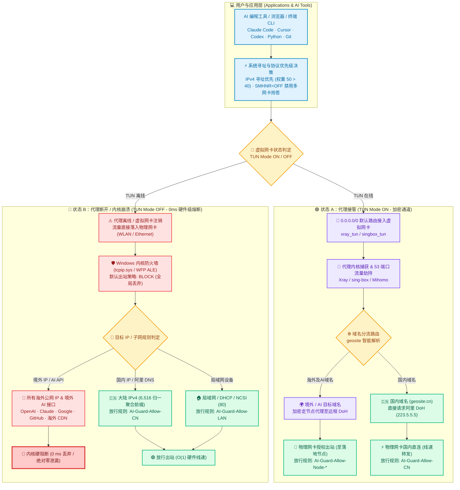
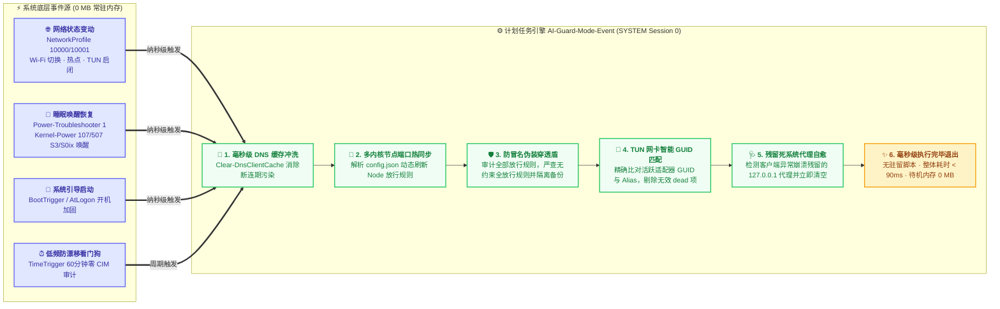
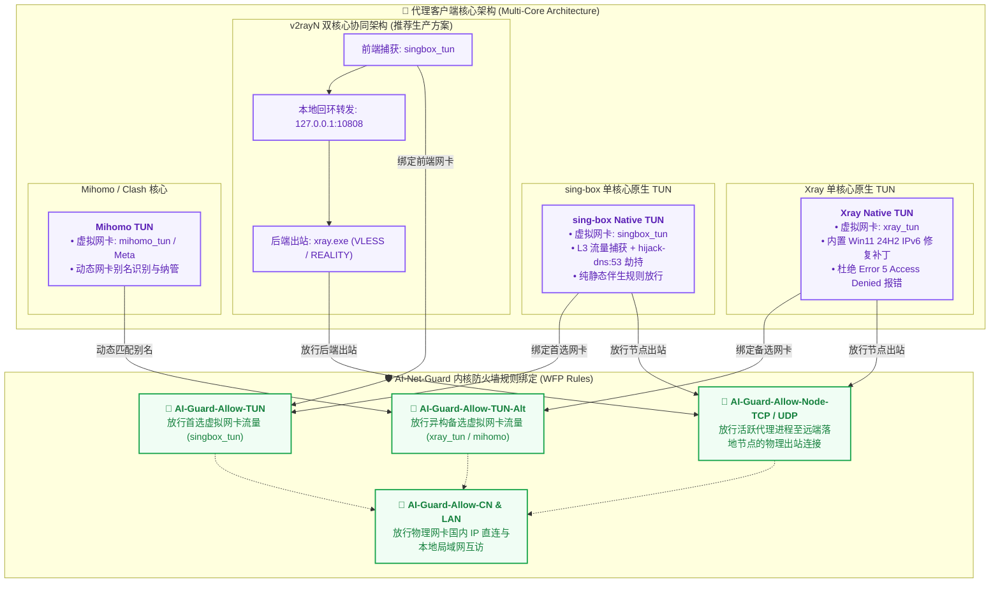

<p align="center">
  <h1 align="center">🛡️ AI-Net-Guard</h1>
  <p align="center">
    <b>Windows 11 / 10 原生单文件配置中心 · 内核级 WFP 静态防护盾 · 绝对零泄漏 DNS/IPv6 熔断器</b>
  </p>
  <p align="center">
    <i>为 AI 编程智能体 (Claude Code · Cursor · Codex · Open-Interpreter) 与 TUN 代理模式量身打造的零驻留系统级安全护航底座</i>
  </p>
  <p align="center">
    <a href="./README.md"><b>简体中文</b></a> | <a href="./README_EN.md"><b>English</b></a>
  </p>
  <p align="center">
    <a href="https://github.com/YOIMIYA66/AI-Net-Guard/releases/latest"></a>
    <a href="https://github.com/YOIMIYA66/AI-Net-Guard/actions/workflows/ci.yml"></a>
    <a href="./LICENSE"></a>
    <a href="https://github.com/YOIMIYA66/AI-Net-Guard"></a>
    <a href="https://github.com/YOIMIYA66/AI-Net-Guard"></a>
    <a href="https://github.com/YOIMIYA66/AI-Net-Guard/releases"></a>
    <a href="./12-regression.ps1"></a>
  </p>
</p>

<p align="center">
  <a href="#-快速上手-quick-start-推荐-gui-桌面端">🚀 快速上手</a> •
  <a href="#-核心设计与痛点对比-why-ai-net-guard">💡 核心痛点与对比</a> •
  <a href="#-系统全景架构与数据流-architecture--data-path">📐 全景架构图解</a> •
  <a href="#-15-项可配置防护策略与特性矩阵-feature-matrix">🎛️ 15项防护策略</a> •
  <a href="#-核心特性深度解析-key-features">⚡ 核心技术特性</a> •
  <a href="#-日常维护与常用命令">🛠️ 常用运维命令</a> •
  <a href="#-工程源码与脚本索引">📚 全工程脚本索引</a>
</p>

---

## 💡 核心设计与痛点对比 (Why AI-Net-Guard?)

在 Windows 环境下使用 AI 编程助手与命令行智能体（如 `Claude Code`、`Cursor`、`Codex`、`Gemini CLI`、`Python` 脚本及海外浏览器）配合 TUN 代理（`v2rayN` / `Xray` / `sing-box` / `Mihomo`）时，往往面临三大致命网络安全风险与日常痛点：

1. **TUN 崩溃 / 节点切换静默漏球**：Windows 底层物理网卡（Wi-Fi / Ethernet）的默认路由 `0.0.0.0/0` 始终存在。一旦代理内核偶发崩溃或切换节点，网络请求在 **0 毫秒** 内悄无声息地回退至真实运营商 IP 直连，导致海外服务账号被封控或敏感代码流量泄露。
2. **多宿主并行 DNS 污染 (`SMHNR`)**：Windows 默认开启智能多宿主解析，向物理网卡与虚拟网卡**并发抢答** DNS，明文查询直奔物理网卡；断网或休眠唤醒后产生脏缓存死锁。
3. **防火墙假闭环与规则漂移**：单纯开启系统防火墙的 `DefaultOutboundAction=Block` 无法防御 Windows 内置的约 180 条全局放行规则，更无法防御第三方软件安装时私自添加的未受限 Allow 规则。

### 📊 传统 TUN 代理 vs. AI-Net-Guard 护航方案对比

| 核心维度 | 传统 TUN 裸奔代理环境 ❌ | AI-Net-Guard v5.7 护航环境 🛡️ | 底层技术实现原理 |
| :--- | :--- | :--- | :--- |
| **代理崩溃 / TUN 断开** | 瞬间降级物理网卡直连，**真实 IP 暴露，API 访问漏球** | **0 ms 硬件级内核硬阻断**，仅保留国内与局域网直通 | Windows 内核 WFP ALE 丢弃一切非白名单物理出站 |
| **DNS 泄漏与抢答** | 物理网卡与 TUN 并发广播明文 DNS，运营商完全可见 | **物理明文 DNS 绝对归零**，锁定 `223.5.5.5` + 禁用 SMHNR | 禁用并行 DNS、禁用 LLMNR/NetBIOS、DoH 加密解析 |
| **IPv6 绕过漏洞** | 运营商 IPv6 绕过 IPv4 TUN 直出公网，真实 IPv6 暴露 | **物理网卡 IPv6 绑定彻底切断**，IPv4 前缀优先级提权 | 禁用物理 `ms_tcpip6`，前缀权重提升（50 > 40） |
| **后台资源开销** | 依赖第三方常驻 Guard 守护进程，占用 50~150 MB 内存 | **0 个常驻后台进程 · 0 MB 待机内存 · 0% 待机 CPU** | 纳秒级 Windows Event Log 原生事件驱动，跑完即退 |
| **双核心架构延迟** | TUN 与后端内核产生内部回环中继，增加 CPU 与延时 | **端到端物理直出**，消除二跳回环中继 | 动态注入物理网卡高优先级 `/32` 主机路由（LPM 机制） |
| **防冒名伪装穿透** | 任何软件均可添加 `interfacetype=any` 规则绕过防御 | **结构体白名单强校验**，无约束规则立即隔离 | 注册表单遍深度审计，识别并隔离伪装 Allow 规则 |
| **日常使用体验** | 开关代理需频繁配置，休眠唤醒后经常网络瘫痪 | **全生命周期无感自动自愈**，开箱即用免运维 | 毫秒级网络/电源事件感知，自动冲洗 DNS 与代理状态 |

---

## 📐 系统全景架构与数据流 (Architecture & Data Path)

AI-Net-Guard 采用 **Windows 内核态静态规则（WFP ALE 过滤）+ 零常驻事件驱动自愈** 的高韧性双层架构。

### 1. 双态流量分流与内核硬阻断架构 (Fail-Closed Data Path)

无论系统处于代理正常开启状态，还是代理崩溃断开的瞬间，内核态流控均能在 **0 ms** 内自适应生效：



---

### 2. 零常驻事件驱动引擎生命周期 (Zero-Resident Event Engine)

不需要任何 `while ($true)` 循环后台进程，平时 **0 MB 内存、0% CPU**。完全由 Windows 内核事件触发纳秒级唤醒，在后台安全 Session 0 执行毫秒级自愈后即刻退出：



---

### 3. 多内核代理架构兼容矩阵 (Multi-Core Compatibility Matrix)

无论是原生单核心，还是 v2rayN 经典的 sing-box + Xray 双核心分流方案，AI-Net-Guard 均能自动识别并精准绑定：



---

## 🚀 快速上手 (Quick Start)

### 选项 A：原生 GUI 桌面配置中心 (强烈推荐 ⭐)

无需安装任何运行时，免配环境变量，双击即用：

1. **下载程序**：前往 [Releases 页面](https://github.com/YOIMIYA66/AI-Net-Guard/releases/latest) 下载 `AI-Net-Guard.exe`（桌面端）或 `AI-Net-Guard-portable.zip`（全套脚本便携包）以及 `Emergency-Rescue.bat`。
2. **启动配置中心**：双击运行 `AI-Net-Guard.exe`（触发一次 UAC 管理员授权）。
3. **环境全自动探测**：GUI 会自动识别系统的 `v2rayN` 安装路径、正在运行的代理内核（`Xray` / `sing-box` / `Mihomo`）以及当前活跃的 TUN 虚拟网卡。
4. **一键部署 / 应用配置**：
   - 默认采用 **🌟 推荐日常防御预设**（14 项推荐防护全部开启，严格全局 NRPT DoH 保持关闭）。
   - 点击 **「🚀 一键部署 / 应用当前配置」**，程序将在 1~2 秒内自动捕获网络基线、安全部署规则引擎至 `C:\AI-Net-Guard`、注入高韧性 ACL 并激活系统事件监控。
5. **GUI 便捷维运按钮**：
   - **🛟 应急脱困 (Emergency Rescue)**：突发断网或配置异常时，一键瞬间清除防火墙出站阻断、重置网卡 DNS 为 DHCP、清空回环代理并冲洗 Winsock，5 秒内恢复上网。
   - **一键健康体检**：自动执行 24 项端到端内核与网络全回归测试（包含 10 秒实机 `pktmon` DNS 抓包）。
   - **立即同步**：在客户端切换代理节点后，一键实时探测并放行新落地节点 IP 与端口。
   - **一键关闭系统代理**：清理注册表中残留的 `127.0.0.1` 代理，实现“仅开关 TUN 即可控制全局流量”的纯粹体验。
   - **一键完整卸载**：完整还原 Windows 原始防火墙、DNS、IPv6、前缀表、时间服务与计划任务。

> [!TIP]
> **零依赖离线脱困工具 (`Emergency-Rescue.bat`)**：随 `AI-Net-Guard.exe` 一并提供并自动解压在 `C:\AI-Net-Guard\Emergency-Rescue.bat`。这是一个纯原生纯文本批处理脚本，双击自动自提权，在不依赖任何 PowerShell 运行时的极端环境下也能彻底脱困并恢复原始网络。

---

### 选项 B：CLI 命令行自动化部署 (极客运维方案)

提供完整的 45 分钟自动回滚安全网，适合 DevOps、无界面自动化及资深用户：

<details>
<summary><b>点击展开 CLI 部署详细步骤与指令</b></summary>

1. **部署工作目录**（打开管理员 PowerShell `Win + X -> Terminal (Admin)`）：
   ```powershell
   Copy-Item -Path .\AI-Net-Guard -Destination C:\AI-Net-Guard -Recurse -Force
   cd C:\AI-Net-Guard
   ```

2. **启动代理软件**：开启 `v2rayN` 并勾选开启 TUN 模式，随后执行只读巡检审计：
   ```powershell
   .\00-audit.ps1
   .\04-wfp-audit.ps1
   ```

3. **Step 1 — 核心基线与 DNS/IPv6/SMHNR 加固**（自动备份原始基线至 `backup\baseline.json`）：
   ```powershell
   .\01-dns-hardening.ps1
   ```

4. **Step 2 — 安装内核防火墙规则并挂载 45 分钟自动回滚安全网**：
   ```powershell
   .\02-killswitch.ps1 -RollbackMinutes 45
   ```

5. **Step 3 — 验证出站通道并正式固化**（验证通过后注销回滚定时器并注册零常驻事件任务）：
   ```powershell
   .\03-verify.ps1 -WfpCheck
   .\08-commit.ps1
   ```

6. **Step 4 — 锁定生产目录 ACL 权限并执行 24 项全回归测试**：
   ```powershell
   .\13-harden-acl.ps1
   ```

</details>

---

## 🎛️ 15 项可配置防护策略与特性矩阵 (Feature Matrix)

在 GUI 配置中心中，所有 15 项功能均支持可视化勾选，并在点击「一键部署」时幂等生效；用户亦可随时通过 `backup\guard-policy.json` 进行自动化编排：

| 策略分类 | 策略键值 (Key) | 功能名称 | 默认状态 | 业务与安全白话释义 | 关闭时的行为 |
| :--- | :--- | :--- | :---: | :--- | :--- |
| **1. 流量与防火墙** | `AllowCnDirect` | **中国大陆 IPv4 直连白名单** | 🟢 **ON** `[推荐]` | 国内网站与应用满速直连，仅拦截境外直连；**关代理时国内访问丝滑不断网**。 | 切换为严格全局铁桶模式（TUN 断开时国内网络亦全部切断）。 |
| **1. 流量与防火墙** | `AllowLan` | **局域网设备互访 (LocalSubnet)** | 🟢 **ON** `[推荐]` | 允许访问同一局域网下的 NAS、打印机、智能家居、投屏与路由器后台。 | 禁用 `AI-Guard-Allow-LAN` 规则（物理网卡彻底隔离本地子网）。 |
| **1. 流量与防火墙** | `AllowNcsi` | **Windows 联网状态图标探测放行** | 🟢 **ON** `[推荐]` | 仅放行微软联网检测探针（`13.107.4.52:80`），防止任务栏误报“无网络小地球”。 | 禁用 `AI-Guard-Allow-NCSI` 规则。 |
| **1. 流量与防火墙** | `QuarantineRogueAllow` | **自动隔离第三方软件出站放行规则** | 🟢 **ON** `[推荐]` | 深度检测第三方软件私自添加的未受限 Allow 规则并自动隔离；含防前缀冒名检测。 | 停止后台漂移规则自动隔离，并恢复被动态隔离的外部规则。 |
| **2. DNS 泄漏防护** | `LockPhysicalDns` | **锁定物理网卡静态 DNS (`223.5.5.5`)** | 🟢 **ON** `[推荐]` | 杜绝运营商 DHCP 劫持；开代理走加密 TUN DoH，关代理安全解析国内网站。 | 从备份恢复物理网卡原始 DHCP 自动获取或自定义 DNS。 |
| **2. DNS 泄漏防护** | `DisableSmhnr` | **禁用智能多宿主并行 DNS (`SMHNR`)** | 🟢 **ON** `[推荐]` | 阻止 Win11 在开启代理时向物理网卡和虚拟网卡并发抢答 DNS，物理明文查询归零。 | 恢复 Windows 默认并行 DNS 抢答行为。 |
| **2. DNS 泄漏防护** | `DisableLlmnrNetbios` | **禁用局域网多播/广播解析 (LLMNR)** | 🟢 **ON** `[推荐]` | 防止域名查询泄漏到局域网，免疫局域网同名欺骗劫持攻击。 | 恢复默认局域网多播与 NetBIOS 设置。 |
| **2. DNS 泄漏防护** | `StrictNrptDoh` | **严格全局 DoH 强制加密 (`NRPT`)** | ⚪ **OFF** `[高级]` | 强制全系统所有域名仅走 `1.1.1.1` DoH；**注意：关代理后国内也将无法解析域名**。 | 移除 `AI-Guard*` NRPT 策略规则，恢复标准解析。 |
| **3. IPv6 与双栈** | `DisablePhysicalIpv6` | **禁用物理网卡 IPv6 协议栈绑定** | 🟢 **ON** `[推荐]` | 彻底堵死应用通过运营商原生 IPv6 绕过 IPv4 TUN 直连海外的漏洞（含热插拔网卡）。 | 恢复物理网卡 `ms_tcpip6` 绑定。 |
| **3. IPv6 与双栈** | `PreferIpv4Prefix` | **提升 IPv4 寻址优先级高于 IPv6** | 🟢 **ON** `[推荐]` | 优先请求 IPv4，彻底消除 Python / Git / CLI 每次请求前等待 IPv6 超时的 2~5 秒卡顿。 | 恢复原始 `DisabledComponents` 注册表值与路由前缀表权重。 |
| **4. 自愈与安全基座** | `ZeroResidentMonitor` | **零内存事件触发与睡眠唤醒自愈** | 🟢 **ON** `[推荐]` | 平时 **0 进程、0 MB 内存**；仅在网络切换、开机、睡眠唤醒时毫秒级自检并清空污染 DNS。 | 注销计划任务，仅保留静态防火墙规则。 |
| **4. 自愈与安全基座** | `AutoNodeSync` | **多内核节点与端口自动热同步** | 🟢 **ON** `[推荐]` | 在 `v2rayN` 切换节点、端口跳跃或更换内核时自动放行新节点，无需手动干预。 | 冻结当前节点放行规则，停止自动跟踪 `config.json`。 |
| **4. 自愈与安全基座** | `AutoHealStaleProxy` | **断电/崩溃残留死系统代理自动清理** | 🟢 **ON** `[推荐]` | 代理异常崩溃后自动清理失效的 `127.0.0.1` 系统代理，避免开机后网页全挂。 | 不自动清理失效的 `HKCU` 系统代理。 |
| **4. 自愈与安全基座** | `DomesticNtp` | **国内高可用时间同步加固** | 🟢 **ON** `[推荐]` | 设置阿里/腾讯/中科院授时，防止电脑长时间睡眠后时钟偏差导致 VLESS 握手死锁。 | 恢复备份的原始 Windows 时间服务器地址。 |
| **4. 自愈与安全基座** | `HardenInstallAcl` | **安装目录防篡改权限锁定 (`ACL`)** | 🟢 **ON** `[推荐]` | 将 `C:\AI-Net-Guard` 锁定为管理员只写，防止普通程序篡改白名单或借任务提权。 | 执行 `13-harden-acl.ps1 -Undo` 恢复默认目录继承权限。 |

---

## ⚡ 核心特性深度解析 (Key Features)

- **100% 静态内核态数据路径 (`0 ms` 切换，`~0%` CPU 损耗)**：
  - 基于 Windows 状态化 WFP ALE 流缓存。包含 6,516 个中国大陆聚合网段的 `AI-Guard-Allow-CN` 规则仅在首次 TCP SYN / 握手数据包时进行哈希匹配（耗时 `< 0.01 ms`），建立连接后的后续海量数据包全部由内核在 `O(1)` 时间复杂度下硬件线速转发。
  - 开关 TUN 代理不需要对防火墙规则进行任何增删修改，即便后台没有任何 PowerShell 进程运行，防御熔断依然绝对生效。
- **零常驻事件驱动引擎 (`0 MB` 待机内存)**：
  - 彻底抛弃低效的 `while ($true)` 轮询脚本。通过 Windows Task Scheduler 深度订阅内核事件：`NetworkProfile`（网络连接/断开事件 `10000/10001`）、系统引导 `BootTrigger`、以及 **S3 睡眠 / 休眠 / 现代待机 (`S0ix`) 唤醒**（`Power-Troubleshooter 1`、`Kernel-Power 107/507`）。
  - 在健康快路径下单次运行耗时仅约 **90 ms**，跑完立即释放全部内存退出。
- **防冒名伪装穿透盾 (Anti-Impersonation Outbound Shield)**：
  - 针对 Windows 防火墙存在的“外部脚本可私自添加未受限 Allow 规则”漏洞，设计了单遍结构体白名单校验算法。即使未授权规则被恶意赋予了 `AI-Guard-*` 前缀，只要其缺少目标 IP 约束（`RA4/RA6`）、网卡接口（`IF`）或程序白名单（`App`），均会被立即判定为非法规则并强制隔离至备份归档。
- **端到端物理直出与消除双核内部二跳 (0 Double-Hop Relay)**：
  - 在 `sing-box` (TUN 前端) + `Xray` (REALITY 后端) 双核心架构下，自动向物理网卡注入高优先级 `/32` 主机明细路由，利用 Windows 内核最长掩码匹配（LPM）机制，强制 Xray 出站 Socket 绕过 `singbox_tun` 虚拟网卡直接从物理网卡直连远端节点，彻底消除了虚拟网卡内的二次 CPU 开销与多余延迟。
- **全多核心节点热同步 (Multi-Core Auto-Sync)**：
  - 自动定位 `v2rayN` 运行环境，同时解析 **Xray**（`outbounds[].protocol`、`vnext`、`servers`、`peers`）与 **sing-box**（`outbounds[].type`、`server`、`server_port` 以及 Hysteria2 端口跳跃范围 `"20000:30000"`）。
  - 自动将目标进程动态绑定至活跃核心（`xray.exe` / `sing-box.exe` / `mihomo.exe`），并通过智能适配器 GUID/别名多级匹配放行异构网卡。
- **Win11 24H2 Xray TUN 核心修复与环境加固**：
  - 针对 Windows 11 24H2 内核变更导致 Xray Wintun 报错 `Error 5: Access is denied` 的深坑，深度集成了内核驱动级的接口 DNS 初始化修复，保证 Xray 原生 TUN 稳定拉起。
  - 内置一键关闭 Windows 11 后台高频遥测服务（`DiagTrack`）脚本，彻底消除微软遥测直连海外 IP 触发防火墙拦截产生的 `connectex 10013` 权限报错。
- **权限防篡改加固与 24 项端到端全回归测试套件**：
  - 生产目录 `C:\AI-Net-Guard` 权限锁定为 `owner=Administrators`、`Administrators/SYSTEM=Full`、`Users=Read+Execute`，杜绝未提权进程篡改白名单或劫持任务。
  - 完整回归测试套件 [`12-regression.ps1`](./12-regression.ps1) 覆盖 24 项系统不变量测试，包含实机 10 秒 `pktmon` 端口 53 抓包校验（`phys_attempts=0, escaped=0`）、WFP 状态审计、直连 Socket 漏球探测等。

---

## 🛠️ 日常维护与常用命令

一旦安装部署完成，日常使用**完全无需人工干预**——切换节点、切换代理核心、插拔 USB 网卡或休眠唤醒均全自动接管。

```powershell
# ==============================================================================
# 1. 普通用户 / IDE 终端日常只读检查 (免 UAC 管理员提权)
# ==============================================================================
cd C:\AI-Net-Guard
.\07-mode.ps1 -Status                # 秒级输出防御健康状态、活跃 TUN 适配器、DNS 护盾与 ACL 权限
.\10-sync-node-rule.ps1 -WhatIfOnly  # 预检预览 v2rayN 当前配置中的节点 IP、端口与核心路径

# ==============================================================================
# 2. 管理员终端维护命令 (PowerShell 以管理员身份运行)
# ==============================================================================
.\07-mode.ps1                        # 立即执行一次健康检查与自愈同步 (耗时 < 100ms)
.\12-regression.ps1                  # 运行完整的 24 项自动化回归测试套件 (包含实机抓包)
.\13-harden-acl.ps1 -SyncWorkspace   # 从 Git 仓库同步最新核心脚本至生产目录并重新加固 ACL
.\09-rollback.ps1                    # 完整卸载防护，还原 Windows 原始出厂网络与防火墙基线
```

### 💡 针对特定第三方软件放行出站规则

若需要长期允许特定的第三方开发工具或自建服务直连海外，可在 `C:\AI-Net-Guard\backup\allowed-outbound-rules.json` 中配置豁免白名单：

```json
[
  "My-Custom-App-Rule",
  "Tailscale-Outbound-Allow"
]
```

---

## 📚 全工程脚本与组件索引

| 脚本文件 | 功能定位与技术细节说明 |
| :--- | :--- |
| [`00-audit.ps1`](./00-audit.ps1) | 系统只读状态快照（网卡列表、静态路由、DNS 设置、IPv6 前缀策略、NTP、防火墙配置文件与客户端配置） |
| [`01-dns-hardening.ps1`](./01-dns-hardening.ps1) | 设置物理网卡静态 `223.5.5.5`、切断物理 IPv6 绑定、提升 IPv4 前缀优先级、关闭 LLMNR/NetBIOS/SMHNR、设置国内高可用 NTP |
| [`02-killswitch.ps1`](./02-killswitch.ps1) | 导出 `.wfw` 原始备份与活跃规则，部署 `AI-Guard-*` 静态规则集，开启 `DefaultOutboundAction=Block`，挂载 45 分钟自动回滚安全网 |
| [`03-verify.ps1`](./03-verify.ps1) | 出站通道与数据路径多维验证（`Proxy=$null` 内核直接探测、`-WfpCheck` WFP 过滤树检查、交互式断网测试） |
| [`04-wfp-audit.ps1`](./04-wfp-audit.ps1) | 导出系统底层 WFP Filters，审计 Xray 的动态 `permit Xray` / `block DNS` 过滤器，支持 `pktmon` 抓包排查 |
| [`05-xray-direct-test.ps1`](./05-xray-direct-test.ps1) | 深度验证 Xray 在 `geosite:cn -> direct` 分流规则下的 `ALE_AUTH_CONNECT` 内核放行行为 |
| [`06-boot-guard.ps1`](./06-boot-guard.ps1) | 跨重启安全网（在重启演练前 `-Arm` 预警，验证自启恢复正常后 `-Remove` 移除） |
| [`07-mode.ps1`](./07-mode.ps1) | **核心调度中枢**：零常驻事件处理、多内核节点热同步、防冒名穿透规则隔离、SMHNR/LLMNR 自愈、死系统代理清理、免提权 `-Status` 查询 |
| [`08-commit.ps1`](./08-commit.ps1) | 固化保护配置：校验所有不变量、注销 45 分钟回滚定时器、正式向系统注册 `AI-Guard-Mode-Event` 与 `Fallback` 计划任务 |
| [`09-rollback.ps1`](./09-rollback.ps1) | 完整复原卸载：还原 Windows 原始出厂防火墙规则集、恢复被隔离的规则、还原 DNS/IPv6/前缀表/NTP，注销全部计划任务 |
| [`10-sync-node-rule.ps1`](./10-sync-node-rule.ps1) | 手动 / 预检（`-WhatIfOnly`）多内核节点与端口防火墙规则同步工具 |
| [`11-geo-cn.ps1`](./11-geo-cn.ps1) | 零内存分配 Protobuf 流式解析器：解析 `geoip.dat`，完成 CIDR 归一化聚合为包含 6,516 行的 [`cn-ipv4.txt`](./cn-ipv4.txt) |
| [`12-regression.ps1`](./12-regression.ps1) | **24 项自动化回归测试套件**：覆盖静态规则、ACL 权限、0 MB 内存特征、TUN 启闭熔断、WFP 注入、10 秒真实 `pktmon` DNS 抓包 |
| [`13-harden-acl.ps1`](./13-harden-acl.ps1) | 生产目录 ACL 权限防篡改锁定（支持 `-Undo` 权限还原与 `-SyncWorkspace` 源码目录热同步） |
| [`14-apply-policy.ps1`](./14-apply-policy.ps1) | **声明式策略编排器**：读取 `backup\guard-policy.json` 实现 15 项特性的增量幂等应用 |
| [`Emergency-Rescue.bat`](./Emergency-Rescue.bat) | 纯原生、无依赖、自带提权的离线一键网络应急脱困批处理脚本 |
| [`scripts/align-xray-egress.bat`](./scripts/align-xray-egress.bat) | 自动注入物理网卡高优先级 `/32` 主机路由，消除双核架构下的二跳中继开销 |
| [`scripts/run-disable-telemetry.bat`](./scripts/run-disable-telemetry.bat) | 一键关闭 Windows 11 遥测服务与遥测组策略，杜绝海外遥测 IP 拦截产生的 `connectex 10013` 报错 |
| [`gui/`](./gui) | 原生 C# WPF 桌面配置中心项目源码（基于 `.NET Framework 4.8`，单文件内嵌核心载荷与 UAC 清单） |

> 想要深入了解系统的架构演进与深层技术复盘，请参阅 [`CURRENT-IMPLEMENTATION.md`](./CURRENT-IMPLEMENTATION.md)。

---

## 🔒 已知安全边界与设计哲学 (Known Boundaries)

1. **TUN 关闭时所有境外流量均被默认丢弃**：这是系统的核心设计目标（Fail-Closed）。当代理断开时，包括 GitHub、Google、Steam 以及境外 AI API 均会被内核防火墙硬件级丢弃，国内流量与本地局域网不受任何影响。
2. **Xray 原生动态 WFP 过滤权限**：在开启 `autoSystemWfpBlockLeak` 时，Xray 会为自身进程安装 `ALE_AUTH_CONNECT` 深度过滤驱动。在此期间，Windows 防火墙严格监管除 Xray 以外的所有进程；Xray 自身流量则由其内部分流规则裁决。`sing-box` 则不加载此 WFP 覆盖层，完全由 AI-Net-Guard 规则严格约束。
3. **国内 IP 中转反代节点**：若使用的第三方 AI 代理服务部署在中国大陆公网 IP 上，其出站连接将匹配 `AI-Guard-Allow-CN` 规则直连放行。
4. **机场 / 酒店 Web 强制认证门户 (Captive Portals)**：部分公共网络强制跳转页面如果架设在境外 IP 或采用私有 DNS 劫持，可能需要在认证期间使用 `Emergency-Rescue.bat` 或 `09-rollback.ps1` 临时还原 DNS，认证完成后重新开启。

---

## 📄 开源许可证

本项目基于 [MIT License](./LICENSE) 协议开源。
