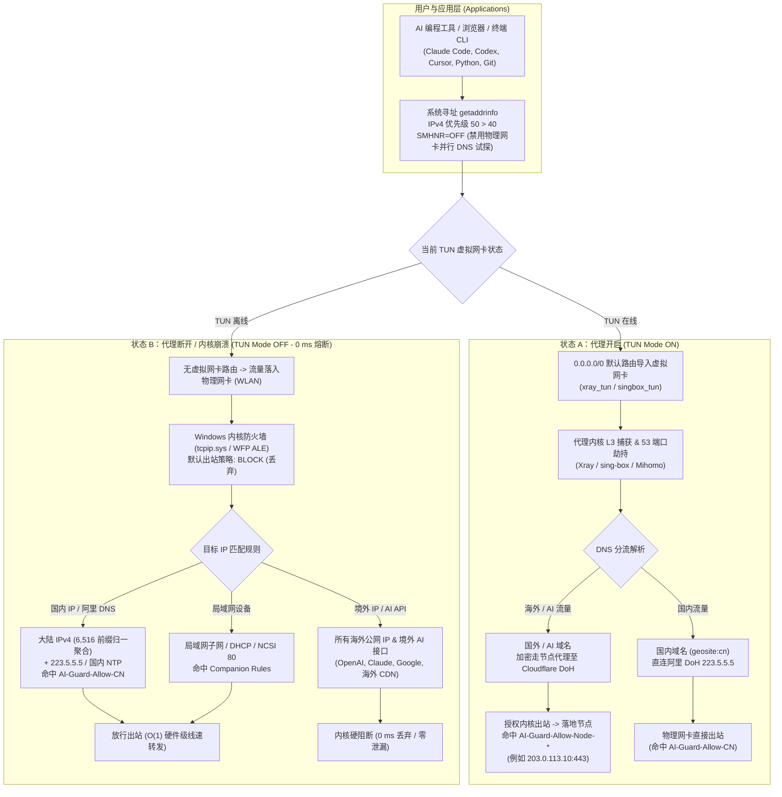
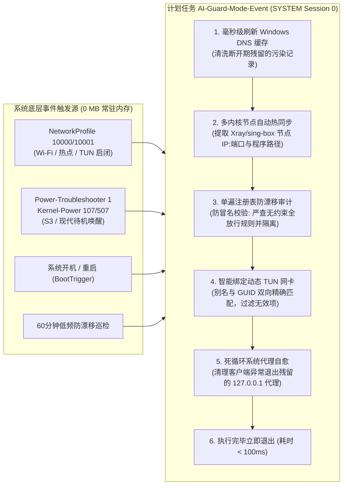
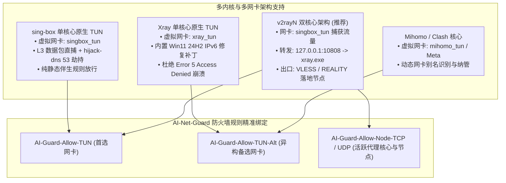

# AI-Net-Guard (v5.6.0)

**Windows 11 & 10 Native GUI Configurator, Standalone Single-File `.exe`, Kernel WFP Static Guard & DNS Leak Shield for AI Coding Tools & TUN Proxies**

> **Standalone Single-File Executable (`~260 KB`, 0 Runtime Install) · Dual-Core TUN Direct Egress Alignment (0 Double-Hop Relay) · Full Support for Xray / sing-box Single-Core & Dual-Core TUN · Windows 11 24H2 Wintun IPv6 Kernel Fix · Anti-Impersonation Outbound Shield · 4 Categories & 15 Feature Toggles · 0 MB Background Idle RAM · 0 ms TUN Switch Latency · Default-Deny Outbound + Mainland-China Direct Allowlist · Multi-Core Auto-Sync (`Xray` / `sing-box` / `Hysteria2` / `Mihomo`) · Reversible One-Click Rollback**

---

## Architecture & Data Path (系统架构与数据流分流图)

AI-Net-Guard 采用**内核态静态规则（WFP ALE）+ 零驻留事件驱动自愈**的双层架构。核心数据流逻辑如下图所示：

### 1. 双态流量分流与内核硬阻断架构 (Fail-Closed Data Path)



### 2. 零常驻事件驱动与自愈生命周期 (Zero-Resident Event Engine)

平时 **0 个常驻进程、0 MB 内存占用、0% 待机 CPU**。仅在操作系统底层网络变化或电源事件时纳秒级唤醒，跑完即退：



### 3. 多内核代理架构兼容矩阵 (Multi-Core Compatibility Matrix)

无论是单核心还是 v2rayN 经典的双核心分流架构，AI-Net-Guard 均能全自动识别并绑定对应的防火墙伴生规则：



---

## Quick Start (GUI Standalone `.exe` — Recommended)

No git clone or command line required:

1. **Download `AI-Net-Guard.exe`** from [GitHub Releases](https://github.com/YOIMIYA66/AI-Net-Guard/releases).
2. **Double-click `AI-Net-Guard.exe`** (Windows will prompt UAC once for Administrator privilege).
3. The modern Fluent GUI launches instantly:
   - Auto-detects your `v2rayN` path, running proxy core (`Xray` / `sing-box` / `Mihomo`), and active TUN interface.
   - Comes pre-configured with the **🌟 Recommended Daily Shield** preset (14 recommended protections ON, strict global NRPT DoH OFF).
4. Click **「🚀 一键部署 / 应用当前配置」** (Deploy / Apply Settings):
   - Automatically extracts and self-updates the kernel engine into `C:\AI-Net-Guard`.
   - Captures original network and firewall baselines, installs static rules, runs connectivity verification, and commits protection.
   - Locks `C:\AI-Net-Guard` ACL permissions to prevent privilege escalation.
5. **One-Click Actions in GUI**:
   - **🛟 应急脱困 (Emergency Rescue)**: Instantly unlocks all firewall outbound blocks, resets NIC DNS to DHCP, clears stale loopback proxies, and flushes Winsock to regain normal internet within seconds.
   - **一键健康体检**: Runs the full 23-check regression suite (including live 10-second `pktmon` DNS capture).
   - **立即同步**: Immediately detects and allows new proxy node IPs/ports when switching servers in `v2rayN`.
   - **一键关闭系统代理**: Clears `HKCU` WinINET loopback proxy with instant refresh so toggling `Enable Tun` alone controls all traffic.
   - **一键完整卸载**: Cleanly restores Windows default firewall, DNS, IPv6, prefix policy, NTP, and ACLs.
6. **Zero-Dependency Offline Rescue Tool (`Emergency-Rescue.bat`)**:
   - Distributed alongside `AI-Net-Guard.exe` and extracted to `C:\AI-Net-Guard\Emergency-Rescue.bat`.
   - Double-clickable pure batch tool that self-elevates to restore native Windows networking anytime without dependencies.

---

## 15 Configurable Feature Switches & Policy Matrix

| Category | Policy Key | Feature Name | Default / Badge | Plain Explanation | Behavior When Turned OFF |
| :--- | :--- | :--- | :--- | :--- | :--- |
| **1. Traffic & Firewall** | `AllowCnDirect` | **中国大陆 IPv4 直连白名单** | **ON** `[推荐开启]` | 国内网站/应用满速直连，仅拦截海外直连流量；关代理国内不断网。 | 切换为严格全局铁桶模式（TUN 断开时国内网亦全部阻断）。 |
| **1. Traffic & Firewall** | `AllowLan` | **局域网设备互访 (LocalSubnet)** | **ON** `[推荐开启]` | 允许访问同一路由器下的 NAS、打印机、投屏与路由器后台。 | 禁用 `AI-Guard-Allow-LAN` 规则（彻底隔离本地子网）。 |
| **1. Traffic & Firewall** | `AllowNcsi` | **Windows 联网状态图标探测放行** | **ON** `[推荐开启]` | 仅放行微软联网检测探针（`13.107.4.52:80`），防止任务栏误报“无网络小地球”。 | 禁用 `AI-Guard-Allow-NCSI` 规则。 |
| **1. Traffic & Firewall** | `QuarantineRogueAllow` | **自动隔离第三方软件出站放行规则** | **ON** `[推荐开启]` | 防止第三方应用或恶意脚本悄悄添加出站 Allow 规则架空拦截（卸载时原样恢复）。含防前缀冒名检测。 | 停止后台漂移规则自动隔离，并恢复被动态隔离的外部规则。 |
| **2. DNS Leak Shield** | `LockPhysicalDns` | **锁定物理网卡安全静态 DNS (`223.5.5.5`)** | **ON** `[推荐开启]` | 防止运营商 DHCP 劫持；开代理走加密 TUN DoH，关代理安全解析国内网站。 | 从备份恢复物理网卡原始 DHCP 自动获取或自定义 DNS。 |
| **2. DNS Leak Shield** | `DisableSmhnr` | **禁用智能多宿主并行 DNS (`SMHNR`)** | **ON** `[推荐开启]` | 阻止 Win11 在开启代理时向物理网卡和虚拟网卡并发抢答 DNS，物理明文查询归零。 | 恢复 Windows 默认并行 DNS 抢答行为。 |
| **2. DNS Leak Shield** | `DisableLlmnrNetbios` | **禁用局域网多播/广播解析 (LLMNR/NetBIOS)** | **ON** `[推荐开启]` | 防止域名查询泄漏到局域网，免疫局域网同名欺骗劫持攻击。 | 恢复默认局域网多播与 NetBIOS 设置。 |
| **2. DNS Leak Shield** | `StrictNrptDoh` | **严格全局 DoH 强制加密 (`NRPT 1.1.1.1`)** | **OFF** `[高级可选]` | 强制全系统所有域名仅走 `1.1.1.1` DoH；**注意：关代理后国内也将无法解析域名**。 | 移除 `AI-Guard*` NRPT 策略规则，恢复标准解析。 |
| **3. IPv6 & Dual-Stack** | `DisablePhysicalIpv6` | **禁用物理网卡 IPv6 协议栈绑定** | **ON** `[推荐开启]` | 彻底堵死应用通过运营商原生 IPv6 绕过 IPv4 TUN 直连海外的漏洞（含热插拔网卡）。 | 恢复物理网卡 `ms_tcpip6` 绑定。 |
| **3. IPv6 & Dual-Stack** | `PreferIpv4Prefix` | **提升 IPv4 寻址优先级高于 IPv6** | **ON** `[推荐开启]` | 优先请求 IPv4，彻底消除因等待 IPv6 超时导致的 Python / Git / CLI 每次请求前卡顿 2~5 秒。 | 恢复原始 `DisabledComponents` 注册表值与路由前缀表权重。 |
| **4. Self-Healing & Security** | `ZeroResidentMonitor` | **零内存事件触发与睡眠唤醒自愈** | **ON** `[推荐开启]` | 平时 **0 进程、0 MB 内存**；仅在网络切换、开机、睡眠唤醒时毫秒级自检并清空污染 DNS。 | 注销 `AI-Guard-Mode-Event` 与 `Fallback` 计划任务，仅保留静态规则。 |
| **4. Self-Healing & Security** | `AutoNodeSync` | **多内核节点与端口自动热同步** | **ON** `[推荐开启]` | 在 `v2rayN` 切换节点、端口跳跃或更换内核时自动放行新节点，无需手动干预。 | 冻结当前节点放行规则，停止自动跟踪 `config.json`。 |
| **4. Self-Healing & Security** | `AutoHealStaleProxy` | **断电/崩溃残留死系统代理自动清理** | **ON** `[推荐开启]` | 代理异常崩溃后自动清理失效的 `127.0.0.1` 系统代理，避免开机后网页全挂。 | 不自动清理失效的 `HKCU` 系统代理。 |
| **4. Self-Healing & Security** | `DomesticNtp` | **国内高可用时间同步加固** | **ON** `[推荐开启]` | 设置阿里/腾讯/中科院授时，防止电脑长时间睡眠后时钟偏差导致 VLESS 握手死锁。 | 恢复备份的原始 Windows 时间服务器地址。 |
| **4. Self-Healing & Security** | `HardenInstallAcl` | **安装目录防篡改权限锁定 (`ACL`)** | **ON** `[推荐开启]` | 将 `C:\AI-Net-Guard` 锁定为管理员只写，防止普通程序篡改白名单或借任务提权。 | 执行 `13-harden-acl.ps1 -Undo` 恢复默认目录继承权限。 |

---

## Why AI-Net-Guard?

When using AI coding assistants and CLI agents (`Claude Code`, `Codex`, `Cursor`, `Gemini CLI`, `Python` SDKs, browsers) alongside a Windows TUN proxy (`v2rayN` with `Xray` or `sing-box`), three failure modes routinely leak your real IP or plaintext DNS:

1. **TUN crash / node switch fallback**: Windows keeps the physical default route (`0.0.0.0/0` on Wi-Fi/Ethernet) alive beneath the TUN split routes. The millisecond `xray.exe` / `sing-box.exe` restarts or TUN drops, connections silently fall back to your ISP IP.
2. **Parallel Multi-Homed DNS (`SMHNR`) & Plaintext Resolvers**: By default, Windows `Dnscache` broadcasts DNS queries across **all** active interfaces simultaneously and falls back to LLMNR / NetBIOS / IPv6 AAAA when TUN transitions.
3. **Default-Allow Windows Firewall + Third-Party Rule Drift**: Simply setting `DefaultOutboundAction = Block` does **not** override Windows' ~180 built-in `Outbound Allow` rules—nor new `Outbound Allow` rules silently added later by third-party app installers.

**AI-Net-Guard v5.6** solves all three directly inside the Windows kernel (`tcpip.sys` / WFP) with **zero resident background scripts**:

- **TUN ON**: Traffic routes through `xray_tun` / `singbox_tun`; foreign AI traffic exits exclusively via your proxy node while domestic traffic routes directly according to your core rules.
- **TUN OFF (or core crashed)**: **0 ms kernel fail-closed switch**—mainland-China IPv4 traffic (`cn-ipv4.txt`, ~6,516 collapsed prefixes), LAN, and DHCP continue working normally at line rate, while **all foreign/AI direct egress is dropped by the kernel firewall**.

---

## Key Features (v5.6)

- **100% Static Kernel Datapath (`0 ms` switch, `~0%` CPU overhead)**:
  - Stateful WFP ALE flow cache evaluates the 6,516-prefix `AI-Guard-Allow-CN` rule only on the first SYN/handshake packet (`< 0.01 ms`), forwarding established flows in `O(1)`.
  - Toggling TUN ON/OFF requires **zero firewall rule mutations**. Protection holds even if zero PowerShell processes ever run.
- **Zero-Resident Event Architecture (`0 MB` idle RAM)**:
  - No `while ($true)` polling daemon. `AI-Guard-Mode-Event` wakes via native Windows Event Log subscriptions on `NetworkProfile` (`10000/10001`), system boot, and **S3 Sleep / Hibernate / Modern Standby (`S0ix`) resume** (`Power-Troubleshooter 1`, `Kernel-Power 107/507`), runs in ~90 ms (zero CIM/WMI loaded on healthy fast path), and exits immediately.
  - `AI-Guard-Mode-Fallback` performs a 60-minute zero-CIM anti-drift check (~90 ms).
- **Anti-Impersonation & Blanket Allow Shield (v5.6 Hardened)**:
  - Single-pass registry audit rigorously inspects every outbound Allow rule. Even if an unapproved rule masquerades with an `AI-Guard-*` prefix, if it lacks remote IP, interface, and application constraints (a blanket allow), it is immediately flagged and quarantined into `backup\auto-disabled-outbound-allow.json`.
- **Hands-Free Multi-Core Node Auto-Sync (`Xray` + `sing-box` / `Hysteria2` + `Mihomo`)**:
  - Automatically detects `v2rayN` installation paths (or `$env:V2RAYN_ROOT` / `-V2rayNRoot`) and parses both **Xray** (`outbounds[].protocol`, `vnext`, `servers`, `peers`) and **sing-box** (`outbounds[].type`, `server`, `server_port`, and Hysteria2 port-hopping ranges `"20000:30000"` -> `"20000-30000"`).
  - Dynamically binds `-Program` to the active core executable (`xray.exe` / `sing-box.exe` / `mihomo.exe`), authorizes alternate TUN adapters (`AI-Guard-Allow-TUN-Alt`) via smart GUID/alias matching, and resolves domain-based nodes over encrypted `https://223.5.5.5/resolve` (`Proxy=$null`) first.
  - **Full Support for Single-Core & Dual-Core TUN Architectures**:
    - **Xray Single-Core Native TUN** (`xray_tun`): Seamlessly integrates with the Win11 24H2 IPv6 `SetInterfaceDnsSettings` kernel fix and Xray's built-in WFP filter engine (`permit Xray` / `block DNS`).
    - **sing-box Single-Core Native TUN** (`singbox_tun`): Full compatibility with sing-box L3 packet capturing, direct whitelist routing, and user-space DNS hijacking (`hijack-dns` on port 53).
    - **sing-box + Xray Dual-Core TUN (v2rayN Default Architecture)**: Simultaneously authorizes `sing-box.exe` (capturing traffic on `singbox_tun`) and `xray.exe` (handling outbound VLESS / REALITY backend traffic to remote proxy nodes on `127.0.0.1:10808`), establishing seamless multi-core companion firewall rules (`AI-Guard-Allow-Core-SingBox-*` + `AI-Guard-Allow-Node-*`).
    - **Mihomo / Clash TUN** (`mihomo_tun` / `Meta`): Dynamic interface alias detection and companion rule authorization.
- **Complete DNS & IPv6 Leak Shield**:
  - Disables physical NIC IPv6 bindings (`ms_tcpip6`) including hot-plugged USB/tethering NICs, elevates IPv4 prefix precedence (`::ffff:0:0/96 = 50 > ::/0 = 40` + `DisabledComponents |= 0x20` to eliminate Python/CLI AAAA stalls), disables **LLMNR**, **NetBIOS**, and **Windows Smart Multi-Homed Name Resolution (`SMHNR`, `DisableSmartNameResolution = 1`)**, and ensures domestic-capable NTP (`ntp.aliyun.com`) to prevent VLESS+REALITY clock-skew deadlocks after sleep.
- **Privilege-Escalation Hardening & 23-Check Automated Regression Suite**:
  - [`13-harden-acl.ps1`](./13-harden-acl.ps1) locks `C:\AI-Net-Guard` ownership and DACL (`owner=Administrators`, `Administrators/SYSTEM=Full`, `Users=Read+Execute`) so unelevated processes cannot tamper with `SYSTEM`-scheduled scripts.
  - `.\07-mode.ps1 -Status` is non-elevated friendly—view your live protection posture instantly from any CLI or IDE terminal without UAC prompts.
  - [`12-regression.ps1`](./12-regression.ps1) verifies 23 end-to-end invariants including live `pktmon` port-53 packet capture (`phys_attempts=0, escaped=0`), WFP filter inspection, `Proxy=$null` direct socket probes, and corrupt `geoip.dat` rejection drills—automatically cleaning up temporary XML/ETL dumps on `PASS`.

---

## Requirements

- **OS**: Windows 11 (22H2 / 23H2 / 24H2+) or Windows 10 22H2
- **Shell**: Windows PowerShell `5.1` or PowerShell `7.x` (all 16 `.ps1` scripts are 100% pure ASCII and dual-engine tested)
- **Proxy Client**: `v2rayN` (7.x+) with `Xray`, `sing-box`, or `Mihomo` TUN mode enabled
  - *Tip*: If you want toggling the **Enable Tun** switch alone to block/unblock browser access to foreign AI sites without exiting `v2rayN`, set v2rayN's bottom system proxy mode to **Clear System Proxy** (`清除系统代理`).

---

## Quick Start (CLI Deployment with 45-Minute Auto-Rollback Net)

1. **Copy to `C:\AI-Net-Guard`** and open an **elevated PowerShell** (`Win + X` -> *Terminal (Admin)*):

   ```powershell
   Copy-Item -Path .\AI-Net-Guard -Destination C:\AI-Net-Guard -Recurse -Force
   cd C:\AI-Net-Guard
   ```

2. **Start `v2rayN` with TUN enabled**, then run the read-only pre-flight audit (optional):

   ```powershell
   .\00-audit.ps1
   .\04-wfp-audit.ps1
   ```

3. **Step 1 — DNS, IPv6, Prefix Policy, SMHNR & NTP Hardening** (records original baseline in `backup\baseline.json`):

   ```powershell
   .\01-dns-hardening.ps1
   ```

4. **Step 2 — Install Static Kernel Firewall & Arm 45-Minute Rollback Safety Net**:

   ```powershell
   .\02-killswitch.ps1 -RollbackMinutes 45
   ```

5. **Step 3 — Verify & Commit** (cancels the 45-minute auto-rollback timer once invariants pass and registers the zero-resident event tasks):

   ```powershell
   .\03-verify.ps1 -WfpCheck
   .\08-commit.ps1
   ```

6. **Step 4 — Lock Install Directory ACL & Run Full 23-Check Regression Suite**:

   ```powershell
   .\13-harden-acl.ps1
   ```

---

## Daily Usage & Maintenance Commands

Once installed and committed, **daily operation is completely hands-free**—switching proxy nodes, switching between `Xray` (VLESS/VMess/Trojan) and `sing-box` (Hysteria2/TUIC), plugging in USB/phone-tethering NICs, and waking from Modern Standby are all handled automatically.

```powershell
# Run in PowerShell (works non-elevated for read-only checks)
cd C:\AI-Net-Guard
.\07-mode.ps1 -Status                # Instant read-only status dashboard (TUN, core, rules, ACL, DNS shield, 0 MB footprint)
.\10-sync-node-rule.ps1 -WhatIfOnly  # Preview parsed node IP/ports/core from v2rayN config.json

# Run in Elevated PowerShell (Admin) for management
.\07-mode.ps1                        # Run an immediate zero-CIM health check / self-heal
.\12-regression.ps1                  # Run the full 23-check end-to-end regression suite (auto-cleans temp captures)
.\13-harden-acl.ps1 -SyncWorkspace   # Pull script updates from a git clone directory & re-lock ACLs
.\09-rollback.ps1                    # Completely uninstall & restore original firewall, DNS, IPv6, prefix policy & tasks
```

### Allowing Specific Third-Party Outbound Firewall Rules

To exempt specific third-party firewall rule names from automatic anti-drift quarantine, create `C:\AI-Net-Guard\backup\allowed-outbound-rules.json` containing a JSON string array of rule `Name` or `DisplayName` values:

```json
[
  "My-Approved-App-Rule"
]
```

---

## Repository Script Reference

| Script | Purpose |
| --- | --- |
| [`00-audit.ps1`](./00-audit.ps1) | Read-only system snapshot (NICs, routes, DNS, IPv6 prefix policy, NTP, firewall profiles/rules, proxy config) |
| [`01-dns-hardening.ps1`](./01-dns-hardening.ps1) | Sets static `223.5.5.5` physical DNS, disables physical IPv6, prefers IPv4 over IPv6, disables LLMNR/NetBIOS/SMHNR, ensures domestic NTP |
| [`02-killswitch.ps1`](./02-killswitch.ps1) | Backs up `.wfw` & active outbound Allow rules, installs `AI-Guard-*` static ruleset, enables `DefaultOutboundAction=Block`, arms 45-min rollback timer |
| [`03-verify.ps1`](./03-verify.ps1) | Configuration & datapath verification (`Proxy=$null` direct kernel probes, `-WfpCheck`, interactive `-FailClosedTest`) |
| [`04-wfp-audit.ps1`](./04-wfp-audit.ps1) | Exports WFP filters to inspect Xray's dynamic `permit Xray` / `block DNS` filters + optional `pktmon` port-53 capture |
| [`05-xray-direct-test.ps1`](./05-xray-direct-test.ps1) | Behavioral proof of Xray's `ALE_AUTH_CONNECT` WFP hard permit under `geosite:cn -> direct` routing |
| [`06-boot-guard.ps1`](./06-boot-guard.ps1) | Cross-reboot safety net (`-Arm` before reboot drill, `-Remove` after verifying persistence) |
| [`07-mode.ps1`](./07-mode.ps1) | **Core controller**: zero-resident guard check, multi-core auto node sync, anti-impersonation rogue Allow quarantine, SMHNR/LLMNR heal, dead proxy cleanup, `-Status` |
| [`08-commit.ps1`](./08-commit.ps1) | Verifies invariants, removes `AI-Guard-Test-Rollback`, and registers `AI-Guard-Mode-Event` + `AI-Guard-Mode-Fallback` |
| [`09-rollback.ps1`](./09-rollback.ps1) | Full baseline restoration with postcondition assertions (tasks, `.wfw`, quarantined rules, DNS, IPv6, prefix policy, NTP, LLMNR, SMHNR) |
| [`10-sync-node-rule.ps1`](./10-sync-node-rule.ps1) | Manual / preview (`-WhatIfOnly`) multi-core node & port rule synchronizer |
| [`11-geo-cn.ps1`](./11-geo-cn.ps1) | Zero-allocation protobuf parser for `geoip-only-cn-private.dat` / `geoip.dat` -> CIDR normalization & lossless aggregation into [`cn-ipv4.txt`](./cn-ipv4.txt) |
| [`12-regression.ps1`](./12-regression.ps1) | **23-check automated regression suite** (static state, ACL lock, 0-MB footprint, TUN on/off datapath, WFP, 10s `pktmon` DNS capture, corrupt GeoIP drill) |
| [`13-harden-acl.ps1`](./13-harden-acl.ps1) | Locks `C:\AI-Net-Guard` owner & DACL against non-admin tampering, runs elevated migration + regression (`-Undo` and `-SyncWorkspace` supported) |
| [`14-apply-policy.ps1`](./14-apply-policy.ps1) | **Idempotent policy orchestrator**: executes clean deploy or incremental 15-toggle reconfiguration from `backup\guard-policy.json` |
| [`scripts/align-xray-egress.bat`](./scripts/align-xray-egress.bat) | Self-elevating alignment utility to inject `/32` physical host route and eliminate dual-core double-hop relay |
| [`scripts/run-disable-telemetry.bat`](./scripts/run-disable-telemetry.bat) | Disables Windows 11 background telemetry services (`DiagTrack`, `AllowTelemetry = 0`) to prevent `connectex 10013` permission errors |
| [`gui/`](./gui) | Standalone Windows-native C# WPF GUI desktop configurator project (`net48`, embeds `payload.zip` + UAC manifest) |
| [`watchdog.ps1`](./watchdog.ps1) | Optional CLR `NetworkChange` event-driven resident daemon (disabled by default in favor of 0-MB `AI-Guard-Mode-Event`) |

For deep architectural notes and the engineering review log, see [`CURRENT-IMPLEMENTATION.md`](./CURRENT-IMPLEMENTATION.md).

---

## Known Security Boundaries

1. **All non-CN direct traffic is blocked when TUN is OFF**: GitHub, Google, Steam, and overseas CDNs are blocked alongside foreign AI endpoints whenever TUN is down (by design under `DefaultOutboundAction = Block` + `AI-Guard-Allow-CN`).
2. **Xray's Dynamic WFP Hard Permit (`permit Xray`)**: While `Xray` TUN is active with `autoSystemWfpBlockLeak`, Xray installs an `ALE_AUTH_CONNECT` filter with `FWPM_FILTER_FLAG_CLEAR_ACTION_RIGHT` for `xray.exe` itself. During TUN operation, Windows Firewall strictly governs **all non-Xray processes**, while `xray.exe`'s own direct vs. proxy split is governed by Xray's routing configuration (`sing-box` does not install this WFP override and is strictly bound by `AI-Guard-Allow-Node-*`). To constrain `xray.exe` externally even against a compromised config, enforce a router/gateway egress allowlist to your proxy node IP:port.
3. **Domestic-IP Relay Proxies**: Traffic sent to third-party API relays hosted on mainland-China IPv4 addresses matches `AI-Guard-Allow-CN` and is not blocked by GeoIP.
4. **Captive Portals**: Hotel/airport Wi-Fi portals using foreign public IPs or private hijacked DNS may require temporarily resetting NIC DNS or running `09-rollback.ps1` to complete portal login.

---

## License

Released under the [MIT License](./LICENSE).
