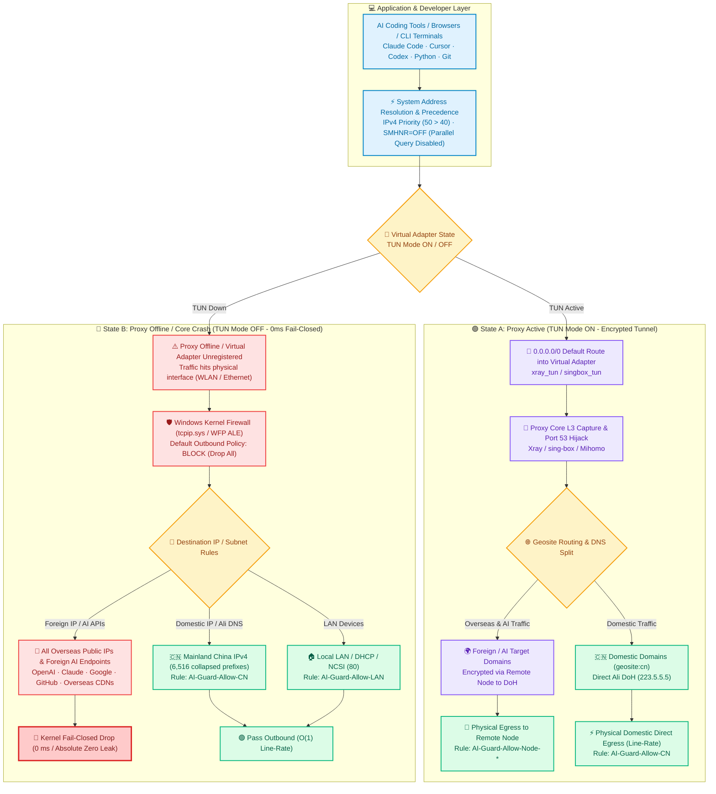
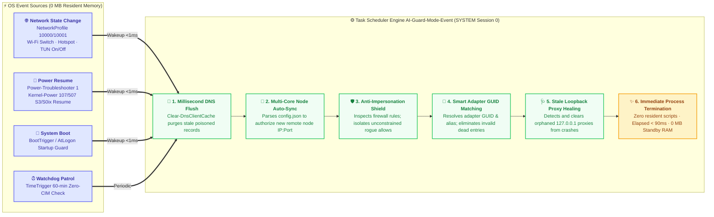
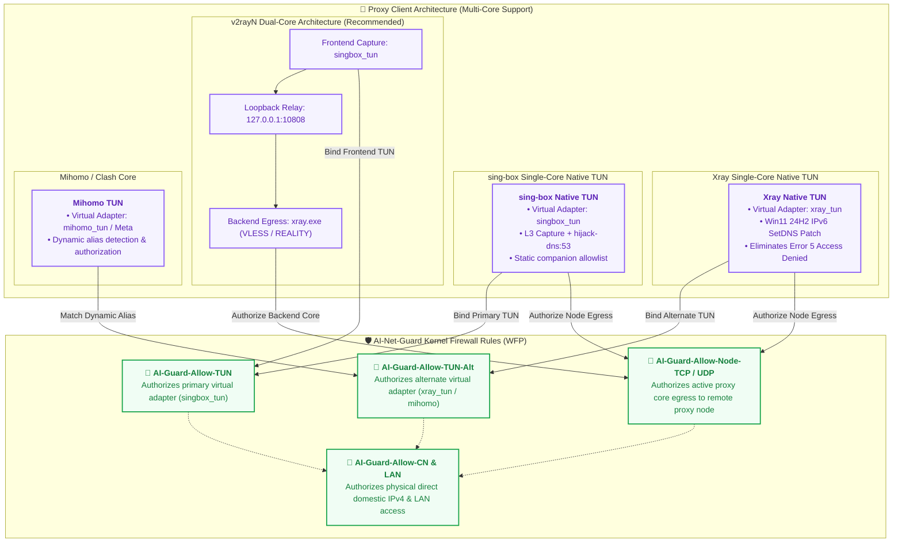

<p align="center">
  <h1 align="center">🛡️ AI-Net-Guard</h1>
  <p align="center">
    <b>Windows 11 / 10 Native Standalone GUI Configurator · Kernel WFP Static Guard · Zero-Leak DNS & IPv6 Kill-Switch</b>
  </p>
  <p align="center">
    <i>Engineered specifically for AI Coding Agents (Claude Code · Cursor · Codex · Open-Interpreter) and TUN Proxies with 0 MB Resident Daemon</i>
  </p>
  <p align="center">
    <a href="./README.md"><b>简体中文</b></a> | <a href="./README_EN.md"><b>English</b></a>
  </p>
  <p align="center">
    <a href="https://github.com/YOIMIYA66/AI-Net-Guard/releases/latest"></a>
    <a href="https://github.com/YOIMIYA66/AI-Net-Guard/actions/workflows/ci.yml"></a>
    <a href="./LICENSE"></a>
    <a href="https://github.com/YOIMIYA66/AI-Net-Guard"></a>
    <a href="https://github.com/YOIMIYA66/AI-Net-Guard"></a>
    <a href="https://github.com/YOIMIYA66/AI-Net-Guard/releases"></a>
    <a href="./12-regression.ps1"></a>
  </p>
</p>

<p align="center">
  <a href="#-quick-start-recommended-gui">🚀 Quick Start</a> •
  <a href="#-why-ai-net-guard-pain-points-solved">💡 Why AI-Net-Guard?</a> •
  <a href="#-architecture--data-path">📐 Architecture</a> •
  <a href="#-15-configurable-feature-switches--policy-matrix">🎛️ Feature Matrix</a> •
  <a href="#-key-technical-features">⚡ Key Features</a> •
  <a href="#-daily-usage--maintenance-commands">🛠️ Maintenance</a> •
  <a href="#-complete-repository-script-reference">📚 Script Index</a>
</p>

---

## 💡 Why AI-Net-Guard? (Pain Points Solved)

When pairing AI coding assistants and CLI agents (`Claude Code`, `Cursor`, `Codex`, `Gemini CLI`, Python SDKs, and overseas browsers) with Windows TUN proxy clients (`v2rayN`, `Xray`, `sing-box`, `Mihomo`), users routinely face three catastrophic leakage failure modes and operational headaches:

1. **TUN Crash / Node Switch Silent Fallback**: Windows keeps the physical default route (`0.0.0.0/0` on Wi-Fi/Ethernet) alive beneath the TUN split routes. The moment the proxy core restarts, drops connection, or switches nodes, traffic silently falls back to your raw physical ISP IP within **0 ms**, causing immediate foreign API risk control lockups or real IP leakage.
2. **Smart Multi-Homed Parallel DNS Leak (`SMHNR`)**: Windows `Dnscache` broadcasts DNS queries across **all** active network interfaces simultaneously. Unencrypted plaintext DNS queries leak directly onto physical adapters; disconnects or sleep wakeups cause stale cache deadlocks.
3. **Firewall False Sense of Security & Rule Drift**: Setting Windows Firewall `DefaultOutboundAction=Block` does **not** override Windows' ~180 built-in Outbound Allow rules—nor unapproved `Outbound Allow` rules silently injected by third-party installers.

### 📊 Standard TUN Proxy vs. AI-Net-Guard Posture Comparison

| Core Dimension | Traditional TUN Environment ❌ | AI-Net-Guard v5.6 Guarded 🛡️ | Underlying Mechanism |
| :--- | :--- | :--- | :--- |
| **Proxy Crash / TUN Drop** | Instant downgrade to physical ISP connection; **Real IP & API requests leak** | **0 ms hardware-level kernel fail-closed drop**; domestic and LAN remain intact | Windows Kernel WFP ALE drops all non-whitelisted physical outbound flows |
| **DNS Leak & Race** | Physical NIC and TUN concurrently broadcast plaintext DNS; ISP sees everything | **Zero plaintext DNS leakage**; locked to `223.5.5.5` + SMHNR disabled | Parallel DNS disabled, LLMNR/NetBIOS off, encrypted DoH in TUN |
| **IPv6 Bypass Hole** | ISP IPv6 bypasses IPv4 TUN directly onto the public internet; IPv6 exposed | **Physical IPv6 stack detached**; IPv4 precedence elevated (50 > 40) | Unbinds physical `ms_tcpip6`, disables parallel AAAA queries |
| **Background Overhead** | Requires third-party resident daemons consuming 50~150 MB RAM | **0 resident processes · 0 MB idle RAM · 0% idle CPU** | Nanosecond Windows Event Log OS hooks; runs and exits immediately |
| **Dual-Core Relay Lag** | TUN frontend and core backend produce internal loopback double-hops | **End-to-end direct physical egress**; 0 double-hop overhead | Injects `/32` LPM host routes directly to physical NIC |
| **Rogue Rule Drift** | Any installer can add `interfacetype=any` rules to punch holes | **Structural whitelist enforcement**; unconstrained rules quarantined | Single-pass registry audit detects and isolates rogue Allow rules |
| **User Experience** | Manual reconfiguration required; sleep wakeups freeze network | **Fully automatic self-healing**; zero maintenance | Millisecond event triggers auto-flush DNS cache & dead proxies |

---

## 📐 Architecture & Data Path

AI-Net-Guard adopts a high-resilience architecture combining **Stateful Kernel Static Filtering (WFP ALE)** and **Zero-Resident Event-Driven Self-Healing**.

### 1. Dual-State Fail-Closed Data Path

Whether the proxy is operating normally or crashes unexpectedly, kernel flow control adapts within **0 ms**:



---

### 2. Zero-Resident Event Engine Lifecycle

Requires no `while ($true)` looping scripts, keeping **0 MB memory and 0% CPU overhead** in standby. Wakes exclusively via native Windows Event Log subscriptions, finishes self-healing in Session 0 in milliseconds, and immediately exits:



---

### 3. Multi-Core Compatibility Matrix

Whether using single-core setups or v2rayN's classic sing-box + Xray dual-core architecture, AI-Net-Guard automatically binds appropriate firewall companion rules:



---

## 🚀 Quick Start (Recommended: GUI)

### Option A: Native GUI Desktop Configurator (Recommended ⭐)

Zero installation, zero runtime dependencies, single-click executable:

1. **Download**: Grab `AI-Net-Guard.exe` (desktop configurator) or `AI-Net-Guard-portable.zip` (full script bundle) and `Emergency-Rescue.bat` from [GitHub Releases](https://github.com/YOIMIYA66/AI-Net-Guard/releases/latest).
2. **Launch**: Double-click `AI-Net-Guard.exe` (prompts once for Administrator UAC).
3. **Automatic Detection**: Automatically identifies `v2rayN` root path, active proxy core (`Xray` / `sing-box` / `Mihomo`), and current active TUN adapter.
4. **Deploy**:
   - Comes preloaded with the **🌟 Recommended Daily Shield** preset (14 recommended protections ON, strict global NRPT DoH OFF).
   - Click **「🚀 一键部署 / 应用当前配置」** (Deploy Settings) to capture baselines, deploy the kernel engine to `C:\AI-Net-Guard`, lock down ACLs, and register system event monitors within seconds.
5. **Key GUI Utility Buttons**:
   - **🛟 应急脱困 (Emergency Rescue)**: Instantly unlocks all firewall outbound blocks, resets NIC DNS to DHCP, clears stale loopback proxies, and flushes Winsock within 5 seconds.
   - **一键健康体检 (Health Check)**: Runs the full 23-check regression suite (including live 10-second `pktmon` DNS capture).
   - **立即同步 (Sync Nodes)**: Dynamically extracts and authorizes new proxy node IPs/ports when switching servers in `v2rayN`.
   - **一键关闭系统代理 (Clear System Proxy)**: Clears `HKCU` WinINET loopback proxies so toggling TUN alone controls all traffic.
   - **一键完整卸载 (Full Uninstall)**: Reversibly restores default Windows firewall, DNS, IPv6, prefix policy, NTP, and ACLs.

> [!TIP]
> **Offline Rescue Utility (`Emergency-Rescue.bat`)**: Distributed alongside `AI-Net-Guard.exe` and extracted to `C:\AI-Net-Guard\Emergency-Rescue.bat`. A pure, self-elevating batch script that restores native Windows networking anytime without PowerShell dependencies.

---

### Option B: CLI Automation (DevOps & Headless Deployment)

Provides an integrated 45-minute automatic rollback safety net:

<details>
<summary><b>Click to expand CLI deployment commands</b></summary>

1. **Deploy Workspace** (Open an elevated PowerShell `Win + X -> Terminal (Admin)`):
   ```powershell
   Copy-Item -Path .\AI-Net-Guard -Destination C:\AI-Net-Guard -Recurse -Force
   cd C:\AI-Net-Guard
   ```

2. **Start Proxy**: Launch `v2rayN` with TUN enabled, then execute pre-flight audits:
   ```powershell
   .\00-audit.ps1
   .\04-wfp-audit.ps1
   ```

3. **Step 1 — Baseline Capture & DNS/IPv6/SMHNR Hardening**:
   ```powershell
   .\01-dns-hardening.ps1
   ```

4. **Step 2 — Install Static Firewall & Arm 45-Minute Rollback Timer**:
   ```powershell
   .\02-killswitch.ps1 -RollbackMinutes 45
   ```

5. **Step 3 — Verify Datapath & Commit Protection** (cancels rollback timer & registers event tasks):
   ```powershell
   .\03-verify.ps1 -WfpCheck
   .\08-commit.ps1
   ```

6. **Step 4 — Lock Directory ACLs & Run 23-Check Automated Regression Suite**:
   ```powershell
   .\13-harden-acl.ps1
   ```

</details>

---

## 🎛️ 15 Configurable Feature Switches & Policy Matrix

All 15 policies can be toggled visually in the GUI or orchestrated programmatically via `backup\guard-policy.json`:

| Category | Policy Key | Feature Name | Default | Plain Explanation | Behavior When Turned OFF |
| :--- | :--- | :--- | :---: | :--- | :--- |
| **1. Traffic & Firewall** | `AllowCnDirect` | **Mainland China IPv4 Allowlist** | 🟢 **ON** `[Rec.]` | Domestic sites route direct at line rate; overseas traffic blocked when TUN is down. Domestic internet never drops. | Enforces strict global fail-closed (all domestic traffic blocked when TUN drops). |
| **1. Traffic & Firewall** | `AllowLan` | **Local Subnet Sharing (LAN)** | 🟢 **ON** `[Rec.]` | Allows access to NAS, printers, routers, and local smart devices. | Disables `AI-Guard-Allow-LAN` (fully isolates local network). |
| **1. Traffic & Firewall** | `AllowNcsi` | **Windows NCSI Probe Allow** | 🟢 **ON** `[Rec.]` | Authorizes Microsoft probe (`13.107.4.52:80`) to avoid false "No Internet" globe icons. | Disables `AI-Guard-Allow-NCSI`. |
| **1. Traffic & Firewall** | `QuarantineRogueAllow` | **Rogue Outbound Allow Quarantine** | 🟢 **ON** `[Rec.]` | Detects and quarantines unconstrained third-party allow rules; includes anti-impersonation shield. | Stops auto-quarantine; restores previously isolated external rules. |
| **2. DNS Leak Shield** | `LockPhysicalDns` | **Lock Static Physical DNS (`223.5.5.5`)** | 🟢 **ON** `[Rec.]` | Prevents ISP DHCP DNS hijacking; resolves domestic names safely when proxy is off. | Restores original DHCP or custom DNS from backup. |
| **2. DNS Leak Shield** | `DisableSmhnr` | **Disable Parallel Multi-Homed DNS** | 🟢 **ON** `[Rec.]` | Stops Windows from racing queries across physical and virtual adapters simultaneously. | Restores default Windows parallel DNS racing behavior. |
| **2. DNS Leak Shield** | `DisableLlmnrNetbios` | **Disable Multicast Resolution (LLMNR)** | 🟢 **ON** `[Rec.]` | Prevents domain queries from leaking onto LAN; protects against spoofing attacks. | Restores default LLMNR and NetBIOS settings. |
| **2. DNS Leak Shield** | `StrictNrptDoh` | **Strict Global DoH Enforcement (NRPT)** | ⚪ **OFF** `[Adv.]` | Forces all system queries to `1.1.1.1` DoH. **Notice: Domestic resolution fails when proxy is off.** | Removes `AI-Guard*` NRPT policies; returns to standard DNS. |
| **3. IPv6 & Dual-Stack** | `DisablePhysicalIpv6` | **Disable Physical NIC IPv6 Binding** | 🟢 **ON** `[Rec.]` | Blocks applications from bypassing IPv4 TUN over native ISP IPv6 (handles hot-plugged NICs). | Restores `ms_tcpip6` binding on physical adapters. |
| **3. IPv6 & Dual-Stack** | `PreferIpv4Prefix` | **Elevate IPv4 Precedence Over IPv6** | 🟢 **ON** `[Rec.]` | Prefers IPv4; eliminates 2~5 second stalls in Python/Git/CLI caused by IPv6 timeouts. | Restores original `DisabledComponents` and prefix table weights. |
| **4. Self-Healing & Security** | `ZeroResidentMonitor` | **Zero-Resident Event Auto-Heal** | 🟢 **ON** `[Rec.]` | **0 daemon processes · 0 MB idle RAM**; wakes via network/sleep/boot events to heal DNS and rules. | Unregisters event tasks; retains static firewall rules only. |
| **4. Self-Healing & Security** | `AutoNodeSync` | **Multi-Core Dynamic Node Auto-Sync** | 🟢 **ON** `[Rec.]` | Automatically detects and authorizes new proxy node IPs/ports when switching servers in v2rayN. | Freezes node firewall rules; stops tracking `config.json`. |
| **4. Self-Healing & Security** | `AutoHealStaleProxy` | **Stale Loopback Proxy Cleanup** | 🟢 **ON** `[Rec.]` | Automatically clears orphaned `127.0.0.1` proxies after client crashes to prevent network lockup. | Does not clean orphaned `HKCU` WinINET proxies. |
| **4. Self-Healing & Security** | `DomesticNtp` | **High-Availability Domestic NTP** | 🟢 **ON** `[Rec.]` | Configures Ali/Tencent/NTSC time servers to avoid VLESS handshake deadlocks from clock skew. | Restores original Windows time server configuration. |
| **4. Self-Healing & Security** | `HardenInstallAcl` | **Install Directory ACL Hardening** | 🟢 **ON** `[Rec.]` | Locks `C:\AI-Net-Guard` to Administrators write-only; stops unprivileged tampering or elevation. | Restores standard directory inheritance (`13-harden-acl.ps1 -Undo`). |

---

## ⚡ Key Technical Features

- **100% Static Kernel Datapath (`0 ms` Switch, `~0%` CPU Overhead)**:
  - Powered by Windows stateful WFP ALE flow cache. The 6,516-prefix `AI-Guard-Allow-CN` rule evaluates only the initial TCP SYN packet (`< 0.01 ms`), after which established flows are forwarded by hardware in `O(1)`.
  - Toggling TUN ON/OFF requires zero firewall mutations. Protection holds even if zero background processes are running.
- **Zero-Resident Event Architecture (`0 MB` Idle RAM)**:
  - Replaces fragile polling loops with native Windows Task Scheduler event subscriptions on `NetworkProfile` (`10000/10001`), `BootTrigger`, and **S3 Sleep / Modern Standby (`S0ix`) resume** (`Power-Troubleshooter 1`, `Kernel-Power 107/507`).
  - Healthy fast path executes in ~90 ms and terminates completely.
- **Anti-Impersonation Outbound Shield**:
  - Single-pass registry audit enforces strict structural whitelist validation. Even if an unapproved rule masquerades with an `AI-Guard-*` prefix, if it lacks remote IP (`RA4/RA6`), interface (`IF`), or application (`App`) constraints, it is flagged as an illegal rogue rule and quarantined into backup archives.
- **Zero Double-Hop Relay (End-to-End Direct Physical Egress)**:
  - Under `sing-box` (TUN frontend) + `Xray` (REALITY backend) dual-core architectures, injects high-priority `/32` host routes directly to the physical adapter. Exploits Windows Longest Prefix Match (LPM) to force Xray's outbound socket to bypass `singbox_tun`, eliminating double-hop CPU waste and relay latency.
- **Win11 24H2 Xray TUN Kernel Fix**:
  - Features complete postmortem documentation and upstream patch for the Windows 11 24H2 Wintun `Error 5: Access is denied` IPv6 initialization bug, ensuring stable native TUN operation.

---

## 🛠️ Daily Usage & Maintenance Commands

```powershell
# ==============================================================================
# 1. Non-Elevated Terminal Dashboard (Runs without UAC prompt)
# ==============================================================================
cd C:\AI-Net-Guard
.\07-mode.ps1 -Status                # Instant read-only status: TUN adapter, core, DNS shield, ACL
.\10-sync-node-rule.ps1 -WhatIfOnly  # Preview parsed node IP/ports from v2rayN config.json

# ==============================================================================
# 2. Elevated Administration (PowerShell Run as Administrator)
# ==============================================================================
.\07-mode.ps1                        # Run immediate health check and auto-sync (< 100ms)
.\12-regression.ps1                  # Run complete 23-check automated regression suite
.\13-harden-acl.ps1 -SyncWorkspace   # Pull updates from git clone directory & re-lock ACLs
.\09-rollback.ps1                    # Cleanly uninstall & restore factory Windows baseline
```

### 💡 Authorizing Specific Third-Party Outbound Rules

To whitelist specific developer tools or custom daemons from anti-drift quarantine, define them in `C:\AI-Net-Guard\backup\allowed-outbound-rules.json`:

```json
[
  "My-Custom-App-Rule",
  "Tailscale-Outbound-Allow"
]
```

---

## 📚 Complete Repository Script Reference

| Script / Component | Role & Technical Description |
| :--- | :--- |
| [`00-audit.ps1`](./00-audit.ps1) | Read-only audit of NICs, routes, DNS, IPv6 prefix table, NTP, firewall profiles, and client configurations |
| [`01-dns-hardening.ps1`](./01-dns-hardening.ps1) | Sets static `223.5.5.5` DNS, unbinds physical IPv6, elevates IPv4 prefix precedence, disables LLMNR/NetBIOS/SMHNR |
| [`02-killswitch.ps1`](./02-killswitch.ps1) | Backs up `.wfw`, installs `AI-Guard-*` static ruleset, sets `DefaultOutboundAction=Block`, arms 45-min rollback safety net |
| [`03-verify.ps1`](./03-verify.ps1) | Datapath verification: direct kernel probes (`Proxy=$null`), `-WfpCheck` filter inspection, interactive disconnect tests |
| [`04-wfp-audit.ps1`](./04-wfp-audit.ps1) | Exports WFP filter tree to audit Xray's `permit Xray` / `block DNS` dynamic filters + `pktmon` capture support |
| [`05-xray-direct-test.ps1`](./05-xray-direct-test.ps1) | Observational proof of Xray's `ALE_AUTH_CONNECT` kernel permit under `geosite:cn -> direct` rules |
| [`06-boot-guard.ps1`](./06-boot-guard.ps1) | Cross-reboot safety net (armed before reboot tests, removed after verifying persistence) |
| [`07-mode.ps1`](./07-mode.ps1) | **Core Controller**: Zero-resident event tasks, node sync, rogue allow quarantine, SMHNR heal, `-Status` dashboard |
| [`08-commit.ps1`](./08-commit.ps1) | Verifies invariants, cancels 45-minute rollback timer, and registers zero-resident event tasks |
| [`09-rollback.ps1`](./09-rollback.ps1) | Complete baseline restore: recovers firewall, isolated rules, DNS, IPv6, prefix policy, NTP, and cleans tasks |
| [`10-sync-node-rule.ps1`](./10-sync-node-rule.ps1) | Manual / preview (`-WhatIfOnly`) multi-core node and port firewall synchronizer |
| [`11-geo-cn.ps1`](./11-geo-cn.ps1) | Zero-allocation protobuf parser: normalizes and aggregates GeoIP into [`cn-ipv4.txt`](./cn-ipv4.txt) (6,516 prefixes) |
| [`12-regression.ps1`](./12-regression.ps1) | **23-Check Automated Regression Suite**: static state, ACL lock, 0 MB memory, fail-closed tests, 10s `pktmon` capture |
| [`13-harden-acl.ps1`](./13-harden-acl.ps1) | Locks `C:\AI-Net-Guard` DACL to Administrators write-only (`-Undo` and `-SyncWorkspace` supported) |
| [`14-apply-policy.ps1`](./14-apply-policy.ps1) | Declarative policy orchestrator: applies 15 feature switches idempotently from `backup\guard-policy.json` |
| [`Emergency-Rescue.bat`](./Emergency-Rescue.bat) | Zero-dependency, pure-batch offline emergency rescue utility with automatic self-elevation |
| [`scripts/align-xray-egress.bat`](./scripts/align-xray-egress.bat) | Injects `/32` physical host route to eliminate dual-core double-hop relay overhead |
| [`scripts/run-disable-telemetry.bat`](./scripts/run-disable-telemetry.bat) | Disables Windows 11 telemetry services (`DiagTrack`) to prevent foreign IP `connectex 10013` errors |
| [`gui/`](./gui) | Native C# WPF desktop configurator project (`net48`, embeds payload archive and UAC manifest) |

> For deep architectural evolution logs and technical postmortems, see [`CURRENT-IMPLEMENTATION.md`](./CURRENT-IMPLEMENTATION.md).

---

## 🔒 Known Security Boundaries

1. **All Non-CN Direct Traffic Blocked When TUN Drops**: By design (Fail-Closed), whenever TUN is offline, all overseas endpoints (GitHub, Google, Steam, foreign AI APIs) are dropped by kernel firewall while domestic traffic runs normally.
2. **Xray Dynamic WFP Hard Permit**: While Xray TUN is active with `autoSystemWfpBlockLeak`, Xray installs an `ALE_AUTH_CONNECT` filter for itself. Windows Firewall strictly governs all other processes; Xray's own traffic is governed by its routing configuration. `sing-box` does not install this filter and is strictly bound by `AI-Guard-Allow-Node-*`.
3. **Domestic Relay Proxies**: Traffic sent to third-party relays hosted on mainland-China IPv4 addresses matches `AI-Guard-Allow-CN` and routes directly.
4. **Captive Portals**: Public airport/hotel Wi-Fi portals on foreign IPs may require temporarily running `Emergency-Rescue.bat` or `09-rollback.ps1` to complete web authentication.

---

## 📄 License

Released under the [MIT License](./LICENSE).
